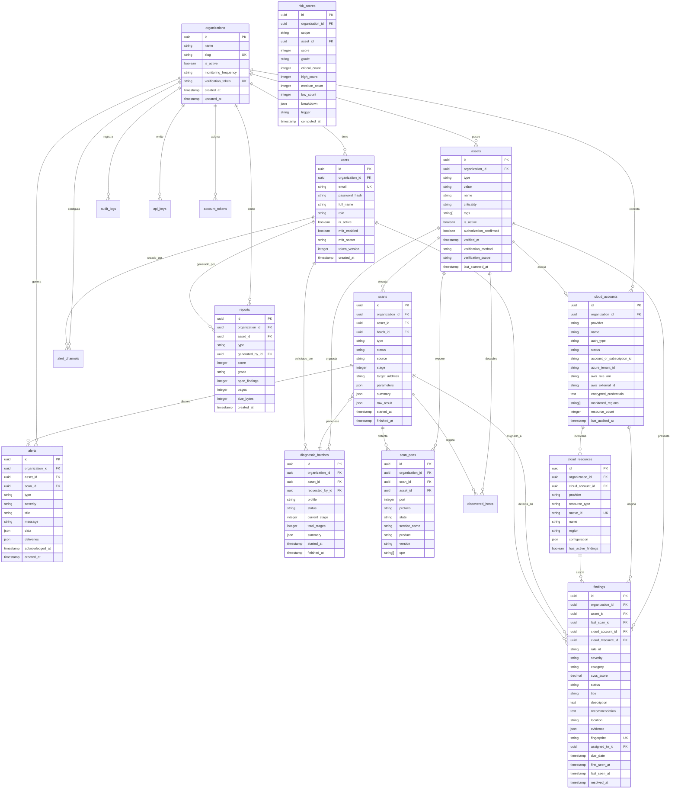

# Modelo de Datos y Esquema de Base de Datos

> **Sistema de Gestión de Postura de Seguridad (SSPM / EASM / CSPM)**  
> Versión: **2.0.0**  
> Motor: **PostgreSQL 16 + Prisma ORM 6**

Este documento detalla el modelo de datos relacional de la plataforma, el diagrama Entidad-Relación (ERD), la definición de tablas, relaciones, índices de rendimiento y las políticas de integridad multi-tenancy.

---

## 1. Diagrama Entidad-Relación (ERD)



---

## 2. Catálogo de Tablas y Entidades

### 2.1 Organizaciones y Usuarios
- **`organizations`**: Entidad raíz del modelo multi-tenant. Toda consulta valida `organization_id`. Posee un `verification_token` único de 64 caracteres que el cliente publica en su DNS o archivo web para demostrar control sobre sus dominios.
- **`users`**: Miembros de una organización. Maneja autenticación JWT, factor de costo de hash de contraseña, versión de token (`token_version` para invalidar JWTs activos tras cambio de credenciales) y soporte nativo de TOTP MFA (`mfa_enabled`, `mfa_secret` en Base32).
- **`account_tokens`**: Tokens efímeros enviados por correo electrónico para restablecimiento de contraseña (`PASSWORD_RESET`) e invitaciones a nuevos miembros (`INVITATION`). Se almacena el hash SHA-256 del token para evitar fuga en caso de volcado de base de datos.
- **`audit_log`**: Registro inmutable (*append-only*) de eventos administrativos, de seguridad y cambios de postura, capturando IP de origen, User-Agent y estado previo/posterior.

### 2.2 Inventario de Activos y Superficie Expuesta
- **`assets`**: Dominios (`DOMAIN`), direcciones IP (`IP`) o cuentas cloud vinculadas (`CLOUD_ACCOUNT`). Almacena el estado de verificación de propiedad (`verified_at`, `verification_method`) y criticidad de negocio.
- **`discovered_hosts`**: Subdominios recolectados pasivamente de Certificate Transparency (`crt.sh`). Permite detectar activos colgados o no inventariados (*Shadow IT*) con resolución DNS activa y registro de certificados comodín.

### 2.3 Orquestación, Escaneos y Puertos
- **`diagnostic_batches`**: Registra la ejecución encadenada del Diagnóstico 360° en 3 etapas (`current_stage`, `total_stages`, `status: PENDING | IN_PROGRESS | COMPLETED | FAILED | CANCELLED`). Almacena en `summary` el diff temporal de postura con el lote previo.
- **`scans`**: Trabajos individuales de escaneo (`PORT_SCAN`, `WEB_HEADERS`, `SSL_CERT`, `SENSITIVE_PATHS`, `EMAIL_SECURITY`, `SUBDOMAIN_DISCOVERY`). Funciona como cola de procesamiento asíncrona mediante lectura transaccional `FOR UPDATE SKIP LOCKED`.
- **`scan_ports`**: Servicios de red detectados por Nmap. Desglosa puerto, protocolo, estado, versión de software y CPEs asociados para cruce con CVEs y CISA KEV.

### 2.4 Gestión de Hallazgos y Vulnerabilidades
- **`findings`**: Entidad central de vulnerabilidades y desalineaciones de postura. 
  - **Deduplicación:** Se basa en una clave única compuesta `@@unique([assetId, fingerprint])`, donde `fingerprint = sha256(ruleId + location)`.
  - **Trazabilidad:** Preserva las marcas de tiempo `first_seen_at` y `last_seen_at`. Cuando una vulnerabilidad deja de reproducirse en escaneos posteriores, su estado cambia automáticamente a `RESOLVED` sin duplicar la fila.
  - **SLAs y Triage:** Registra fecha de vencimiento (`due_date`), usuario asignado (`assigned_to_id`), notas de remediación y justificaciones formales de riesgo aceptado.

### 2.5 Seguridad Cloud Multicloud (CSPM)
- **`cloud_accounts`**: Cuentas conectadas de AWS y Azure. Almacena credenciales sensibles (`encrypted_credentials`) cifradas mediante **AES-256-GCM**, IDs de suscripción/cuenta, roles asumibles y regiones monitoreadas.
- **`cloud_resources`**: Recursos descubiertos en la nube (Buckets S3, Máquinas Virtuales EC2/VM, Grupos de Seguridad NSG, Bases de Datos RDS/SQL). Almacena su configuración cruda en JSON para auditoría histórica.

### 2.6 Postura, Alertas y Reportes
- **`risk_scores`**: Instantáneas periódicas o bajo demanda del Security Score (0-100) y Grado (A-F), guardando el desglose matemático ponderado (`breakdown`) para auditorías de cumplimiento.
- **`alerts`** y **`alert_channels`**: Sistema de notificaciones en tiempo real (correo SMTP y webhooks hacia Slack/Discord) con registro del estado de entrega en `deliveries`.
- **`reports`**: Bitácora de reportes ejecutivos y técnicos generados en PDF bajo demanda.
- **`api_keys`**: Credenciales de máquina para integración con SIEM, SOAR y scripts externos.

---

## 3. Estrategias de Rendimiento e Índices

1. **Índices de Multi-Tenancy:** Todas las consultas filtran primariamente por `organization_id`. Se configuraron índices B-Tree compuestos como `@@index([organizationId, status, severity])` para permitir filtros instantáneos (< 20 ms) en el gestor de hallazgos.
2. **Cola de Procesamiento no Bloqueante:**
   El worker reclama escaneos utilizando la consulta:
   ```sql
   SELECT * FROM scans
   WHERE status = 'PENDING'
   ORDER BY created_at ASC
   LIMIT 1
   FOR UPDATE SKIP LOCKED;
   ```
   Esto evita que múltiples réplicas de la API compitan o se bloqueen entre sí.
3. **Integridad Referencial con Eliminación en Cascada:**
   La eliminación de una organización borra de forma limpia y automática en cascada todos sus usuarios, activos, hallazgos, alertas y reportes (`onDelete: Cascade`), evitando registros huérfanos.
