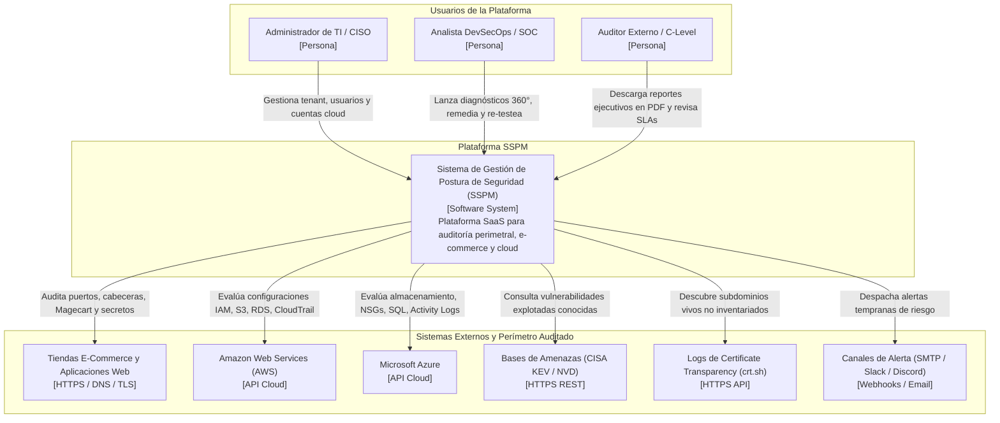
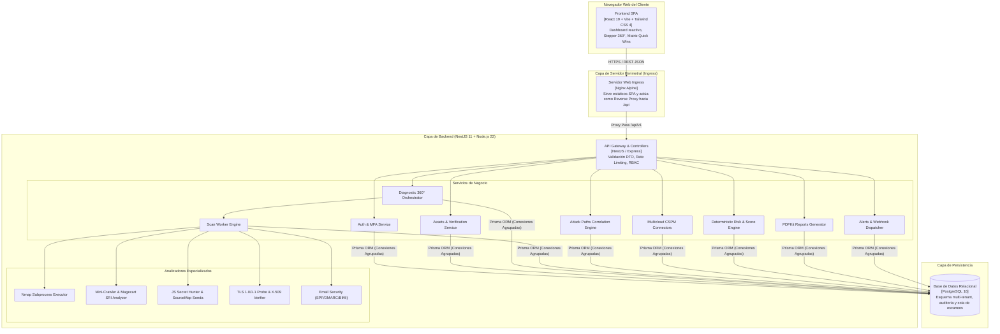
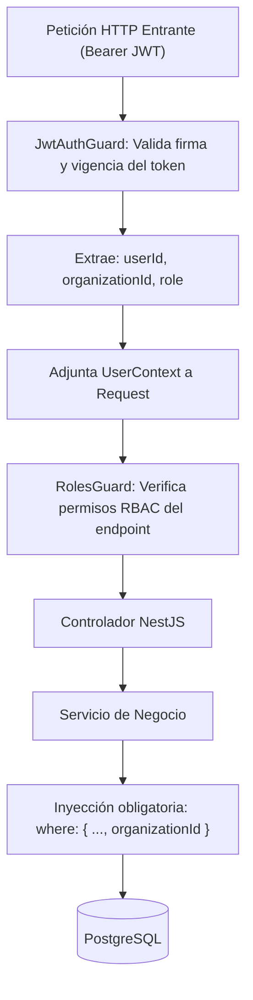
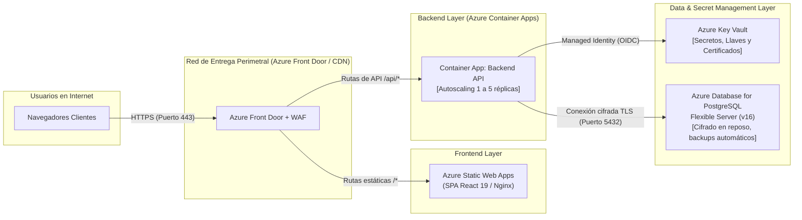

# Visión General de la Arquitectura del Sistema

> **Sistema de Gestión de Postura de Seguridad (SSPM / EASM / CSPM)**  
> Versión: **2.0.0 (Sprint 13)**  
> Estado: **Producción / Azure Ready**

Este documento describe la arquitectura global del sistema, la descomposición de componentes, los límites de seguridad y el modelo de infraestructura utilizado para desplegar la plataforma.

---

## 1. Principios de Diseño y Filosofía Arquitectónica

La plataforma fue diseñada bajo los siguientes principios fundamentales:

1. **Monorrepo Modular y Cohesivo:** Frontend y backend conviven en un único repositorio con interfaces fuertemente tipadas en TypeScript, facilitando el versionado sincronizado, refactorizaciones seguras y pipelines de integración unificados.
2. **Arquitectura Agentless (Sin Agentes):** Ningún cliente o servidor auditado requiere instalar binarios propietarios o agentes residentes en sus sistemas. Toda la auditoría se efectúa mediante protocolos de red abiertos (HTTP, TLS, DNS, TCP) o APIs nativas de nube (AWS REST con SigV4, Azure ARM).
3. **Desacoplamiento Asíncrono de Procesamiento:** Las tareas intensivas de auditoría (Nmap, sondeos web, escaneo multicloud) se desacoplan de la API REST mediante una cola transaccional en base de datos, garantizando tiempos de respuesta inmediatos (< 50 ms) para los usuarios web.
4. **Seguridad por Diseño (Secure by Design):** Cifrado en reposo para credenciales de terceros (AES-256-GCM), sanitización automática de secretos detectados en código, tokens JWT de expiración corta, verificación de dos factores (TOTP) y registros de auditoría append-only.

---

## 2. Diagramas C4 del Sistema

### 2.1 C4 Nivel 1: Diagrama de Contexto del Sistema

El siguiente diagrama ilustra los usuarios principales, las fronteras del sistema SSPM y los sistemas externos con los que interactúa:



---

### 2.2 C4 Nivel 2: Diagrama de Contenedores

Desglose de los subsistemas y componentes de software desplegables:



---

## 3. Modelo de Aislamiento Multi-Tenancy

El sistema garantiza aislamiento lógico de nivel bancario entre organizaciones mediante una estrategia de **Defensa en Profundidad**:



### Reglas de Implementación en Código:
1. **Nunca confiar en IDs de la URL o Body:** Aunque el cliente envíe `assetId: "abc"`, el query a base de datos se formula como:
   ```typescript
   await this.prisma.asset.findFirst({
     where: { id: assetId, organizationId: user.organizationId }
   });
   ```
   Si el activo no pertenece al tenant del usuario autenticado, el resultado es `null`, generando un error `404 Not Found` que evita revelar la existencia de activos de terceros.
2. **Bóveda de Credenciales Seguras (`CryptoVaultService`):**
   Las llaves de API y credenciales de AWS/Azure se cifran con **AES-256-GCM** utilizando una llave maestra derivada del entorno (`APP_VAULT_KEY`). Cada registro posee su propio IV (Initialization Vector) aleatorio de 96 bits y Authentication Tag de 128 bits, impidiendo ataques de texto plano conocido.

---

## 4. Topología de Infraestructura en Producción (Azure)

En entornos de producción sobre Microsoft Azure, la solución se despliega en una arquitectura de alta disponibilidad y bajo mantenimiento operativo:



### Características de Despliegue:
- **Autoscaling:** Azure Container Apps ajusta el número de réplicas en función del consumo de CPU y la profundidad de la cola de escaneo.
- **Identidad Administrada (Managed Identity):** No se almacenan contraseñas de Azure Key Vault en archivos de configuración ni variables de entorno del repositorio.
- **Cero Downtime:** Actualizaciones mediante despliegues azul/verde (*Blue/Green Deployments*) gestionados automáticamente por GitHub Actions.
