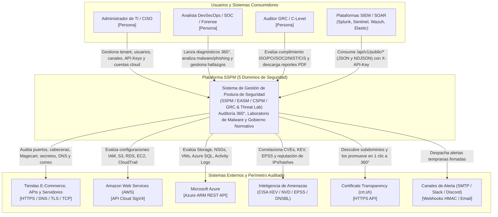
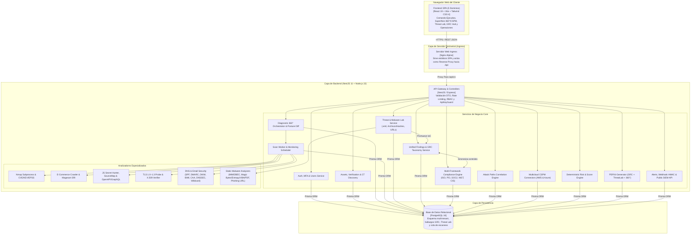
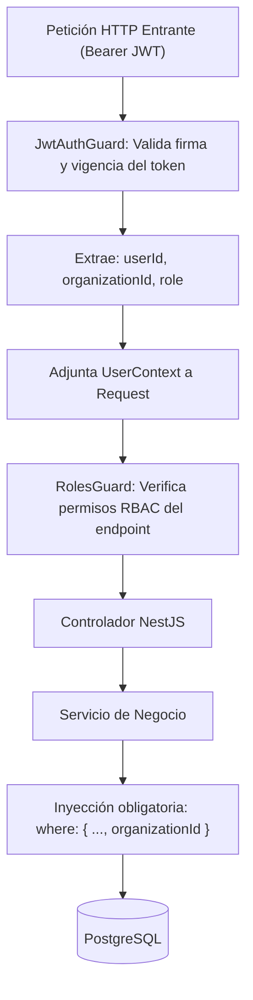
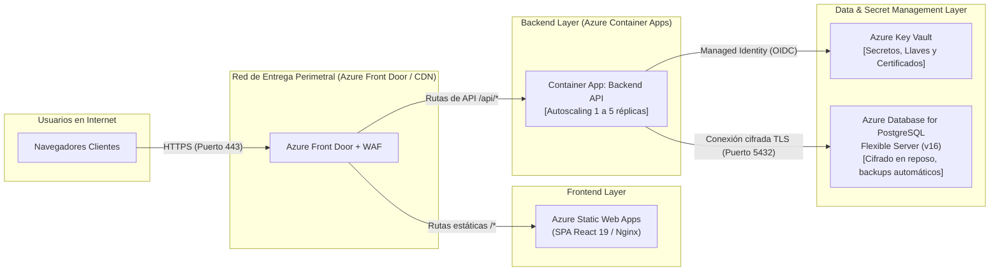

# Visión General de la Arquitectura del Sistema

> **Sistema de Gestión de Postura de Seguridad (SSPM / EASM / CSPM / GRC & Threat Lab)**  
> Versión: **3.0.0 (Sprint 23 — 5 Dominios de Seguridad)**  
> Estado: **Producción / Azure Ready**

Este documento describe la arquitectura global del sistema, su organización modular en **5 Dominios de Seguridad**, la descomposición de componentes C4, los límites de seguridad multi-tenant y el modelo de infraestructura utilizado para desplegar la plataforma.

---

## 1. Principios de Diseño y Arquitectura en 5 Dominios

La plataforma fue diseñada bajo los siguientes principios fundamentales:

1. **Arquitectura Funcional en 5 Dominios Cohesivos:** Todas las vistas de usuario (`AppShell.tsx`) y módulos de backend están estructurados en 5 dominios interconectados:
   - **Dominio 1 — Comando Ejecutivo:** Vista General 360°, Security Score determinista, Quick Wins 24h y Rutas de Ataque (*Kill-Chains*).
   - **Dominio 2 — Superficie y Diagnóstico:** Inventario de Activos, Descubrimiento Certificate Transparency (con promoción 1-clic a 360°), Orquestador de Diagnóstico Profundo 360° y Conectores CSPM Multicloud (AWS & Azure).
   - **Dominio 3 — Laboratorio de Amenazas (`Threat & Malware Lab`):** Estación forense sin ejecución para Correos `.eml` / Cabeceras MIME (BEC, spoofing), Archivos / Hashes (Magic Bytes, entropía de Shannon, macros VBA/XLM, firmas PDF) y URLs sospechosas, con promoción en 1 clic a hallazgo GRC.
   - **Dominio 4 — Centro de Hallazgos y GRC (`GRC Hub`):** Centro Maestro de Hallazgos enriquecido con taxonomía CWE, OWASP Top 10:2021 y MITRE ATT&CK, triaje y SLA en lote, auditoría manual/pentest y evaluación continua sobre 5 marcos normativos (`ISO_27001`, `PCI_DSS`, `SOC_2`, `NIST_CSF`, `CIS_CONTROLS`).
   - **Dominio 5 — Operaciones y Gobierno:** Alertas Tempranas multicanal (SMTP y Webhooks firmados HMAC-SHA256), Reportes PDF Ejecutivos y Técnicos con Matriz GRC y Threat Lab, Monitoreo Continuo (360° + CSPM), API Pública SIEM/SOAR (JSON y NDJSON) y Gobierno RBAC/MFA/Auditoría.
2. **Monorrepo Modular y Cohesivo:** Frontend y backend conviven en un único repositorio con interfaces fuertemente tipadas en TypeScript.
3. **Arquitectura Agentless y Análisis Estático Seguro:** Ningún activo auditado requiere agentes locales, y el análisis de artefactos maliciosos opera de forma 100% estática y heurística en memoria sin ejecutar binarios ni visitar URLs sospechosas.
4. **Desacoplamiento Asíncrono de Procesamiento:** Las tareas intensivas de auditoría (Nmap, sondeos web, escaneo multicloud) se desacoplan de la API REST mediante una cola transaccional en PostgreSQL (`FOR UPDATE SKIP LOCKED`).
5. **Seguridad por Diseño (Secure by Design):** Cifrado en reposo para credenciales cloud (AES-256-GCM), sanitización automática de secretos detectados en código, tokens JWT con versión de revocación, 2FA TOTP, API Keys con hash SHA-256 y bitácora `audit_log` inmutable.

---

## 2. Diagramas C4 del Sistema

### 2.1 C4 Nivel 1: Diagrama de Contexto del Sistema

El siguiente diagrama ilustra los usuarios principales, las fronteras del sistema SSPM y los sistemas externos con los que interactúa:



---

### 2.2 C4 Nivel 2: Diagrama de Contenedores

Desglose de los subsistemas y componentes de software desplegables:



---

## 3. Modelo de Aislamiento Multi-Tenancy

El sistema garantiza aislamiento lógico de nivel bancario entre organizaciones mediante una estrategia de **Defensa en Profundidad**:



### Reglas de Implementación en Código:
1. **Nunca confiar en IDs de la URL o Body:** Aunque el cliente envíe `assetId: "abc"`, el query a base de datos se formula como:
   ```typescript
   await this.prisma.asset.findFirst({
     where: { id: assetId, organizationId: user.organizationId }
   });
   ```
   Si el activo no pertenece al tenant del usuario autenticado, el resultado es `null`, generando un error `404 Not Found` que evita revelar la existencia de activos de terceros.
2. **Bóveda de Credenciales Seguras (`CryptoVaultService`):**
   Las llaves de API y credenciales de AWS/Azure se cifran con **AES-256-GCM** utilizando una llave maestra derivada del entorno (`APP_VAULT_KEY`). Cada registro posee su propio IV (Initialization Vector) aleatorio de 96 bits y Authentication Tag de 128 bits, impidiendo ataques de texto plano conocido.

---

## 4. Topología de Infraestructura en Producción (Azure)

En entornos de producción sobre Microsoft Azure, la solución se despliega en una arquitectura de alta disponibilidad y bajo mantenimiento operativo:



### Características de Despliegue:
- **Autoscaling:** Azure Container Apps ajusta el número de réplicas en función del consumo de CPU y la profundidad de la cola de escaneo.
- **Identidad Administrada (Managed Identity):** No se almacenan contraseñas de Azure Key Vault en archivos de configuración ni variables de entorno del repositorio.
- **Cero Downtime:** Actualizaciones mediante despliegues azul/verde (*Blue/Green Deployments*) gestionados automáticamente por GitHub Actions.
