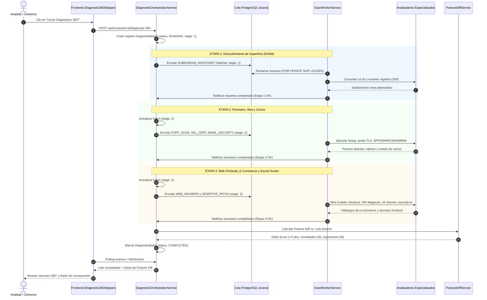
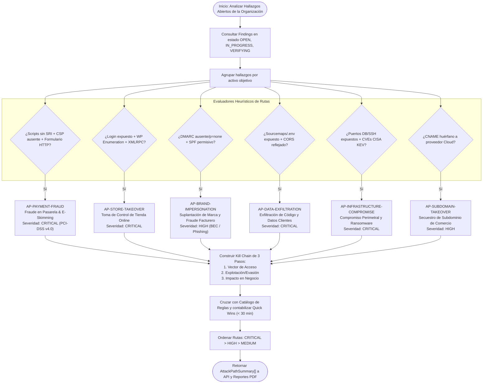
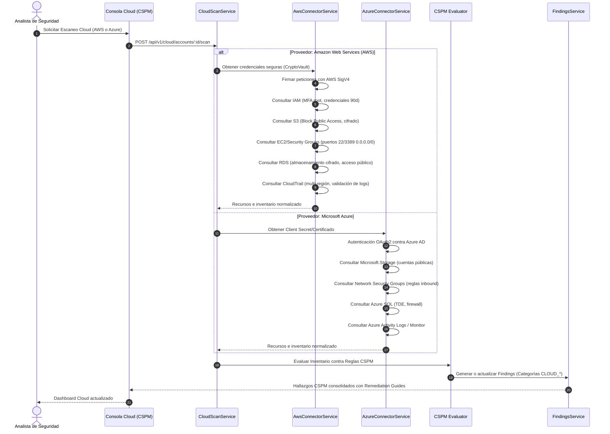
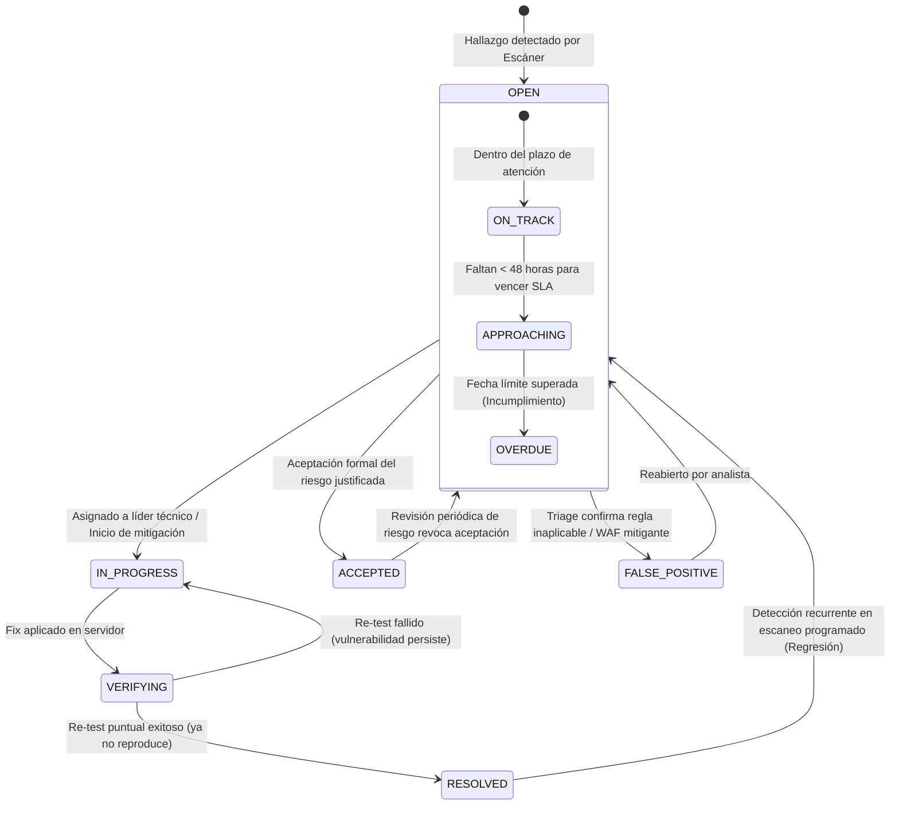
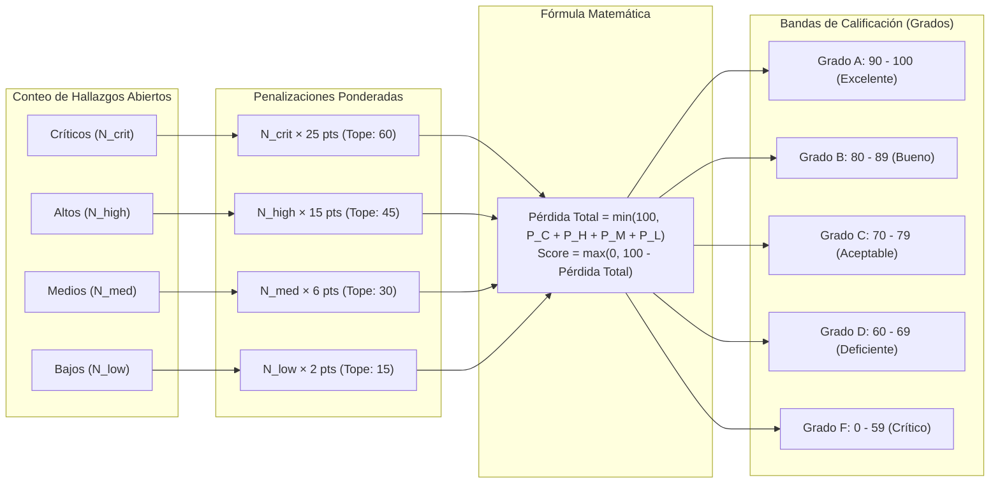

# Flujos de Trabajo y Diagramas de Secuencia

> **Sistema de Gestión de Postura de Seguridad (SSPM / EASM / CSPM)**  
> Versión: **2.0.0**  
> Alcance: **Flujos Críticos del Sistema en Mermaid**

Este documento recopila la especificación técnica y los diagramas de secuencia/flujo de los 5 procesos centrales de la plataforma.

---

## Índice de Flujos de Trabajo

1. [Flujo 1: Orquestador de Diagnóstico 360° en 3 Etapas](#1-flujo-del-orquestador-de-diagnóstico-360-en-3-etapas)
2. [Flujo 2: Motor de Correlación de Rutas de Ataque (Attack Paths & Kill Chain)](#2-flujo-del-motor-de-correlación-de-rutas-de-ataque-attack-paths)
3. [Flujo 3: Escaneo de Postura Cloud Multicloud (CSPM AWS & Azure)](#3-flujo-de-escaneo-de-postura-cloud-multicloud-cspm-aws--azure)
4. [Flujo 4: Ciclo de Vida del Hallazgo y Gestión de SLAs](#4-flujo-del-ciclo-de-vida-del-hallazgo-y-gestión-de-slas)
5. [Flujo 5: Algoritmo Determinista del Security Score](#5-flujo-del-algoritmo-determinista-del-security-score)

---

## 1. Flujo del Orquestador de Diagnóstico 360° en 3 Etapas

El diagnóstico 360° orquesta la ejecución secuencial ordenada de múltiples tipos de escáner en un solo clic, garantizando que el descubrimiento de subdominios alimente las etapas posteriores y calculando al finalizar el diferencial de postura con el lote anterior.

### Mecanismos de Tolerancia a Fallos del Orquestador:
- **Cancelación en Cascada:** Si el usuario aborta el diagnóstico en la Etapa 2, todos los escaneos pendientes en la base de datos pertenecientes al `batchId` pasan automáticamente al estado `CANCELLED`.
- **Aislamiento de Etapa:** El fallo aislado de un analizador (por ejemplo, timeout en la consulta a `crt.sh`) no detiene el avance hacia la Etapa 2; el error se registra en el sumario y el proceso continúa.

---

## 2. Flujo del Motor de Correlación de Rutas de Ataque (Attack Paths)

Este flujo transforma los hallazgos individuales (que a menudo saturan a los equipos técnicos) en **escenarios de riesgo de negocio compuestos**, dotando a los directivos de contexto sobre el impacto financiero real.

---

## 3. Flujo de Escaneo de Postura Cloud Multicloud (CSPM AWS & Azure)

Inspección automatizada y periódica de cuentas en nubes públicas sin requerir instalación de agentes en máquinas virtuales.

---

## 4. Flujo del Ciclo de Vida del Hallazgo y Gestión de SLAs

Control de estados formal con cálculo de vencimiento y re-testeo directo:

---

## 5. Flujo del Algoritmo Determinista del Security Score

El cálculo de la calificación global opera de forma 100% matemática y reproducible:

