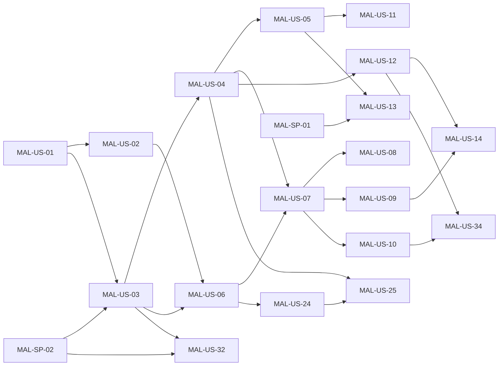

# Backlog: Módulo de Análisis de Malware

> **Sistema de Gestión de Postura de Seguridad (SSPM / EASM / CSPM)**
> Épica: **[MAL] Módulo de análisis de malware (archivos, correos y URLs)**
> Diseño: [docs/modules/malware-analysis.md](../modules/malware-analysis.md) · Decisiones: [ADR-0008](../adr/0008-modulo-analisis-malware.md)
> Importación a Azure Boards: [malware-analysis-azure-boards.csv](malware-analysis-azure-boards.csv)

Este documento desglosa la integración en spikes, funcionalidades, historias de usuario y tareas, con criterios de aceptación, estimación, dependencias, rol responsable y un plan de sprints sugerido. Los identificadores (`MAL-SP-xx`, `MAL-Fx`, `MAL-US-xx`, `MAL-US-xx-Tyy`) son estables: úsalos en commits y PRs (junto al `AB#<id>` que asigne Azure Boards) para mantener la trazabilidad.

---

## 1. Convenciones

| Elemento | Formato | Ejemplo |
|---|---|---|
| Épica | `[MAL] …` | `[MAL] Módulo de análisis de malware…` |
| Spike (investigación acotada) | `MAL-SP-xx` | `MAL-SP-02` PoC del worker aislado |
| Funcionalidad (*Feature*) | `MAL-Fx` | `MAL-F2` Análisis de archivos |
| Historia de usuario | `MAL-US-xx` | `MAL-US-07` ClamAV |
| Tarea | `MAL-US-xx-Tyy` | `MAL-US-07-T02` cliente clamd |
| Rama | `feature/mal-us-xx-descripcion` | `feature/mal-us-07-clamav` |
| Commit | `feat(malware): … (MAL-US-07, AB#123)` | |

- **Estimación** en puntos de historia (escala de Fibonacci). Los spikes tienen una duración máxima equivalente a sus puntos.
- **Roles:** Backend, Frontend, DevOps, Seguridad, QA, Producto. En Azure Boards se cargan como etiquetas para asignar responsables según el equipo.
- **Prioridad:** 1 = fases 0 y 1, 2 = fase 2, 3 = fase 3.

## 2. Definición de terminado (DoD) del módulo

Además de la DoD general del proyecto (CONTRIBUTING.md), cada historia de este módulo se considera terminada cuando:

1. Lint, typecheck, pruebas unitarias y e2e pasan en CI (backend y frontend según corresponda).
2. Toda consulta nueva filtra por `organizationId` y existe una prueba de aislamiento entre organizaciones cuando hay endpoints.
3. Ningún archivo de malware real se versiona; las pruebas usan EICAR generado en tiempo de ejecución o *fixtures* benignos.
4. Ningún contenido de muestras, cuerpos de correo ni claves aparece en logs, respuestas de error o auditoría.
5. Los motores externos tienen cliente falso para las pruebas y respetan el presupuesto de llamadas.
6. Las acciones sensibles (envío, cancelación, descarga, compartir con terceros, configuración) quedan en la auditoría.
7. La documentación afectada se actualiza (diseño del módulo, modelo de datos, despliegue, README si aplica).
8. La interfaz es responsive, funciona en modo claro y oscuro, y muestra los veredictos con ícono + etiqueta.

---

## 3. Resumen por funcionalidad

| ID | Funcionalidad | Fase | Historias | Estimación |
|---|---|---|---|---|
| MAL-SP | Spikes de preparación | 0 y 2 | 4 | 8 SP |
| MAL-F1 | Núcleo e infraestructura del módulo | 1 | 5 | 26 SP |
| MAL-F2 | Análisis de archivos | 1 y 2 | 7 | 34 SP |
| MAL-F3 | Análisis de URLs | 1 | 3 | 13 SP |
| MAL-F4 | Análisis de correos | 2 | 4 | 24 SP |
| MAL-F5 | Vigilancia de activos y postura | 2 | 5 | 23 SP |
| MAL-F6 | Interfaz de usuario | 1 y 2 | 4 | 18 SP |
| MAL-F7 | Integraciones externas y reportes | 2 | 4 | 14 SP |
| MAL-F8 | Seguridad, despliegue y operación | 1 y 2 | 4 | 18 SP |
| MAL-F9 | Análisis avanzado (opcional) | 3 | 5 | 21 SP |
| | **Total** | | **45** | **199 SP** |

## 4. Plan de sprints sugerido

Supuesto: sprints de 2 semanas y una velocidad de unos 25 puntos por sprint para dos personas. Ajustar con la velocidad real del equipo.

| Sprint | Fase | Elementos | Puntos |
|---|---|---|---|
| 14 | 0, 1 | MAL-SP-01, MAL-SP-02, MAL-SP-04, MAL-US-01, MAL-US-02, MAL-US-03 | 24 |
| 15 | 1 | MAL-US-04, MAL-US-05, MAL-US-06, MAL-US-07, MAL-US-32 | 26 |
| 16 | 1 | MAL-US-08, MAL-US-09, MAL-US-10, MAL-US-11, MAL-US-24 | 26 |
| 17 | 1 | MAL-US-12, MAL-US-13, MAL-US-14, MAL-US-25, MAL-US-34 | 23 |
| 18 | 2 | MAL-SP-03, MAL-US-15, MAL-US-16, MAL-US-21, MAL-US-22, MAL-US-41 | 26 |
| 19 | 2 | MAL-US-17, MAL-US-19, MAL-US-20, MAL-US-27, MAL-US-30 | 24 |
| 20 | 2 | MAL-US-18, MAL-US-23, MAL-US-26, MAL-US-28, MAL-US-29, MAL-US-33, MAL-US-35 | 26 |
| 21 | 2, 3 | MAL-US-31, MAL-US-36, MAL-US-37, MAL-US-38, MAL-US-39, MAL-US-40 | 24 |

| Fase | Puntos |
|---|---|
| Fase 0 — Preparación | 6 |
| Fase 1 — MVP | 93 |
| Fase 2 — Correo y activos | 79 |
| Fase 3 — Profundidad | 21 |

### 4.1 Camino crítico de la fase 1

## 5. Detalle de spikes, historias y tareas

### MAL-SP · Spikes de preparación

#### MAL-SP-01 · Licencias y términos de uso de los motores externos

| Fase | Sprint sugerido | Estimación | Rol | Depende de |
|---|---|---|---|---|
| Fase 0 | 14 | 2 SP | Producto, Seguridad | — |

**Objetivo:** Confirmar qué motores se pueden usar en un producto comercial y con qué costo.

**Tareas:**

- [ ] MAL-SP-01-T01 · Revisar términos de VirusTotal (API pública vs premium), Google Web Risk vs Safe Browsing, abuse.ch (URLhaus, MalwareBazaar), Spamhaus DQS, urlscan.io y CIRCL
- [ ] MAL-SP-01-T02 · Revisar licencias de los conjuntos de reglas YARA comunitarios (atribución, uso comercial)
- [ ] MAL-SP-01-T03 · Proponer plan: motores gratuitos + BYOK en fase 1 y contratación posterior

**Criterios de aceptación:**

- Tabla de motores con licencia, costo, límites y decisión (usar / BYOK / descartar) adjunta a ADR-0008
- Pregunta abierta P1 del diseño respondida

#### MAL-SP-02 · Prueba de concepto del worker aislado con ClamAV, YARA y 7z

| Fase | Sprint sugerido | Estimación | Rol | Depende de |
|---|---|---|---|---|
| Fase 0 | 14 | 3 SP | DevOps, Backend | — |

**Objetivo:** Validar tamaño de imagen, tiempos y endurecimiento antes de construir el módulo.

**Tareas:**

- [ ] MAL-SP-02-T01 · Agregar yara, p7zip y oletools a una imagen de prueba y medir el tamaño
- [ ] MAL-SP-02-T02 · Levantar clamav/clamav como sidecar y analizar EICAR por INSTREAM desde Node
- [ ] MAL-SP-02-T03 · Probar read_only, tmpfs, cap_drop ALL y no-new-privileges en Compose
- [ ] MAL-SP-02-T04 · Medir tiempos de ClamAV y YARA sobre fixtures de 1, 10 y 32 MB

**Criterios de aceptación:**

- Informe con tamaño de imagen, tiempos y configuración de endurecimiento que funciona
- EICAR detectado por clamd desde un script Node sin shell

#### MAL-SP-03 · Elegir el proveedor del buzón de reporte entrante

| Fase | Sprint sugerido | Estimación | Rol | Depende de |
|---|---|---|---|---|
| Fase 2 | 18 | 2 SP | DevOps | — |

**Objetivo:** Decidir cómo recibir correos reenviados por los clientes.

**Tareas:**

- [ ] MAL-SP-03-T01 · Comparar SendGrid Inbound Parse, Mailgun Routes y Microsoft Graph/IMAP (costo, firma del webhook, tamaño máximo, formato MIME crudo)
- [ ] MAL-SP-03-T02 · Definir el formato de la dirección por organización (reportar+<token>@dominio)

**Criterios de aceptación:**

- Decisión documentada en ADR-0008 (pregunta P3) con el proveedor y la verificación de firma

#### MAL-SP-04 · Revisión del modelo de amenazas del módulo

| Fase | Sprint sugerido | Estimación | Rol | Depende de |
|---|---|---|---|---|
| Fase 0 | 14 | 1 SP | Seguridad | — |

**Objetivo:** Validar en equipo la sección 11 del diseño antes de implementar.

**Tareas:**

- [ ] MAL-SP-04-T01 · Sesión STRIDE sobre la sección 11 del diseño
- [ ] MAL-SP-04-T02 · Registrar controles nuevos como criterios de aceptación en las historias afectadas

**Criterios de aceptación:**

- Modelo de amenazas revisado y aprobado; cambios reflejados en el backlog

### MAL-F1 · Núcleo e infraestructura del módulo

#### MAL-US-01 · Modelo de datos y migraciones del módulo

| Fase | Sprint sugerido | Estimación | Rol | Depende de |
|---|---|---|---|---|
| Fase 1 | 14 | 5 SP | Backend | — |

**Historia:** Como equipo de desarrollo, quiero las tablas y enums del módulo para poder persistir envíos, resultados, IOC y configuración.

**Tareas:**

- [ ] MAL-US-01-T01 · Agregar enums MalwareSubmissionKind, MalwareSubmissionSource, MalwareAnalysisStatus, MalwareVerdict y MalwareIndicatorType
- [ ] MAL-US-01-T02 · Agregar modelos MalwareSubmission, MalwareEngineResult, MalwareIndicator, MalwareReputationCache, MalwareSettings y ExternalApiUsage (sección 8.2)
- [ ] MAL-US-01-T03 · Agregar relaciones inversas en Organization, User, Asset y Scan
- [ ] MAL-US-01-T04 · Agregar valores MALWARE_REPUTATION/WEB_MALWARE (ScanType), MALWARE (FindingCategory), MALWARE_DETECTED/ASSET_REPUTATION_LISTED (AlertType)
- [ ] MAL-US-01-T05 · Generar la migración aditiva y probarla sobre una copia de datos
- [ ] MAL-US-01-T06 · Actualizar docs/architecture/data-model.md

**Criterios de aceptación:**

- prisma migrate deploy aplica sin errores sobre una base existente y sin pérdida de datos
- Los índices de la sección 8.2 existen (cola, organización, hash)
- Borrar una organización borra en cascada sus envíos, resultados, IOC y configuración

#### MAL-US-02 · Almacenamiento de cuarentena cifrado

| Fase | Sprint sugerido | Estimación | Rol | Depende de |
|---|---|---|---|---|
| Fase 1 | 14 | 5 SP | Backend | [MAL-US-01](#mal-us-01--modelo-de-datos-y-migraciones-del-módulo) |

**Historia:** Como plataforma, quiero guardar las muestras cifradas en un almacenamiento privado para que nadie pueda ejecutarlas ni leerlas por accidente.

**Tareas:**

- [ ] MAL-US-02-T01 · Definir la interfaz SampleStorage (put en streaming, get en streaming, delete, exists)
- [ ] MAL-US-02-T02 · Implementar el driver fs para Compose y desarrollo
- [ ] MAL-US-02-T03 · Implementar el driver azure-blob con identidad administrada
- [ ] MAL-US-02-T04 · Cifrado de aplicación AES-256-GCM por objeto con MALWARE_ENCRYPTION_KEY (claves aleatorias sin extensión)
- [ ] MAL-US-02-T05 · Validación de entorno: en producción exigir azure-blob y MALWARE_ENCRYPTION_KEY

**Criterios de aceptación:**

- El contenido guardado no es legible sin la clave (prueba que compara bytes)
- Subir y leer un archivo de 32 MB no carga el archivo completo en memoria
- En NODE_ENV=production la API no arranca con el driver fs o sin clave

#### MAL-US-03 · Cola y worker de malware aislado

| Fase | Sprint sugerido | Estimación | Rol | Depende de |
|---|---|---|---|---|
| Fase 1 | 14 | 8 SP | Backend | [MAL-US-01](#mal-us-01--modelo-de-datos-y-migraciones-del-módulo), [MAL-SP-02](#mal-sp-02--prueba-de-concepto-del-worker-aislado-con-clamav-yara-y-7z) |

**Historia:** Como plataforma, quiero procesar los envíos en un worker separado de la API para que una muestra maliciosa no pueda afectar a la API.

**Tareas:**

- [ ] MAL-US-03-T01 · MalwareWorkerService con reclamo FOR UPDATE SKIP LOCKED, límite global y por organización
- [ ] MAL-US-03-T02 · Timeouts por motor y total, cancelación con AbortSignal y cancelación en cascada a hijos
- [ ] MAL-US-03-T03 · Estado WAITING_CHILDREN y hook de finalización que reevalúa al padre
- [ ] MAL-US-03-T04 · Detección de huérfanos y devolución a PENDING en apagado ordenado
- [ ] MAL-US-03-T05 · Punto de entrada malware-worker.main.ts y MALWARE_WORKER_ENABLED (false en la API)
- [ ] MAL-US-03-T06 · Pruebas unitarias del ciclo de estados

**Criterios de aceptación:**

- Dos réplicas del worker nunca procesan el mismo envío
- Cancelar un correo cancela sus adjuntos y URLs pendientes
- Al detener el worker, los envíos en curso vuelven a PENDING
- La API arranca y acepta envíos aunque no haya ningún worker activo

#### MAL-US-04 · Interfaz de motores y veredicto determinista

| Fase | Sprint sugerido | Estimación | Rol | Depende de |
|---|---|---|---|---|
| Fase 1 | 15 | 5 SP | Backend | [MAL-US-03](#mal-us-03--cola-y-worker-de-malware-aislado) |

**Historia:** Como analista, quiero un veredicto que siempre sea el mismo para las mismas señales y que explique por qué, para confiar en el resultado.

**Tareas:**

- [ ] MAL-US-04-T01 · engine.interface.ts con MalwareEngine, EngineResult, MalwareSignal y el token MALWARE_ENGINES
- [ ] MAL-US-04-T02 · pipeline.service.ts con las etapas IDENTIFY, REPUTATION, STATIC, DECOMPOSE, DYNAMIC y AGGREGATE
- [ ] MAL-US-04-T03 · verdict.ts con la tabla de puntos, señales definitivas, umbrales y verdictModelVersion
- [ ] MAL-US-04-T04 · ioc-extractor.ts (URLs, dominios, IPs, correos y hashes)
- [ ] MAL-US-04-T05 · Pruebas con tabla de casos fijos (incluye EICAR con etiqueta test)

**Criterios de aceptación:**

- Las mismas señales producen siempre el mismo veredicto y puntaje
- Si fallan todos los motores locales el veredicto es UNKNOWN, nunca CLEAN
- El veredicto del padre es el máximo entre el propio y el de sus hijos
- Cada resultado incluye la explicación en español de cada señal

#### MAL-US-05 · Presupuesto de APIs externas y caché de reputación

| Fase | Sprint sugerido | Estimación | Rol | Depende de |
|---|---|---|---|---|
| Fase 1 | 15 | 3 SP | Backend | [MAL-US-04](#mal-us-04--interfaz-de-motores-y-veredicto-determinista) |

**Historia:** Como plataforma, quiero controlar el consumo de APIs externas para no agotar cuotas ni generar costos inesperados.

**Tareas:**

- [ ] MAL-US-05-T01 · external-api-budget.service.ts con contadores por minuto y por día en ExternalApiUsage
- [ ] MAL-US-05-T02 · Caché MalwareReputationCache con TTL de 7 días (limpio/desconocido) y 30 días (malicioso)
- [ ] MAL-US-05-T03 · El motor devuelve SKIPPED cuando no hay presupuesto
- [ ] MAL-US-05-T04 · Purga de entradas vencidas en el servicio de retención

**Criterios de aceptación:**

- Superar la cuota configurada de un motor no produce errores: el motor queda SKIPPED y la UI lo indica
- Un segundo análisis del mismo hash no consulta la API externa mientras la caché esté vigente
- La caché no guarda ningún identificador de organización

### MAL-F2 · Análisis de archivos

#### MAL-US-06 · Subida de archivos para análisis

| Fase | Sprint sugerido | Estimación | Rol | Depende de |
|---|---|---|---|---|
| Fase 1 | 15 | 5 SP | Backend | [MAL-US-02](#mal-us-02--almacenamiento-de-cuarentena-cifrado), [MAL-US-03](#mal-us-03--cola-y-worker-de-malware-aislado) |

**Historia:** Como analista, quiero subir un archivo sospechoso para saber si es malware.

**Tareas:**

- [ ] MAL-US-06-T01 · POST /malware/submissions/files con multipart en streaming hacia la cuarentena
- [ ] MAL-US-06-T02 · SHA-256, SHA-1 y MD5 calculados al vuelo
- [ ] MAL-US-06-T03 · Límite de tamaño, cuota diaria por organización y RBAC (ADMIN y ANALYST)
- [ ] MAL-US-06-T04 · Saneamiento del nombre (displayName) y del tipo declarado
- [ ] MAL-US-06-T05 · Casilla de consentimiento shareContent según la política de la organización
- [ ] MAL-US-06-T06 · Auditoría malware.submission_created
- [ ] MAL-US-06-T07 · GET /malware/submissions, GET /malware/submissions/:id, cancel y reanalyze

**Criterios de aceptación:**

- Un archivo de más de 32 MB recibe 413 y no queda nada en la cuarentena
- Un VIEWER recibe 403 al subir
- Una organización no puede ver ni cancelar envíos de otra (404)
- Al superar la cuota diaria se responde 429

#### MAL-US-07 · Identificación de tipo real y antivirus ClamAV

| Fase | Sprint sugerido | Estimación | Rol | Depende de |
|---|---|---|---|---|
| Fase 1 | 15 | 5 SP | Backend | [MAL-US-04](#mal-us-04--interfaz-de-motores-y-veredicto-determinista), [MAL-US-06](#mal-us-06--subida-de-archivos-para-análisis) |

**Historia:** Como analista, quiero que el archivo se revise con un antivirus y que se detecte si su extensión engaña.

**Tareas:**

- [ ] MAL-US-07-T01 · Motor IDENTIFY: tipo por bytes mágicos, discrepancia extensión/tipo, doble extensión y carácter RTLO
- [ ] MAL-US-07-T02 · Cliente clamd por TCP con el protocolo INSTREAM y versión de firmas en engineVersion
- [ ] MAL-US-07-T03 · Archivo EICAR generado en tiempo de prueba (nunca versionado)
- [ ] MAL-US-07-T04 · clamd falso para pruebas e2e

**Criterios de aceptación:**

- EICAR se marca MALICIOUS con la etiqueta test y no dispara alertas a canales
- factura.pdf.exe genera la señal de extensión engañosa
- Si clamd no responde, el motor queda en ERROR y el envío se marca incompleto

#### MAL-US-08 · Reglas YARA propias y comunitarias

| Fase | Sprint sugerido | Estimación | Rol | Depende de |
|---|---|---|---|---|
| Fase 1 | 16 | 5 SP | Backend, Seguridad | [MAL-US-07](#mal-us-07--identificación-de-tipo-real-y-antivirus-clamav) |

**Historia:** Como equipo de seguridad, quiero detectar familias y técnicas con reglas YARA que podamos mantener nosotros.

**Tareas:**

- [ ] MAL-US-08-T01 · Estructura backend/malware-rules/own y community con LICENSES.md
- [ ] MAL-US-08-T02 · Reglas propias iniciales: skimmers, webshells PHP, droppers de macros y kits de phishing de marcas locales
- [ ] MAL-US-08-T03 · Compilación de reglas en el build (el build falla si una regla no compila)
- [ ] MAL-US-08-T04 · Motor YARA con spawn sin shell, timeout y lectura de meta severity
- [ ] MAL-US-08-T05 · Tarea de actualización de reglas con verificación de hash del paquete

**Criterios de aceptación:**

- Una regla con error de sintaxis rompe el build de la imagen
- La severidad de la meta de la regla se refleja en los puntos de la señal
- Un fixture benigno que coincide con una regla de prueba produce la detección esperada

#### MAL-US-09 · Analizadores estáticos de Office, PDF y scripts

| Fase | Sprint sugerido | Estimación | Rol | Depende de |
|---|---|---|---|---|
| Fase 1 | 16 | 8 SP | Backend | [MAL-US-07](#mal-us-07--identificación-de-tipo-real-y-antivirus-clamav) |

**Historia:** Como analista, quiero saber si un documento tiene macros o código que se ejecuta al abrirlo.

**Tareas:**

- [ ] MAL-US-09-T01 · Motor OFFICE_MACROS con olevba y mraptor (auto-ejecución, shell, descargas, XLM)
- [ ] MAL-US-09-T02 · Motor PDF_STATIC (/JavaScript, /OpenAction, /Launch, /EmbeddedFile, objetos ofuscados)
- [ ] MAL-US-09-T03 · Motor SCRIPT_HTML para JS, HTML, PowerShell y VBS reutilizando los patrones de magecart-security y js-secrets-sourcemap
- [ ] MAL-US-09-T04 · Fixtures benignos con macro auto-ejecutable inocua y PDF con JavaScript inocuo

**Criterios de aceptación:**

- Una macro AutoOpen que llama a Shell genera la señal OFFICE_AUTOEXEC_SHELL (60 puntos)
- Un PDF con /OpenAction y /JavaScript genera su señal
- Las URLs encontradas en macros y scripts se registran como IOC

#### MAL-US-10 · Análisis recursivo de archivos comprimidos

| Fase | Sprint sugerido | Estimación | Rol | Depende de |
|---|---|---|---|---|
| Fase 1 | 16 | 5 SP | Backend, Seguridad | [MAL-US-07](#mal-us-07--identificación-de-tipo-real-y-antivirus-clamav) |

**Historia:** Como analista, quiero que se revise el contenido de un zip o 7z, incluso si tiene contraseña.

**Tareas:**

- [ ] MAL-US-10-T01 · archive.decomposer.ts con 7z sin shell y contraseña opcional
- [ ] MAL-US-10-T02 · Límites: profundidad, número de archivos, tamaño total descomprimido y relación de compresión
- [ ] MAL-US-10-T03 · Nombres de extracción generados (UUID) y descarte de rutas absolutas o con ..
- [ ] MAL-US-10-T04 · Cada archivo extraído se crea como hijo DERIVED

**Criterios de aceptación:**

- Una bomba zip se detiene al superar el límite y genera la señal ARCHIVE_LIMIT_EXCEEDED sin agotar memoria ni disco
- Un archivo con ruta ../../ no se escribe fuera del directorio temporal
- Un ejecutable dentro de un zip cifrado genera la señal correspondiente

#### MAL-US-11 · Reputación por hash (CIRCL y MalwareBazaar)

| Fase | Sprint sugerido | Estimación | Rol | Depende de |
|---|---|---|---|---|
| Fase 1 | 16 | 3 SP | Backend | [MAL-US-05](#mal-us-05--presupuesto-de-apis-externas-y-caché-de-reputación) |

**Historia:** Como analista, quiero saber si el archivo ya es conocido como malware o como software legítimo.

**Tareas:**

- [ ] MAL-US-11-T01 · Motor HASHLOOKUP_CIRCL (software legítimo conocido, señal benign)
- [ ] MAL-US-11-T02 · Motor MALWAREBAZAAR con Auth-Key (malware conocido, señal definitiva)
- [ ] MAL-US-11-T03 · Cortocircuito: si hay malware conocido se omiten los motores pesados configurados como omitibles
- [ ] MAL-US-11-T04 · Clientes falsos para pruebas

**Criterios de aceptación:**

- Un hash conocido como malware produce MALICIOUS con confianza alta
- Un hash de software legítimo resta puntos pero no anula una firma antivirus
- Solo se envía el hash: ninguna prueba registra el contenido saliendo hacia estos motores

#### MAL-US-41 · Analizador estático de ejecutables PE y ELF

| Fase | Sprint sugerido | Estimación | Rol | Depende de |
|---|---|---|---|---|
| Fase 2 | 18 | 3 SP | Backend | [MAL-US-07](#mal-us-07--identificación-de-tipo-real-y-antivirus-clamav) |

**Historia:** Como analista, quiero saber si un ejecutable tiene rasgos típicos de malware aunque ningún antivirus lo detecte todavía.

**Tareas:**

- [ ] MAL-US-41-T01 · Motor STATIC_PE: cabeceras, secciones con entropía alta (empaquetado), imports sospechosos (inyección, descarga, persistencia)
- [ ] MAL-US-41-T02 · Presencia y validez básica de la firma Authenticode
- [ ] MAL-US-41-T03 · Cabeceras ELF y binarios sin símbolos en Linux

**Criterios de aceptación:**

- Un ejecutable empaquetado de los fixtures genera la señal de entropía alta
- Un binario firmado y conocido no genera señales por sí solo

### MAL-F3 · Análisis de URLs

#### MAL-US-12 · Envío de URL y descarga segura

| Fase | Sprint sugerido | Estimación | Rol | Depende de |
|---|---|---|---|---|
| Fase 1 | 17 | 5 SP | Backend | [MAL-US-04](#mal-us-04--interfaz-de-motores-y-veredicto-determinista) |

**Historia:** Como analista, quiero pegar un enlace sospechoso y saber a dónde lleva sin abrirlo yo.

**Tareas:**

- [ ] MAL-US-12-T01 · POST /malware/submissions/urls con normalización (IDN a punycode, longitud, esquemas http/https)
- [ ] MAL-US-12-T02 · url-fetch.decomposer.ts reutilizando target-resolver y http-client (IP fijada, redirecciones revalidadas)
- [ ] MAL-US-12-T03 · Límites de tamaño, redirecciones y tiempo; User-Agent configurable
- [ ] MAL-US-12-T04 · Una respuesta binaria se crea como hijo de tipo archivo

**Criterios de aceptación:**

- Una URL hacia 169.254.169.254 o una IP privada recibe 422
- Una redirección hacia una IP privada se corta y se registra
- La cadena de redirecciones completa aparece en el resultado

#### MAL-US-13 · Reputación de URL (Web Risk y URLhaus)

| Fase | Sprint sugerido | Estimación | Rol | Depende de |
|---|---|---|---|---|
| Fase 1 | 17 | 3 SP | Backend | [MAL-US-05](#mal-us-05--presupuesto-de-apis-externas-y-caché-de-reputación), [MAL-SP-01](#mal-sp-01--licencias-y-términos-de-uso-de-los-motores-externos) |

**Historia:** Como analista, quiero saber si el enlace ya está reportado como phishing o malware.

**Tareas:**

- [ ] MAL-US-13-T01 · Motor WEB_RISK (uso comercial) con clave de la plataforma o BYOK
- [ ] MAL-US-13-T02 · Motor URLHAUS con Auth-Key (URL y host)
- [ ] MAL-US-13-T03 · Caché y presupuesto compartidos con MAL-US-05

**Criterios de aceptación:**

- Una URL listada produce MALICIOUS sin descargar su contenido
- Si Web Risk no está configurado el motor queda SKIPPED y el análisis continúa

#### MAL-US-14 · Análisis estático de páginas: phishing y código malicioso

| Fase | Sprint sugerido | Estimación | Rol | Depende de |
|---|---|---|---|---|
| Fase 1 | 17 | 5 SP | Backend | [MAL-US-12](#mal-us-12--envío-de-url-y-descarga-segura), [MAL-US-09](#mal-us-09--analizadores-estáticos-de-office-pdf-y-scripts) |

**Historia:** Como analista, quiero saber si una página es un formulario falso de inicio de sesión o esconde código malicioso.

**Tareas:**

- [ ] MAL-US-14-T01 · SCRIPT_HTML aplicado a la página: formularios de credenciales, iframes ocultos, meta refresh, mineros, skimmers y ofuscación
- [ ] MAL-US-14-T02 · Detección de marca suplantada: título, logo o textos de la marca frente al dominio real
- [ ] MAL-US-14-T03 · Señal de dominio recién registrado (RDAP) cuando esté disponible
- [ ] MAL-US-14-T04 · Fixtures HTML benignos y de phishing sintético

**Criterios de aceptación:**

- Un formulario de contraseña en un dominio distinto al de la marca mostrada genera su señal
- La página nunca se renderiza ni se ejecuta su JavaScript

### MAL-F4 · Análisis de correos

#### MAL-US-15 · Subida y parseo de correos .eml y .msg

| Fase | Sprint sugerido | Estimación | Rol | Depende de |
|---|---|---|---|---|
| Fase 2 | 18 | 5 SP | Backend | [MAL-US-06](#mal-us-06--subida-de-archivos-para-análisis) |

**Historia:** Como analista, quiero subir un correo sospechoso tal como lo recibí para que se revise completo.

**Tareas:**

- [ ] MAL-US-15-T01 · POST /malware/submissions/emails
- [ ] MAL-US-15-T02 · Parseo con mailparser (.eml) y lector de .msg
- [ ] MAL-US-15-T03 · Guardar en la BD solo cabeceras relevantes, señales e IOC; el cuerpo queda en cuarentena
- [ ] MAL-US-15-T04 · Fixtures .eml sintéticos (legítimo, spoofing, BEC, adjunto con macro)

**Criterios de aceptación:**

- Un .msg corrupto recibe 415
- El HTML del correo nunca se renderiza en la UI (solo texto)

#### MAL-US-16 · Análisis de cabeceras y suplantación

| Fase | Sprint sugerido | Estimación | Rol | Depende de |
|---|---|---|---|---|
| Fase 2 | 18 | 8 SP | Backend, Seguridad | [MAL-US-15](#mal-us-15--subida-y-parseo-de-correos-eml-y-msg) |

**Historia:** Como gerente, quiero saber si un correo que parece de mi banco, de un proveedor o de mi empresa es falso.

**Tareas:**

- [ ] MAL-US-16-T01 · Motor EMAIL_HEADERS: Authentication-Results de confianza (trustedAuthservIds), SPF/DKIM/DMARC y alineación
- [ ] MAL-US-16-T02 · From frente a Reply-To y Return-Path, nombre visible engañoso
- [ ] MAL-US-16-T03 · lookalike.ts: homoglifos y distancia de edición frente a los dominios verificados de la organización
- [ ] MAL-US-16-T04 · Reputación del dominio remitente con DNS_BLOCKLIST reutilizando dnsbl.ts
- [ ] MAL-US-16-T05 · Recomendaciones según el tipo de amenaza (phishing, BEC, malware)

**Criterios de aceptación:**

- Un correo desde un dominio parecido a uno propio con DMARC fallido produce al menos SUSPICIOUS
- Solo se confía en el Authentication-Results añadido por un servidor configurado
- Un correo legítimo de los fixtures sale CLEAN

#### MAL-US-17 · Descomposición del correo en adjuntos y URLs

| Fase | Sprint sugerido | Estimación | Rol | Depende de |
|---|---|---|---|---|
| Fase 2 | 19 | 3 SP | Backend | [MAL-US-16](#mal-us-16--análisis-de-cabeceras-y-suplantación), [MAL-US-10](#mal-us-10--análisis-recursivo-de-archivos-comprimidos), [MAL-US-12](#mal-us-12--envío-de-url-y-descarga-segura) |

**Historia:** Como analista, quiero que se revisen los adjuntos y los enlaces del correo y ver el resultado de cada uno.

**Tareas:**

- [ ] MAL-US-17-T01 · email.decomposer.ts: adjuntos como hijos de tipo archivo y URLs (incluido href distinto del texto visible) como hijos de tipo URL
- [ ] MAL-US-17-T02 · Deduplicar URLs repetidas y limitar el número de hijos

**Criterios de aceptación:**

- Un correo con un adjunto malicioso queda MALICIOUS aunque sus cabeceras sean correctas
- Un enlace cuyo texto muestra un dominio y apunta a otro genera una señal

#### MAL-US-18 · Buzón de reporte entrante por organización

| Fase | Sprint sugerido | Estimación | Rol | Depende de |
|---|---|---|---|---|
| Fase 2 | 20 | 8 SP | Backend, DevOps | [MAL-US-17](#mal-us-17--descomposición-del-correo-en-adjuntos-y-urls), [MAL-SP-03](#mal-sp-03--elegir-el-proveedor-del-buzón-de-reporte-entrante) |

**Historia:** Como empleado, quiero reenviar un correo sospechoso a una dirección y recibir la respuesta de si es peligroso.

**Tareas:**

- [ ] MAL-US-18-T01 · Dirección reportar+<token>@<dominio-entrante> por organización (inboundToken)
- [ ] MAL-US-18-T02 · POST /malware/inbound/email con verificación de firma del proveedor, tolerancia de tiempo y tamaño máximo
- [ ] MAL-US-18-T03 · Aceptar solo remitentes que sean usuarios de la organización o dominios configurados
- [ ] MAL-US-18-T04 · Respuesta automática por correo con el veredicto y el enlace al detalle
- [ ] MAL-US-18-T05 · Configuración del proveedor elegido en MAL-SP-03 y DNS MX del dominio entrante

**Criterios de aceptación:**

- Un POST sin firma válida recibe 401 y no crea envíos
- Un correo reenviado por un usuario de la organización crea un envío INBOUND_EMAIL y el usuario recibe el veredicto
- Un token de otra organización no permite crear envíos en la tuya

### MAL-F5 · Vigilancia de activos y postura

#### MAL-US-19 · Escáner pasivo MALWARE_REPUTATION

| Fase | Sprint sugerido | Estimación | Rol | Depende de |
|---|---|---|---|---|
| Fase 2 | 19 | 5 SP | Backend | [MAL-US-13](#mal-us-13--reputación-de-url-web-risk-y-urlhaus), [MAL-US-21](#mal-us-21--reglas-mal--score-ruta-de-ataque-y-cumplimiento) |

**Historia:** Como administrador de TI, quiero saber si mi dominio o mi IP aparecen en listas de malware o bloqueo.

**Tareas:**

- [ ] MAL-US-19-T01 · malware-reputation.scanner.ts como Scanner pasivo para DOMAIN e IP
- [ ] MAL-US-19-T02 · Reutilizar los motores WEB_RISK, URLHAUS y DNS_BLOCKLIST exportados por MalwareModule
- [ ] MAL-US-19-T03 · Generar los hallazgos MAL-REP-* con evidencia de la fuente

**Criterios de aceptación:**

- Un dominio listado en los fixtures genera MAL-REP-WEBRISK-FLAGGED o MAL-REP-URLHAUS-LISTED
- Si la fuente no responde, los hallazgos abiertos se conservan (incompleteCategories)

#### MAL-US-20 · Escáner activo WEB_MALWARE

| Fase | Sprint sugerido | Estimación | Rol | Depende de |
|---|---|---|---|---|
| Fase 2 | 19 | 8 SP | Backend | [MAL-US-08](#mal-us-08--reglas-yara-propias-y-comunitarias), [MAL-US-09](#mal-us-09--analizadores-estáticos-de-office-pdf-y-scripts), [MAL-US-21](#mal-us-21--reglas-mal--score-ruta-de-ataque-y-cumplimiento) |

**Historia:** Como dueño de una tienda en línea, quiero saber si mi sitio fue comprometido con un skimmer, un minero o redirecciones.

**Tareas:**

- [ ] MAL-US-20-T01 · web-malware.scanner.ts reutilizando ecommerce-crawler (mismo alcance y límites)
- [ ] MAL-US-20-T02 · Crear envíos hijos ASSET_SCAN con el contenido descargado para que el worker de malware ejecute ClamAV, YARA y SCRIPT_HTML
- [ ] MAL-US-20-T03 · Esperar el veredicto y convertir las señales en hallazgos MAL-WEB-*
- [ ] MAL-US-20-T04 · Exigir activo verificado como el resto de escáneres activos

**Criterios de aceptación:**

- Un sitio de prueba con un script minero genera MAL-WEB-CRYPTOMINER
- El escaneo no corre sobre un activo sin verificar
- El análisis de contenido ocurre en el worker de malware, no en la API

#### MAL-US-21 · Reglas MAL-*, score, ruta de ataque y cumplimiento

| Fase | Sprint sugerido | Estimación | Rol | Depende de |
|---|---|---|---|---|
| Fase 2 | 18 | 5 SP | Backend | [MAL-US-01](#mal-us-01--modelo-de-datos-y-migraciones-del-módulo) |

**Historia:** Como gerente, quiero que un sitio comprometido se refleje en la nota de seguridad, las rutas de ataque y el cumplimiento.

**Tareas:**

- [ ] MAL-US-21-T01 · Reglas MAL-WEB-* y MAL-REP-* en rules.catalog.ts con guía en remediation.catalog.ts
- [ ] MAL-US-21-T02 · Escenario AP-MALWARE-DISTRIBUTION en attack-paths.service.ts
- [ ] MAL-US-21-T03 · Mapeo en compliance.catalog.ts: ISO 27001 A.8.7 y A.5.7, PCI-DSS 5.x y 5.4.1, NIST CSF DE.CM-09 y DE.AE-02, CIS 10 y 9.7
- [ ] MAL-US-21-T04 · Decidir la pregunta P4 (tope de nota) y, si se aprueba, actualizar ADR-0003 y scoring

**Criterios de aceptación:**

- Las reglas nuevas pasan rules.catalog.spec (ids únicos, severidad coherente con CVSS)
- Un hallazgo MAL-WEB-SKIMMER-DETECTED activa la ruta de ataque cuando falta SRI o CSP
- Los controles nuevos aparecen en la página de Cumplimiento

#### MAL-US-22 · Alertas MALWARE_DETECTED y ASSET_REPUTATION_LISTED

| Fase | Sprint sugerido | Estimación | Rol | Depende de |
|---|---|---|---|---|
| Fase 2 | 18 | 3 SP | Backend | [MAL-US-04](#mal-us-04--interfaz-de-motores-y-veredicto-determinista) |

**Historia:** Como administrador de TI, quiero recibir un aviso cuando se detecta malware o mi dominio entra en una lista de bloqueo.

**Tareas:**

- [ ] MAL-US-22-T01 · Reglas de alerta en alert-rules.ts y textos de notificación
- [ ] MAL-US-22-T02 · Respetar alertOnSuspicious y la etiqueta test de EICAR
- [ ] MAL-US-22-T03 · Pruebas con canales falsos

**Criterios de aceptación:**

- Un envío MALICIOUS genera una alerta HIGH por los canales que cumplen la severidad mínima
- EICAR no genera alertas a canales

#### MAL-US-23 · Diagnóstico 360° y monitoreo continuo con los nuevos escáneres

| Fase | Sprint sugerido | Estimación | Rol | Depende de |
|---|---|---|---|---|
| Fase 2 | 20 | 2 SP | Backend | [MAL-US-19](#mal-us-19--escáner-pasivo-malware_reputation), [MAL-US-20](#mal-us-20--escáner-activo-web_malware) |

**Historia:** Como cliente, quiero que la vigilancia de malware corra sola junto con el resto de auditorías.

**Tareas:**

- [ ] MAL-US-23-T01 · MALWARE_REPUTATION en la etapa 1 de todos los perfiles; WEB_MALWARE en la etapa 3 de COMMERCE_360 y FULL_AUDIT
- [ ] MAL-US-23-T02 · Incluir ambos en la auditoría programada

**Criterios de aceptación:**

- Un Diagnóstico 360° COMMERCE_360 incluye los dos escáneres nuevos
- El diff de postura muestra hallazgos MAL-* nuevos y resueltos

### MAL-F6 · Interfaz de usuario

#### MAL-US-24 · Página Análisis de malware: envío y listado

| Fase | Sprint sugerido | Estimación | Rol | Depende de |
|---|---|---|---|---|
| Fase 1 | 16 | 5 SP | Frontend | [MAL-US-06](#mal-us-06--subida-de-archivos-para-análisis) |

**Historia:** Como analista, quiero una pantalla para subir archivos, correos o enlaces y ver mis análisis.

**Tareas:**

- [ ] MAL-US-24-T01 · Ruta /malware y entrada en el menú lateral (ícono Bug)
- [ ] MAL-US-24-T02 · SubmitPanel con pestañas Archivo, Correo y URL, arrastrar y soltar, contraseña de comprimidos y consentimiento
- [ ] MAL-US-24-T03 · Listado con filtros, búsqueda por hash/nombre/URL y estado en vivo
- [ ] MAL-US-24-T04 · Hooks de TanStack Query en queries.ts y tipos en types.ts

**Criterios de aceptación:**

- El rol VIEWER ve el listado pero no el panel de envío
- La página no tiene desbordamiento horizontal en móvil y funciona en modo claro y oscuro
- El aviso de privacidad aparece antes de compartir contenido con terceros

#### MAL-US-25 · Detalle del envío con veredicto explicado

| Fase | Sprint sugerido | Estimación | Rol | Depende de |
|---|---|---|---|---|
| Fase 1 | 17 | 5 SP | Frontend | [MAL-US-24](#mal-us-24--página-análisis-de-malware-envío-y-listado), [MAL-US-04](#mal-us-04--interfaz-de-motores-y-veredicto-determinista) |

**Historia:** Como gerente, quiero entender en lenguaje claro por qué algo es peligroso y qué debo hacer.

**Tareas:**

- [ ] MAL-US-25-T01 · Ruta /malware/:id con VerdictBadge (ícono + etiqueta), puntaje y confianza
- [ ] MAL-US-25-T02 · SignalList con la explicación de cada señal y bloque Qué hacer
- [ ] MAL-US-25-T03 · SubmissionTree, EngineResultsTable (solo ADMIN y ANALYST) e IndicatorList con copiar y exportar
- [ ] MAL-US-25-T04 · Aviso: no detectado no significa seguro

**Criterios de aceptación:**

- Nombres y asuntos con HTML se muestran como texto
- El árbol de un correo muestra adjuntos y URLs con su veredicto

#### MAL-US-26 · Tarjeta de reputación en el activo y KPI en la vista general

| Fase | Sprint sugerido | Estimación | Rol | Depende de |
|---|---|---|---|---|
| Fase 2 | 20 | 3 SP | Frontend | [MAL-US-19](#mal-us-19--escáner-pasivo-malware_reputation), [MAL-US-20](#mal-us-20--escáner-activo-web_malware) |

**Historia:** Como administrador de TI, quiero ver en la ficha de cada activo si está en listas de bloqueo o sirve malware.

**Tareas:**

- [ ] MAL-US-26-T01 · AssetReputationCard en AssetDetailPage
- [ ] MAL-US-26-T02 · KPI de amenazas analizadas y detectadas en DashboardPage

**Criterios de aceptación:**

- La tarjeta muestra la fecha del último análisis y enlaza a los hallazgos MAL-*

#### MAL-US-27 · Configuración del módulo

| Fase | Sprint sugerido | Estimación | Rol | Depende de |
|---|---|---|---|---|
| Fase 2 | 19 | 5 SP | Frontend, Backend | [MAL-US-24](#mal-us-24--página-análisis-de-malware-envío-y-listado), [MAL-US-01](#mal-us-01--modelo-de-datos-y-migraciones-del-módulo) |

**Historia:** Como administrador, quiero decidir qué motores externos se usan, con qué claves y qué se comparte.

**Tareas:**

- [ ] MAL-US-27-T01 · GET/PUT /malware/settings (solo ADMIN) con claves BYOK cifradas con CryptoVaultService
- [ ] MAL-US-27-T02 · Pestaña Análisis de malware en SettingsPage: motores, claves enmascaradas, política de compartición, retención, alertas por sospechosos y dirección del buzón
- [ ] MAL-US-27-T03 · Auditoría malware.settings_updated

**Criterios de aceptación:**

- Las claves nunca vuelven completas al navegador
- Un ANALYST recibe 403 al cambiar la configuración

### MAL-F7 · Integraciones externas y reportes

#### MAL-US-28 · VirusTotal con BYOK y consentimiento

| Fase | Sprint sugerido | Estimación | Rol | Depende de |
|---|---|---|---|---|
| Fase 2 | 20 | 5 SP | Backend | [MAL-US-27](#mal-us-27--configuración-del-módulo), [MAL-SP-01](#mal-sp-01--licencias-y-términos-de-uso-de-los-motores-externos) |

**Historia:** Como analista, quiero contrastar con VirusTotal y, solo si lo autorizo, subirle el archivo.

**Tareas:**

- [ ] MAL-US-28-T01 · Motor VIRUSTOTAL por hash, URL y dominio con la clave de la organización o de la plataforma
- [ ] MAL-US-28-T02 · Subida del archivo solo con shareContent y política distinta de NEVER
- [ ] MAL-US-28-T03 · Auditoría malware.content_shared con el motor destino
- [ ] MAL-US-28-T04 · Presupuesto por minuto y por día

**Criterios de aceptación:**

- Con la política NEVER ningún archivo se sube aunque el usuario marque la casilla
- Cada subida queda registrada en la auditoría

#### MAL-US-29 · API pública y exportación de IOC

| Fase | Sprint sugerido | Estimación | Rol | Depende de |
|---|---|---|---|---|
| Fase 2 | 20 | 3 SP | Backend | [MAL-US-06](#mal-us-06--subida-de-archivos-para-análisis), [MAL-US-12](#mal-us-12--envío-de-url-y-descarga-segura) |

**Historia:** Como equipo de SOC, quiero consumir veredictos e IOC desde mi SIEM o SOAR.

**Tareas:**

- [ ] MAL-US-29-T01 · Scopes malware:read y malware:submit en api-keys
- [ ] MAL-US-29-T02 · GET /malware/verdicts y /malware/indicators en NDJSON; POST de URLs y hashes
- [ ] MAL-US-29-T03 · Exportación CSV de IOC en la API interna

**Criterios de aceptación:**

- Una llave sin malware:submit recibe 403 al enviar URLs
- La exportación solo incluye datos de la organización de la llave

#### MAL-US-30 · Sección de amenazas en los reportes PDF

| Fase | Sprint sugerido | Estimación | Rol | Depende de |
|---|---|---|---|---|
| Fase 2 | 19 | 3 SP | Backend | [MAL-US-04](#mal-us-04--interfaz-de-motores-y-veredicto-determinista) |

**Historia:** Como gerente, quiero ver en el reporte cuántas amenazas se analizaron y detectaron.

**Tareas:**

- [ ] MAL-US-30-T01 · Reporte ejecutivo: totales y tendencia de 30 días
- [ ] MAL-US-30-T02 · Reporte técnico: envíos maliciosos, familias e IOC principales

**Criterios de aceptación:**

- El PDF se genera sin errores con y sin datos de malware

#### MAL-US-31 · Descarga auditada de muestras

| Fase | Sprint sugerido | Estimación | Rol | Depende de |
|---|---|---|---|---|
| Fase 2 | 21 | 3 SP | Backend, Frontend | [MAL-US-02](#mal-us-02--almacenamiento-de-cuarentena-cifrado), [MAL-US-25](#mal-us-25--detalle-del-envío-con-veredicto-explicado) |

**Historia:** Como administrador, quiero descargar una muestra de forma segura para entregarla a un especialista.

**Tareas:**

- [ ] MAL-US-31-T01 · GET /malware/submissions/:id/sample solo ADMIN, ZIP cifrado con contraseña infected y Content-Disposition attachment
- [ ] MAL-US-31-T02 · Auditoría malware.sample_downloaded
- [ ] MAL-US-31-T03 · Botón con advertencia en el detalle

**Criterios de aceptación:**

- Un ANALYST recibe 403
- Una muestra ya purgada responde 409
- Cada descarga queda en la auditoría

### MAL-F8 · Seguridad, despliegue y operación

#### MAL-US-32 · Despliegue en Docker Compose y Azure

| Fase | Sprint sugerido | Estimación | Rol | Depende de |
|---|---|---|---|---|
| Fase 1 | 15 | 8 SP | DevOps | [MAL-SP-02](#mal-sp-02--prueba-de-concepto-del-worker-aislado-con-clamav-yara-y-7z), [MAL-US-03](#mal-us-03--cola-y-worker-de-malware-aislado) |

**Historia:** Como equipo, quiero desplegar el worker de malware aislado en local y en producción.

**Tareas:**

- [ ] MAL-US-32-T01 · Imagen: yara, p7zip y oletools fijados; reglas compiladas en el build; escaneo Trivy
- [ ] MAL-US-32-T02 · docker-compose: servicios clamav y malware-worker endurecidos (sección 15.2) y volumen de muestras
- [ ] MAL-US-32-T03 · Terraform: cuenta de almacenamiento y contenedor de cuarentena privado con ciclo de vida, Container App del worker con sidecar clamav, identidad administrada y secretos en Key Vault
- [ ] MAL-US-32-T04 · Escalado del worker por longitud de cola
- [ ] MAL-US-32-T05 · Actualizar docs/deployment.md e infra/README.md

**Criterios de aceptación:**

- docker compose up levanta el worker y analiza EICAR de punta a punta
- El contenedor del worker corre sin root, con sistema de archivos de solo lectura y sin capabilities
- El plan de Terraform no expone la cuenta de almacenamiento a Internet

#### MAL-US-33 · Observabilidad y alarmas operativas

| Fase | Sprint sugerido | Estimación | Rol | Depende de |
|---|---|---|---|---|
| Fase 2 | 20 | 3 SP | DevOps, Backend | [MAL-US-32](#mal-us-32--despliegue-en-docker-compose-y-azure) |

**Historia:** Como operador, quiero saber si el módulo está sano y si las firmas están al día.

**Tareas:**

- [ ] MAL-US-33-T01 · Métricas de la sección 17 (cola, duración y error por motor, presupuesto)
- [ ] MAL-US-33-T02 · Alarmas: firmas de ClamAV con más de 48 h, cola atascada, tasa de error alta
- [ ] MAL-US-33-T03 · Logs sin contenido de muestras

**Criterios de aceptación:**

- Detener freshclam en pruebas dispara la alarma de firmas desactualizadas

#### MAL-US-34 · Pruebas de seguridad y job nocturno con ClamAV real

| Fase | Sprint sugerido | Estimación | Rol | Depende de |
|---|---|---|---|---|
| Fase 1 | 17 | 5 SP | QA, Seguridad | [MAL-US-10](#mal-us-10--análisis-recursivo-de-archivos-comprimidos), [MAL-US-12](#mal-us-12--envío-de-url-y-descarga-segura) |

**Historia:** Como equipo, quiero pruebas que demuestren que el módulo resiste muestras hostiles.

**Tareas:**

- [ ] MAL-US-34-T01 · E2E: bomba zip, path traversal, nombres con HTML, URL privada, webhook sin firma, archivo de 33 MB, aislamiento entre organizaciones
- [ ] MAL-US-34-T02 · Job programado de CI con clamav real y EICAR
- [ ] MAL-US-34-T03 · Prueba de carga de los SLO de la sección 13

**Criterios de aceptación:**

- Todas las pruebas de seguridad pasan en CI
- El job nocturno detecta EICAR con ClamAV real

#### MAL-US-35 · Documentación de usuario, operación y términos de uso

| Fase | Sprint sugerido | Estimación | Rol | Depende de |
|---|---|---|---|---|
| Fase 2 | 20 | 2 SP | Producto | [MAL-US-25](#mal-us-25--detalle-del-envío-con-veredicto-explicado) |

**Historia:** Como cliente, quiero entender qué hace el módulo, qué se comparte y qué no garantiza.

**Tareas:**

- [ ] MAL-US-35-T01 · Guía de usuario (qué subir, cómo leer el veredicto, límites)
- [ ] MAL-US-35-T02 · Guía de operación (actualización de firmas y reglas, purgas)
- [ ] MAL-US-35-T03 · Cláusula de términos de uso: prohibido probar malware propio, tratamiento de datos

**Criterios de aceptación:**

- Documentación publicada y enlazada desde la ayuda de la página

### MAL-F9 · Análisis avanzado (opcional)

#### MAL-US-36 · Renderizado de URLs con urlscan.io (opt-in)

| Fase | Sprint sugerido | Estimación | Rol | Depende de |
|---|---|---|---|---|
| Fase 3 | 21 | 3 SP | Backend | [MAL-US-28](#mal-us-28--virustotal-con-byok-y-consentimiento) |

**Historia:** Como analista, quiero ver cómo se comporta una página al cargarse en un navegador real, sin hacerlo yo.

**Tareas:**

- [ ] MAL-US-36-T01 · Motor URLSCAN con envíos privados, solo con consentimiento
- [ ] MAL-US-36-T02 · Captura y dominios contactados en el detalle

**Criterios de aceptación:**

- Sin consentimiento la URL no se envía a urlscan.io

#### MAL-US-37 · Sandbox dinámico (opt-in)

| Fase | Sprint sugerido | Estimación | Rol | Depende de |
|---|---|---|---|---|
| Fase 3 | 21 | 8 SP | Backend, Seguridad | [MAL-US-28](#mal-us-28--virustotal-con-byok-y-consentimiento) |

**Historia:** Como analista, quiero un análisis de comportamiento para archivos que siguen sospechosos.

**Tareas:**

- [ ] MAL-US-37-T01 · Motor SANDBOX con el proveedor elegido (pregunta P5)
- [ ] MAL-US-37-T02 · Solo para veredictos SUSPICIOUS/UNKNOWN con consentimiento
- [ ] MAL-US-37-T03 · Veredicto preliminar mientras el sandbox termina

**Criterios de aceptación:**

- El sandbox solo recibe archivos con consentimiento registrado
- El veredicto final se actualiza al terminar el sandbox

#### MAL-US-38 · Exportación de IOC en STIX 2.1

| Fase | Sprint sugerido | Estimación | Rol | Depende de |
|---|---|---|---|---|
| Fase 3 | 21 | 3 SP | Backend | [MAL-US-29](#mal-us-29--api-pública-y-exportación-de-ioc) |

**Historia:** Como equipo de SOC, quiero importar los IOC en mi plataforma de inteligencia de amenazas.

**Tareas:**

- [ ] MAL-US-38-T01 · format=stix en /malware/indicators con objetos indicator y malware

**Criterios de aceptación:**

- El paquete STIX valida con una herramienta de validación de STIX 2.1

#### MAL-US-39 · Salida de red controlada del worker

| Fase | Sprint sugerido | Estimación | Rol | Depende de |
|---|---|---|---|---|
| Fase 3 | 21 | 5 SP | DevOps | [MAL-US-32](#mal-us-32--despliegue-en-docker-compose-y-azure) |

**Historia:** Como equipo de seguridad, quiero que el worker solo pueda conectarse a los servicios que necesita.

**Tareas:**

- [ ] MAL-US-39-T01 · Entorno de Container Apps con VNet y NAT Gateway o Azure Firewall
- [ ] MAL-US-39-T02 · Lista de destinos permitidos para las APIs externas e IP de salida dedicada para descargas de URLs

**Criterios de aceptación:**

- Una conexión del worker a un destino no permitido se bloquea

#### MAL-US-40 · Evaluar Microsoft Defender for Storage como motor

| Fase | Sprint sugerido | Estimación | Rol | Depende de |
|---|---|---|---|---|
| Fase 3 | 21 | 2 SP | DevOps | [MAL-US-32](#mal-us-32--despliegue-en-docker-compose-y-azure) |

**Historia:** Como producto, quiero saber si el escaneo administrado de Azure mejora la detección a un costo razonable.

**Tareas:**

- [ ] MAL-US-40-T01 · Prueba con muestras de prueba y estimación de costo por GB

**Criterios de aceptación:**

- Informe con detección, latencia, costo y recomendación

---

## 6. Importación en Azure Boards

1. En Azure DevOps: **Boards → Work items → Import Work Items → Choose file** y seleccionar `malware-analysis-azure-boards.csv`.
2. El archivo usa el proceso **Agile** (Epic → Feature → User Story → Task) con las columnas `Title 1` a `Title 4` para crear la jerarquía.
3. Si el proyecto usa **Scrum**, reemplazar `User Story` por `Product Backlog Item` y la columna `Story Points` por `Effort`. Con el proceso **Basic**, usar `Epic` → `Issue` → `Task` y quitar `Story Points`.
4. La columna `Iteration Path` trae el sprint sugerido (`Sprint 14` …). Ajustarla al nombre real de las iteraciones del proyecto (p. ej. `SSPM\Sprint 14`) o borrarla antes de importar.
5. Revisar la vista previa antes de confirmar: Azure Boards indica los campos que no reconoce.
