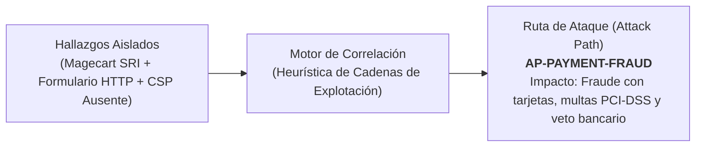

# Módulo de Correlación de Rutas de Ataque (Attack Paths) y Quick Wins 24h

> **Sistema de Gestión de Postura de Seguridad (SSPM / EASM / CSPM)**  
> Módulo Backend: [`findings/attack-paths.service.ts`](file:///home/miguel/Proyectos/Sistema-de-Gestion-de-Postura-de-Seguridad-SSPM/backend/src/findings/attack-paths.service.ts) y [`findings/rules-catalog.ts`](file:///home/miguel/Proyectos/Sistema-de-Gestion-de-Postura-de-Seguridad-SSPM/backend/src/findings/rules-catalog.ts)  
> Componente Frontend: [`AttackPathsCard.tsx`](file:///home/miguel/Proyectos/Sistema-de-Gestion-de-Postura-de-Seguridad-SSPM/frontend/src/components/AttackPathsCard.tsx)  
> Versión: **2.0.0 (Sprint 13 - Pilar 3)**

Este documento describe la arquitectura, la lógica heurística y los escenarios de amenaza del motor de correlación de Rutas de Ataque (*Attack Paths*) y la matriz de priorización Quick Wins 24h.

---

## 1. Justificación y Cambio de Paradigma

Uno de los mayores dolores de cabeza para los equipos de seguridad y directores de comercio electrónico es la **"fatiga de alertas"**: encontrarse ante una lista interminable de 50 o 100 hallazgos atómicos descontextualizados (ej. "Falta X-Frame-Options", "Puerto 3306 abierto", "Directiva SPF ausente").

El **Motor de Attack Paths** transforma estos hallazgos dispersos en **historias de ataque comprensibles (Kill Chains)** que conectan la debilidad técnica con el daño patrimonial:



---

## 2. Los 6 Escenarios Compuestos de Rutas de Ataque

El motor evalúa los hallazgos abiertos (`OPEN`, `IN_PROGRESS`, `VERIFYING`) de la organización y activa los siguientes escenarios cuando se cumplen las condiciones de correlación:

### 2.1 AP-PAYMENT-FRAUD: Fraude en Pasarela & E-Skimming (Magecart)
- **Severidad:** `CRITICAL`
- **Condición Heurística:** Scripts externos sin SRI (`ECOM-SRI-MISSING`) + Ausencia de Content-Security-Policy restrictivo (`HDR-CSP-MISSING`) + Formulario de checkout no seguro o formulario HTTP.
- **Kill Chain de 3 Pasos:**
  1. **Acceso Inicial:** Inyección de script malicioso a través de una librería de analítica o CDN de terceros comprometida.
  2. **Explotación y Evasión:** El script inyectado intercepta las pulsaciones de teclado (*keylogging*) y eventos `submit` en el checkout sin ser bloqueado por CSP.
  3. **Impacto en Negocio:** Exfiltración de datos de tarjetas de crédito (PAN y CVV), multas millonarias por incumplimiento de PCI-DSS v4.0 (Req. 6.4.3/11.6.1) y suspensión de la pasarela de pagos.

---

### 2.2 AP-STORE-TAKEOVER: Toma de Control de Tienda Online
- **Severidad:** `CRITICAL`
- **Condición Heurística:** Enumeración de usuarios WordPress activa (`WP-USER-ENUM`) + Interfaz XML-RPC habilitada (`WP-XMLRPC-ENABLED`) o panel de administración expuesto (`CMS-ADMIN-EXPOSED`).
- **Kill Chain de 3 Pasos:**
  1. **Acceso Inicial:** El atacante extrae la lista completa de nombres de usuario legítimos a través de `/wp-json/wp/v2/users`.
  2. **Explotación y Evasión:** Ejecución de ataques de fuerza bruta amplificados mediante peticiones multicall contra `/xmlrpc.php`, evadiendo los bloqueos típicos de login web.
  3. **Impacto en Negocio:** Acceso administrativo no autorizado a la tienda, modificación de precios de productos, alteración de pedidos y robo de la base de clientes.

---

### 2.3 AP-BRAND-IMPERSONATION: Suplantación de Marca y Fraude Facturero (BEC)
- **Severidad:** `HIGH`
- **Condición Heurística:** Registro DMARC ausente o con política permisiva `p=none` (`EMAIL-DMARC-NONE`) + Registro SPF permisivo `+all` o `?all` (`EMAIL-SPF-PERMISSIVE`).
- **Kill Chain de 3 Pasos:**
  1. **Acceso Inicial:** El atacante detecta que los servidores de correo no validan criptográficamente el remitente para el dominio.
  2. **Explotación y Evasión:** Envío masivo de correos fraudulentos suplantando al director ejecutivo o financiero (*Business Email Compromise* - BEC).
  3. **Impacto en Negocio:** Engaño a clientes y proveedores solicitando transferencias a cuentas bancarias de los ciberdelincuentes, daño reputacional de marca y pérdida de entregabilidad en buzones.

---

### 2.4 AP-DATA-EXFILTRATION: Exfiltración de Código y Datos de Clientes
- **Severidad:** `CRITICAL`
- **Condición Heurística:** Source Maps expuestos públicamente (`WEB-SOURCEMAP-EXPOSED`) o archivos `.env`/`debug.log` expuestos + Configuración CORS excesivamente permisiva (`WEB-CORS-REFLECTED-ORIGIN`).
- **Kill Chain de 3 Pasos:**
  1. **Acceso Inicial:** Descarga de archivos `.js.map` o archivos de entorno expuestos en la raíz web.
  2. **Explotación y Evasión:** Reconstrucción del código fuente del backend/frontend, identificación de rutas internas de API y abuso de políticas CORS relajadas para leer respuestas privadas de usuarios.
  3. **Impacto en Negocio:** Robo de propiedad intelectual, exposición de llaves de API y exfiltración de registros personales con sanciones de la autoridad de protección de datos (GDPR / SIC).

---

### 2.5 AP-INFRASTRUCTURE-COMPROMISE: Compromiso Perimetral y Ransomware
- **Severidad:** `CRITICAL`
- **Condición Heurística:** Puertos administrativos o de base de datos expuestos a Internet (SSH: 22, RDP: 3389, MySQL: 3306, Postgres: 5432, Mongo: 27017) + Presencia de vulnerabilidades con exploit público en CISA KEV (`KEV-EXPLOITED-CVE`).
- **Kill Chain de 3 Pasos:**
  1. **Acceso Inicial:** Escaneo perimetral detecta puerto de gestión abierto sin restricción de IP de origen.
  2. **Explotación y Evasión:** Explotación directa de la vulnerabilidad conocida registrada en CISA KEV o ataque de diccionario sobre servicios de administración remota.
  3. **Impacto en Negocio:** Cifrado completo de servidores, despliegue de ransomware, secuestro de bases de datos y parálisis total de las operaciones del comercio.

---

### 2.6 AP-SUBDOMAIN-TAKEOVER: Secuestro de Subdominio de Comercio
- **Severidad:** `HIGH`
- **Condición Heurística:** Registro CNAME huérfano apuntando a un servicio cloud no reclamado (AWS S3, Azure Blob, GitHub Pages, Heroku, Shopify) descubierto mediante EASM.
- **Kill Chain de 3 Pasos:**
  1. **Acceso Inicial:** Identificación de subdominios descubiertos con registros CNAME cuyos recursos destino fueron eliminados por el cliente.
  2. **Explotación y Evasión:** El atacante registra el nombre de recurso coincidente en el proveedor de nube y aloja un portal malicioso.
  3. **Impacto en Negocio:** Phishing con certificado SSL válido bajo el dominio legítimo de la empresa, robo de cookies de sesión compartidas y desprestigio absoluto de la marca.

---

## 3. Catálogo de Esfuerzo de Remediación (Remediation Effort)

Cada regla del catálogo [`rules-catalog.ts`](file:///home/miguel/Proyectos/Sistema-de-Gestion-de-Postura-de-Seguridad-SSPM/backend/src/findings/rules-catalog.ts) cuenta con una clasificación formal de esfuerzo:

```typescript
export enum RemediationEffort {
  QUICK_WIN = 'QUICK_WIN',   // < 30 minutos (alta efectividad, baja fricción)
  MODERATE = 'MODERATE',     // 30 minutos a 2 horas (requiere configuración)
  STRUCTURAL = 'STRUCTURAL'  // > 4 horas (cambio de código o arquitectura)
}
```

### Ejemplos de Clasificación:

| Regla | Severidad | Esfuerzo | Tiempo Est. | Acción Concreta |
| :--- | :---: | :---: | :---: | :--- |
| `HDR-X-CONTENT-TYPE-MISSING` | LOW | **QUICK_WIN** | 10 min | Agregar cabecera `X-Content-Type-Options: nosniff` en Nginx |
| `EMAIL-SPF-MISSING` | HIGH | **QUICK_WIN** | 15 min | Publicar registro DNS TXT `v=spf1 include:... ~all` |
| `WP-XMLRPC-ENABLED` | HIGH | **QUICK_WIN** | 15 min | Bloquear acceso a `xmlrpc.php` en `.htaccess` o regla WAF |
| `ECOM-SECURITY-TXT-MISSING` | LOW | **QUICK_WIN** | 20 min | Subir archivo de contacto a `/.well-known/security.txt` |
| `ECOM-SRI-MISSING` | HIGH | **MODERATE** | 60 min | Generar hashes SHA-384 e incluirlos en las etiquetas `<script>` |
| `PORT-DB-EXPOSED` | CRITICAL | **MODERATE** | 45 min | Modificar Security Group para permitir solo la IP del backend |
| `VULN-SOFTWARE-OUTDATED` | CRITICAL | **STRUCTURAL** | 240 min | Actualizar versión mayor de base de datos o sistema operativo |

---

## 4. Matriz de Priorización Quick Wins 24h

La matriz permite al equipo técnico o al comercio desarticular rutas críticas de ataque atacando primero los eslabones más fáciles de mitigar:

1. **Filtro Rápido en Frontend:**
   En [`FindingsPage.tsx`](file:///home/miguel/Proyectos/Sistema-de-Gestion-de-Postura-de-Seguridad-SSPM/frontend/src/pages/FindingsPage.tsx) y [`AssetDetailPage.tsx`](file:///home/miguel/Proyectos/Sistema-de-Gestion-de-Postura-de-Seguridad-SSPM/frontend/src/pages/AssetDetailPage.tsx), un botón interactivo **"⚡ Quick Wins (< 30 min)"** aísla inmediatamente los hallazgos que pueden resolverse en la misma jornada laboral.
2. **Tarjeta de Rutas Activas (`AttackPathsCard.tsx`):**
   Muestra cada ruta activa con su nivel de riesgo y destaca un indicador:  
   *`"Desarticula esta ruta resolviendo 2 Quick Wins disponibles"`*.
3. **Sección en Reportes Ejecutivos PDF:**
   El PDF generado para la junta directiva incluye un apartado específico:  
   *Plan de Remediación Rápida 24h: 4 acciones que recuperan +18 puntos de Security Score en menos de 2 horas de trabajo.*
