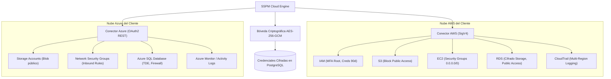

# Módulo de Postura de Seguridad Cloud Multicloud (CSPM)

> **Sistema de Gestión de Postura de Seguridad (SSPM / EASM / CSPM)**  
> Módulo Backend: [`cloud/`](file:///home/miguel/Proyectos/Sistema-de-Gestion-de-Postura-de-Seguridad-SSPM/backend/src/cloud/)  
> Servicios: [`aws-connector.service.ts`](file:///home/miguel/Proyectos/Sistema-de-Gestion-de-Postura-de-Seguridad-SSPM/backend/src/cloud/connectors/aws-connector.service.ts), [`azure-connector.service.ts`](file:///home/miguel/Proyectos/Sistema-de-Gestion-de-Postura-de-Seguridad-SSPM/backend/src/cloud/connectors/azure-connector.service.ts) y [`crypto-vault.service.ts`](file:///home/miguel/Proyectos/Sistema-de-Gestion-de-Postura-de-Seguridad-SSPM/backend/src/cloud/crypto-vault.service.ts)  
> Versión: **2.0.0**

Este documento describe la arquitectura de los conectores nativos sin agente (*agentless*) para **Amazon Web Services (AWS)** y **Microsoft Azure**, el almacenamiento criptográfico de credenciales y el catálogo de reglas de postura cloud basadas en CIS Benchmarks.

---

## 1. Arquitectura y Enfoque Agentless

El módulo CSPM de la plataforma adopta un enfoque 100% **sin agentes (*agentless*)**:
- No se instalan binarios, demonios ni extensiones en las máquinas virtuales o instancias de los clientes.
- La auditoría se realiza mediante llamadas a las **APIs de gestión nativas** (AWS REST con firma SigV4 y Azure Resource Manager REST API).
- Cero impacto en el rendimiento de las cargas de trabajo en producción y cero riesgo de incompatibilidad de dependencias.

---

## 2. Gestión Criptográfica de Credenciales (`CryptoVaultService`)

Para conectarse a las nubes de los clientes, la plataforma debe almacenar secretos altamente sensibles (AWS Access Key Secret o Azure Service Principal Client Secret). Para prevenir su exposición ante accesos no autorizados a la base de datos, se implementó una bóveda criptográfica con **AES-256-GCM**:

### Estructura Criptográfica:
- **Algoritmo:** `aes-256-gcm`.
- **Llave Maestra:** Derivada de la variable de entorno `APP_VAULT_KEY` (32 bytes / 256 bits).
- **Vector de Inicialización (IV):** Generado aleatoriamente con `crypto.randomBytes(12)` (96 bits) por cada registro cifrado.
- **Tag de Autenticación:** 16 bytes (128 bits) que garantizan que el secreto no haya sido manipulado en reposo.
- **Formato Serializado en Base de Datos:**
  `ivHex:authTagHex:ciphertextHex`

---

## 3. Conector de Amazon Web Services (AWS)

El servicio [`AwsConnectorService`](file:///home/miguel/Proyectos/Sistema-de-Gestion-de-Postura-de-Seguridad-SSPM/backend/src/cloud/connectors/aws-connector.service.ts) implementa la autenticación segura sin requerir SDKs pesados de terceros mediante firmas criptográficas **AWS Signature Version 4 (SigV4)**.

### Métodos de Conexión Soportados:
1. **Rol Asumible IAM (Role ARN):** Mecanismo recomendado donde el cliente crea un rol en su cuenta AWS con relación de confianza hacia la cuenta de SSPM y un `ExternalId` único para mitigar el ataque de *Confused Deputy*.
2. **Llaves de Acceso IAM (Access Keys):** Par de `AccessKeyId` y `SecretAccessKey` con permisos de solo lectura (`SecurityAudit` o `ReadOnlyAccess`).

### Servicios e Inspecciones Evaluadas:
- **IAM:**
  - `AWS-IAM-ROOT-MFA`: Alerta si la cuenta root no tiene autenticación multifactor habilitada.
  - `AWS-IAM-ACCESS-KEYS-90D`: Alerta si existen llaves de acceso activas con más de 90 días sin rotación.
- **Amazon S3:**
  - `AWS-S3-PUBLIC-READ`: Alerta si un bucket tiene deshabilitado el bloqueo de acceso público (*Block Public Access*) o acl público.
  - `AWS-S3-DEFAULT-ENCRYPTION`: Alerta si el bucket no tiene habilitado el cifrado predeterminado en reposo (SSE-S3 o SSE-KMS).
- **Amazon EC2 & VPC:**
  - `AWS-SG-SSH-WORLD-OPEN`: Alerta si un Security Group permite tráfico entrante en puerto 22 desde `0.0.0.0/0`.
  - `AWS-SG-RDP-WORLD-OPEN`: Alerta si un Security Group permite puerto 3389 desde `0.0.0.0/0`.
- **Amazon RDS:**
  - `AWS-RDS-PUBLIC-ACCESS`: Alerta si una instancia de base de datos tiene la bandera `PubliclyAccessible = true`.
  - `AWS-RDS-STORAGE-UNENCRYPTED`: Alerta si el almacenamiento de la base de datos no está cifrado.
- **AWS CloudTrail:**
  - `AWS-TRAIL-NOT-MULTI-REGION`: Alerta si no existe un trail multi-región activo recolectando eventos de gestión.

---

## 4. Conector de Microsoft Azure

El servicio [`AzureConnectorService`](file:///home/miguel/Proyectos/Sistema-de-Gestion-de-Postura-de-Seguridad-SSPM/backend/src/cloud/connectors/azure-connector.service.ts) interactúa con Azure Resource Manager (ARM) REST APIs.

### Métodos de Conexión Soportados:
- **Service Principal (Microsoft Entra ID):** Requiere `tenantId`, `clientId`, `subscriptionId` y `clientSecret` cifrado. Se le asigna el rol nativo de Azure **Reader** sobre la suscripción deseada.

### Servicios e Inspecciones Evaluadas:
- **Azure Storage:**
  - `AZURE-STORAGE-PUBLIC-BLOB`: Alerta si una cuenta de almacenamiento permite acceso público a nivel de contenedor/blob (`allowBlobPublicAccess: true`).
  - `AZURE-STORAGE-REQUIRE-HTTPS`: Alerta si la cuenta no fuerza el uso exclusivo de HTTPS (`supportsHttpsTrafficOnly: false`).
- **Network Security Groups (NSGs):**
  - `AZURE-NSG-INBOUND-SSH-ANY`: Alerta si existe una regla de seguridad de red con acción `Allow`, dirección `Inbound`, puerto `22` y origen `*` o `0.0.0.0/0`.
  - `AZURE-NSG-INBOUND-RDP-ANY`: Alerta similar para el puerto `3389`.
- **Azure SQL Database:**
  - `AZURE-SQL-TDE-DISABLED`: Alerta si Transparent Data Encryption (TDE) no está activo.
  - `AZURE-SQL-FIREWALL-ALLOW-ALL`: Alerta si el firewall permite la regla `0.0.0.0 - 0.0.0.0` ("Permitir que los servicios de Azure accedan al servidor") sin restricción de Virtual Network.
- **Azure Monitor / Activity Logs:**
  - `AZURE-LOG-PROFILE-MISSING`: Alerta si no existe una configuración de exportación de registros de auditoría hacia un Log Analytics Workspace.

---

## 5. Guías de Remediación Integradas

Cada hallazgo CSPM generado se enriquece con:
1. **Comandos CLI Directos:** Comandos listos para copiar y pegar en `aws cli` o `az cli` para corregir la desconfiguración en la terminal del administrador.
2. **Pasos en Consola Web:** Instrucciones navegación paso a paso dentro de la consola de AWS o Azure Portal para equipos que no utilizan automatización de infraestructura como código (IaC).
