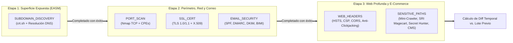
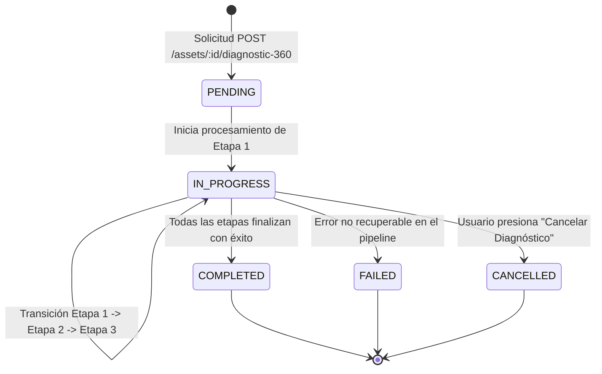

# Módulo Orquestador de Diagnóstico 360° y Diff Temporal

> **Sistema de Gestión de Postura de Seguridad (SSPM / EASM / CSPM)**  
> Módulo Backend: [`scans/diagnostic-orchestrator.service.ts`](file:///home/miguel/Proyectos/Sistema-de-Gestion-de-Postura-de-Seguridad-SSPM/backend/src/scans/diagnostic-orchestrator.service.ts) y [`scans/posture-diff.service.ts`](file:///home/miguel/Proyectos/Sistema-de-Gestion-de-Postura-de-Seguridad-SSPM/backend/src/scans/posture-diff.service.ts)  
> Componente Frontend: [`Diagnostic360Stepper.tsx`](file:///home/miguel/Proyectos/Sistema-de-Gestion-de-Postura-de-Seguridad-SSPM/frontend/src/components/Diagnostic360Stepper.tsx)  
> Versión: **2.0.0 (Sprint 12 - Pilar 2)**

Este documento describe la arquitectura, la máquina de estados y los algoritmos del Orquestador de Diagnóstico 360° y el motor de Diff Temporal de Postura.

---

## 1. Visión y Objetivos

El **Diagnóstico 360°** permite a un comercio o analista ejecutar una auditoría integral y holística sobre un activo en **un solo clic**. Antes de este módulo, el usuario debía lanzar manualmente hasta 6 tipos de escaneo diferentes de manera inconexa. 

El orquestador introduce tres capacidades clave:
1. **Pipeline Secuencial Multi-Etapa:** Ordena los escaneos lógicamente de lo pasivo a lo activo para que cada etapa informe a la siguiente.
2. **Seguimiento Reactivo y Control:** Interfaz con Stepper en tiempo real que reporta el porcentaje de progreso de la campaña, con soporte de cancelación inmediata.
3. **Diff Temporal Automatizado:** Compara matemáticamente la postura obtenida en el diagnóstico actual frente al lote anterior, identificando vulnerabilidades remediadas, regresiones y deltas de puntuación.

---

## 2. Pipeline de Ejecución en 3 Etapas



### Detalle de las Etapas:
1. **Etapa 1: Descubrimiento de Superficie (EASM):**
   - Ejecuta `SUBDOMAIN_DISCOVERY`. Recolecta certificados históricos en Certificate Transparency y sondea DNS para descubrir subdominios vivos y verificar que el host principal sea alcanzable antes de lanzar pruebas de red.
2. **Etapa 2: Perímetro, Red y Correo:**
   - Encola concurrentemente `PORT_SCAN`, `SSL_CERT` y `EMAIL_SECURITY`.
   - Analiza qué puertos están expuestos a nivel TCP, verifica la vigencia y configuración del certificado TLS y comprueba la inmunidad del dominio frente a suplantación de correo (*Phishing* / BEC).
3. **Etapa 3: Web Profunda, E-Commerce y Secret Hunter:**
   - Encola `WEB_HEADERS` y `SENSITIVE_PATHS`.
   - Rastrea rutas críticas de la tienda online (`/checkout`, `/cart`, `/admin`), analiza la integridad de scripts de terceros (Anti-Magecart PCI-DSS v4.0), busca secretos de pasarelas en JavaScript y audita interfaces CMS.

---

## 3. Modelo y Ciclo de Vida del Lote (`DiagnosticBatch`)

El estado del lote se administra mediante la entidad `DiagnosticBatch` en PostgreSQL:



### Propiedades Clave del Modelo:
- `currentStage`: Etapa actual en ejecución (`1`, `2` o `3`).
- `totalStages`: Número total de etapas (`3`).
- `summary`: Objeto JSON con el resumen final, incluyendo:
  - `findingsCount`: Total de hallazgos detectados desglosados por severidad.
  - `portsCount`: Total de puertos abiertos descubiertos.
  - `scoreSnapshot`: Instantánea del Security Score calculado al finalizar.
  - `postureDiff`: Diferencial completo respecto al diagnóstico previo.

### Cancelación en Cascada:
Cuando el usuario envía una petición `POST /api/v1/diagnostic-batches/:id/cancel`:
1. El estado del batch se marca inmediatamente como `CANCELLED`.
2. Todos los escaneos en la tabla `scans` vinculados a ese `batchId` que se encuentren en estado `PENDING` o `RUNNING` son actualizados a `CANCELLED`.
3. El `ScanWorkerService` omite la ejecución de tareas marcadas como canceladas.

---

## 4. Motor de Diff Temporal de Postura (`PostureDiffService`)

Una vez que la Etapa 3 concluye, el servicio invoca automáticamente el cálculo de diferencias temporales:

```typescript
export interface PostureDiff {
  previousBatchId: string | null;
  scoreDelta: number;               // ej. +15 (mejora) o -20 (degradación)
  resolvedFindingsCount: number;    // hallazgos resueltos desde el último lote
  newFindingsCount: number;         // regresiones o nuevas vulnerabilidades
  persistingFindingsCount: number;  // vulnerabilidades que siguen abiertas
  portChanges: {
    newlyOpened: number[];          // puertos recién abiertos
    closed: number[];               // puertos cerrados
  };
  technologiesDiff: {
    added: string[];
    removed: string[];
  };
}
```

### Algoritmo de Comparación:
1. **Búsqueda del Predecesor:** Selecciona el último `DiagnosticBatch` con estado `COMPLETED` para el mismo activo con fecha anterior a la creación del lote actual.
2. **Cálculo de Delta de Score:**
   $$\Delta_{\text{Score}} = \text{Score}_{\text{actual}} - \text{Score}_{\text{anterior}}$$
3. **Intersección de Hallazgos:**
   - Hallazgos **Remediados**: Aquellos presentes en el escaneo previo que ahora tienen estado `RESOLVED`.
   - Hallazgos **Nuevos (Regresiones)**: Aquellos con `firstSeenAt` dentro del rango temporal de ejecución del lote actual.
   - Hallazgos **Persistentes**: Aquellos con `firstSeenAt` previo que aún continúan en estado `OPEN`.
4. **Variación de Red:** Compara el conjunto de puertos en estado `open` entre los escaneos de puertos de ambos lotes.

---

## 5. Experiencia de Usuario en Frontend (`Diagnostic360Stepper.tsx`)

El componente de interfaz en React 19 proporciona una experiencia fluida y reactiva:
- **Barra de Progreso y Stepper:** Muestra visualmente las 3 etapas con iconos de estado (Pendiente, En Ejecución con animación spinner, y Completado con checkmark verde).
- **Polling No Intrusivo:** Monitorea el progreso cada 3 segundos hasta la finalización.
- **Tarjeta de Diff Temporal:** Al completarse, despliega un cuadro comparativo:
  - Badge verde con `+X pts` o rojo con `-X pts`.
  - Contadores de hallazgos resueltos vs. regresiones.
  - Notificación de alerta inmediata si se detectaron puertos nuevos o caída de puntuación.
