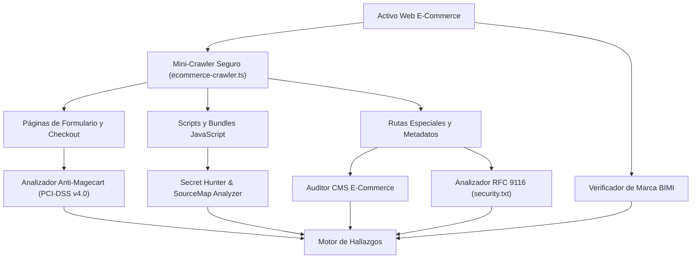

# Módulo de Auditoría E-Commerce, Mini-Crawler y Secret Hunter

> **Sistema de Gestión de Postura de Seguridad (SSPM / EASM / CSPM)**  
> Módulo Backend: [`scans/web/`](file:///home/miguel/Proyectos/Sistema-de-Gestion-de-Postura-de-Seguridad-SSPM/backend/src/scans/web/) y [`scans/analyzers/`](file:///home/miguel/Proyectos/Sistema-de-Gestion-de-Postura-de-Seguridad-SSPM/backend/src/scans/analyzers/)  
> Versión: **2.0.0 (Sprint 11 - Pilar 1)**

Este documento describe la arquitectura, algoritmos y reglas de detección del módulo especializado en auditoría profunda de comercios electrónicos, protección de pasarelas de pago, análisis de bundles JavaScript y cumplimiento PCI-DSS v4.0.

---

## 1. Justificación y Objetivos de Negocio

El comercio electrónico moderno depende masivamente de componentes web del lado del cliente (*client-side*): pasarelas de pago incrustadas (Stripe, MercadoPago, PayPal), librerías de analítica (Google Analytics, Hotjar, Meta Pixel) y plugins de marketing. Esta arquitectura introduce tres vectores críticos de riesgo que los escáneres perimetrales tradicionales no detectan:

1. **Ataques Magecart / E-Skimming:** Inyección de código malicioso en scripts de terceros alojados en CDNs externas para robar datos de tarjetas de crédito en el navegador del comprador.
2. **Fuga de Secretos en Frontend (Secret Hunter):** Exposición involuntaria de llaves secretas de pasarelas de pago (`sk_live_...`) o tokens de nube en bundles JavaScript minificados.
3. **Superficie Expuesta de CMS E-Commerce:** Paneles de administración desprotegidos, endpoints de enumeración de usuarios y configuraciones inseguras en plataformas líderes (WordPress, WooCommerce, PrestaShop, Magento, Shopify).

---

## 2. Componentes del Módulo



---

## 3. Especificación Técnica de Analizadores

### 3.1 Mini-Crawler Seguro (`ecommerce-crawler.ts`)
- **Control de Alcance (*Scoping*):** Limita el rastreo estrictamente al mismo FQDN del activo. No sigue enlaces salientes ni dominios de terceros.
- **Respeto a Políticas:** Consulta previamente `robots.txt` para excluir rutas denegadas explícitamente al User-Agent del sistema.
- **Límites Operacionales:**
  - Profundidad máxima de enlace: 2 niveles.
  - Concurrencia máxima: 2 peticiones paralelas.
  - Timeout por petición: 8 segundos.
  - Tope global: 20 páginas por escaneo para prevenir sobrecarga en servidores de producción.
- **Detección de Formularios Sensibles:** Inspecciona el DOM buscando inputs de tipo `password`, `tel` o atributos como `name="cardnumber"`, `name="cvv"`, `autocomplete="cc-number"`, identificando páginas de checkout o autenticación.

---

### 3.2 Analizador Anti-Magecart y SRI (`magecart-security.analyzer.ts`)
Alineado con los requisitos más estrictos del estándar **PCI-DSS v4.0**:

1. **Requisito 6.4.3 (Subresource Integrity - SRI):**
   - Evalúa cada etiqueta `<script src="...">` cargada desde un dominio externo.
   - Si el script no cuenta con el atributo `integrity="sha384-..."` o `integrity="sha512-..."`, se genera el hallazgo `ECOM-SRI-MISSING` (**Severidad: HIGH**).
   - Justificación de Negocio: Si la CDN externa es comprometida, el atacante puede inyectar un sniffer de tarjetas sin que el servidor de la tienda lo note.
2. **Requisito 11.6.1 (Integridad de Encabezados y Páginas de Pago):**
   - Verifica la presencia de encabezados CSP restrictivos (`script-src`, `connect-src`).
   - Alerta ante formularios sensibles cargados sobre enlaces HTTP no seguros (*Mixed Content*) o formularios que envíen datos a dominios no verificados (`ECOM-UNENCRYPTED-FORM`, **Severidad: CRITICAL**).

---

### 3.3 Secret Hunter y Detección de Source Maps (`js-secrets-sourcemap.analyzer.ts`)

Inspecciona el contenido de cada archivo `.js` descargado en busca de patrones criptográficos y credenciales privadas:

| Proveedor / Servicio | Patrón Expresión Regular | Severidad | Regla |
| :--- | :--- | :---: | :--- |
| **Stripe Secret Key** | `/(?:sk_live_[0-9a-zA-Z]{24,99})/g` | **CRITICAL** | `SECRET-STRIPE-LIVE` |
| **MercadoPago Access Token** | `/(?:APP_USR-[0-9a-zA-Z_-]{40,80})/g` | **CRITICAL** | `SECRET-MERCADOPAGO-LIVE` |
| **AWS Access Key ID** | `/(?:AKIA[0-9A-Z]{16})/g` | **HIGH** | `SECRET-AWS-KEY` |
| **Google API Key** | `/(?:AIza[0-9A-Za-z\\-_]{35})/g` | **MEDIUM** | `SECRET-GOOGLE-API` |
| **JSON Web Token Privado** | `/(?:eyJ[a-zA-Z0-9_-]{10,}\.eyJ[a-zA-Z0-9_-]{10,}\.[a-zA-Z0-9_-]{10,})/g` | **MEDIUM** | `SECRET-JWT-EXPOSED` |

#### Política de Ofuscación Estricta (`redactToken`):
Para evitar que la base de datos de SSPM se convierta en un repositorio de secretos vulnerables, cualquier credencial detectada es inmediatamente enmascarada antes de persistirse:
```typescript
export function redactToken(token: string): string {
  if (token.length <= 12) return '***';
  const prefix = token.slice(0, 8);
  const suffix = token.slice(-4);
  return `${prefix}...${suffix}`;
}
```
*Ejemplo:* `sk_live_51NwYzKL90P...4b21`

#### Auditoría de Source Maps (`.js.map`):
- Prueba la disponibilidad de archivos de mapa de código fuente (p. ej. `app.min.js.map`).
- Si el archivo devuelve código HTTP `200 OK` con JSON válido conteniendo `sourcesContent`, se genera el hallazgo `WEB-SOURCEMAP-EXPOSED` (**Severidad: MEDIUM**), ya que revela la estructura original del frontend en TypeScript/React, nombres de variables y posibles rutas de endpoints privados de la API.

---

### 3.4 Auditoría de Plataformas CMS E-Commerce (`cms-ecommerce.analyzer.ts`)

Identifica la presencia y versiones de los principales gestores de tiendas online y ejecuta sondeos activos no destructivos:

1. **WordPress y WooCommerce:**
   - **Enumeración de Usuarios (`WP-USER-ENUM`):** Consulta a `/wp-json/wp/v2/users`. Si el endpoint está activo, expone los nombres de usuario del sistema, facilitando ataques de fuerza bruta dirigidos.
   - **Interfaz XML-RPC Activa (`WP-XMLRPC-ENABLED`):** Prueba peticiones POST a `/xmlrpc.php`. Si está habilitada, expone la tienda a amplificación de ataques de denegación de servicio (DDoS) y ataques de diccionario masivos mediante `system.multicall`.
   - **Archivos de Depuración Expuestos (`CMS-DEBUG-LOG`):** Sondeo en `/wp-content/debug.log`, verificando si existen volcados de errores con trazas de base de datos o contraseñas.
2. **PrestaShop:**
   - Detección de carpetas de administración expuestas con nombres por defecto (`/admin123`, `/admin-dev`).
3. **Magento / Adobe Commerce:**
   - Sonda a `/downloader/` o interfaces de configuración de módulos de pago expuestos.
4. **Shopify:**
   - Detección de configuración de tienda alojada y verificación de encabezados de seguridad provistos por el CDN de Shopify.

---

### 3.5 Estándares de Divulgación y Marca: RFC 9116 y BIMI

- **Madurez RFC 9116 (`security-txt.analyzer.ts`):**
  - Inspecciona `/.well-known/security.txt` y `/security.txt`.
  - Comprueba que la directiva `Contact:` sea accesible y que la fecha en `Expires:` no haya caducado.
  - Regla: `ECOM-SECURITY-TXT-MISSING` (**Severidad: LOW / Esfuerzo: QUICK_WIN**).
- **Verificación de Marca de Correo BIMI (`bimi.ts`):**
  - Consulta DNS TXT en `default._bimi.<dominio>`.
  - Valida la sintaxis del registro (`v=BIMI1; l=https://.../logo.svg; a=...`).
  - Ayuda al comercio a certificar ante Gmail y Yahoo su logotipo de marca, reduciendo la efectividad del phishing que suplanta su identidad.
