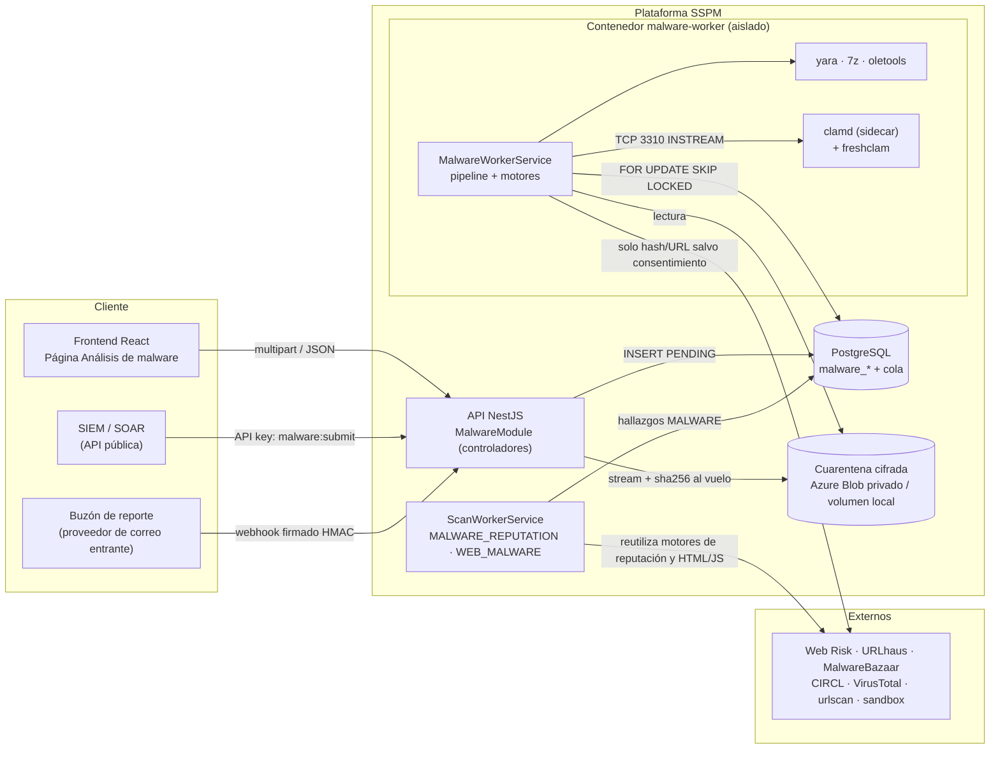
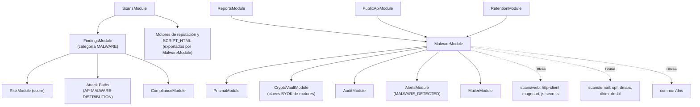
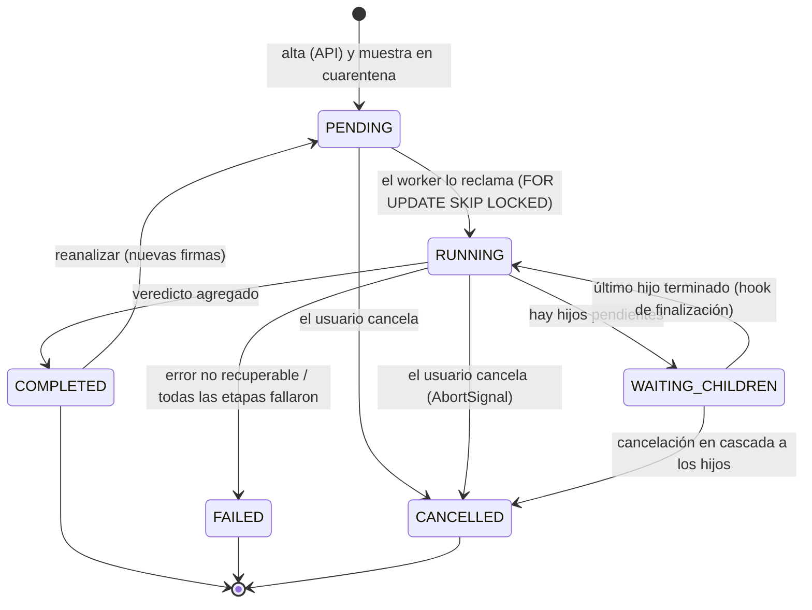
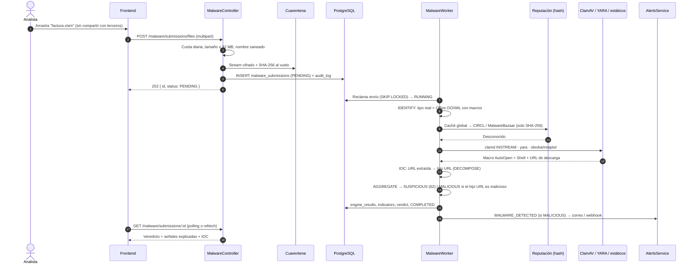
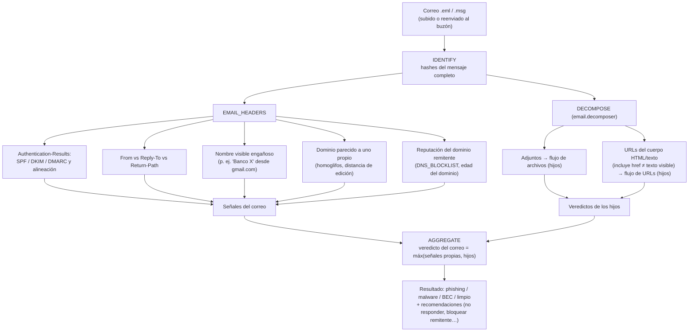
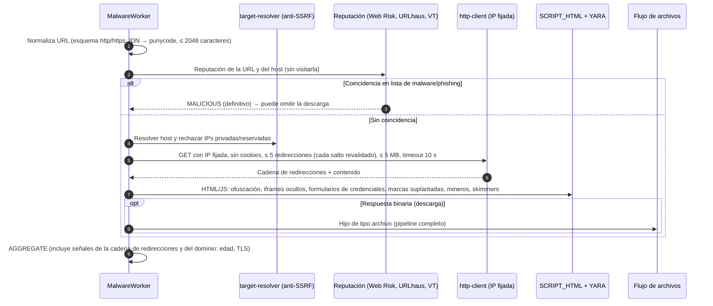
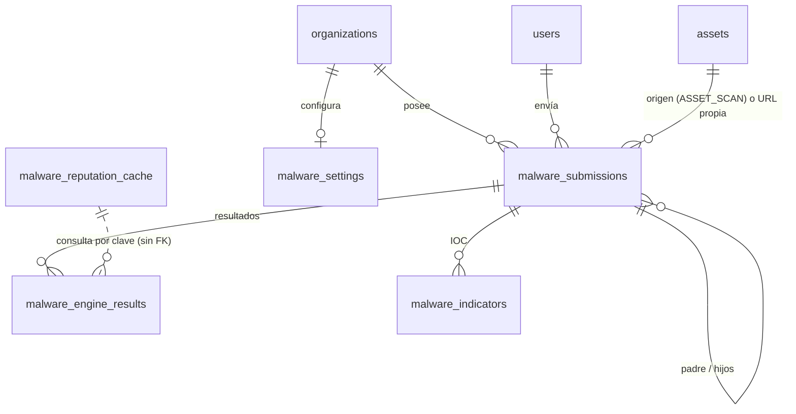

# Módulo de Análisis de Malware (Archivos, Correos y URLs)

> **Sistema de Gestión de Postura de Seguridad (SSPM / EASM / CSPM)**
> Módulo Backend propuesto: `backend/src/malware/` + escáneres `MALWARE_REPUTATION` y `WEB_MALWARE` en `backend/src/scans/scanners/`
> Estado: **Diseño aprobado para implementación (planificado, Sprints 14-21)**
> Decisiones: [ADR-0008](../adr/0008-modulo-analisis-malware.md) · Backlog: [malware-analysis-backlog.md](../backlog/malware-analysis-backlog.md)
> Requerimientos: [RF-19 a RF-23](../requirements/functional-requirements.md#rf-19-análisis-de-malware-en-archivos) · [RNF-11 y RNF-12](../requirements/non-functional-requirements.md#rnf-11-aislamiento-y-manejo-seguro-de-muestras)

Este documento especifica el módulo que analiza **archivos, correos electrónicos y URLs** en busca de malware y phishing, y que además vigila si **los propios activos de la organización** (sus sitios web, dominios e IPs) distribuyen malware o están en listas de bloqueo. Describe el alcance, los motores de análisis (propios y externos), el flujo de trabajo, la estructura dentro del sistema, el modelo de datos, la API, la seguridad del propio módulo y su integración con el resto de la plataforma.

---

## Índice

1. [Justificación y objetivos](#1-justificación-y-objetivos)
2. [Alcance](#2-alcance)
3. [Principios de diseño](#3-principios-de-diseño)
4. [Motores de análisis](#4-motores-de-análisis)
5. [Arquitectura y ubicación dentro del sistema](#5-arquitectura-y-ubicación-dentro-del-sistema)
6. [Flujos de trabajo](#6-flujos-de-trabajo)
7. [Motor de veredicto determinista](#7-motor-de-veredicto-determinista)
8. [Modelo de datos](#8-modelo-de-datos)
9. [API REST](#9-api-rest)
10. [Integración con los módulos existentes](#10-integración-con-los-módulos-existentes)
11. [Seguridad del propio módulo (modelo de amenazas)](#11-seguridad-del-propio-módulo-modelo-de-amenazas)
12. [Privacidad, consentimiento y aspectos legales](#12-privacidad-consentimiento-y-aspectos-legales)
13. [Límites, cuotas y rendimiento](#13-límites-cuotas-y-rendimiento)
14. [Interfaz de usuario](#14-interfaz-de-usuario)
15. [Configuración y despliegue](#15-configuración-y-despliegue)
16. [Estrategia de pruebas](#16-estrategia-de-pruebas)
17. [Observabilidad](#17-observabilidad)
18. [Fases de entrega](#18-fases-de-entrega)
19. [Preguntas abiertas](#19-preguntas-abiertas)

---

## 1. Justificación y objetivos

Hoy la plataforma mide **qué puertas tiene abiertas** una organización (puertos, cabeceras, TLS, correo, nube). No responde a otra pregunta que una PyME se hace a diario: **"¿esto que me llegó es peligroso?"**. Esa pregunta llega en tres formas:

- un **archivo** (una factura en `.xlsm`, un `.zip` de un proveedor, un ejecutable descargado);
- un **correo** sospechoso (suplantación del banco, de un proveedor o del propio gerente: *BEC*);
- un **enlace** (un acortador, una página de inicio de sesión falsa).

Además, una PyME rara vez se entera de que **su propio sitio fue comprometido** (skimmer en el checkout, minero de criptomonedas, redirecciones a phishing, spam SEO) hasta que el navegador de sus clientes muestra una advertencia de "sitio peligroso" o su dominio cae en una lista de bloqueo y sus correos dejan de llegar.

**Objetivos:**

| # | Objetivo | Métrica de éxito |
|---|---|---|
| O1 | Dar un veredicto claro y explicable (limpio / sospechoso / malicioso) sobre archivos, correos y URLs | Veredicto en < 2 min (P95) sin sandbox dinámico |
| O2 | Detectar si un activo propio distribuye malware o está en listas de bloqueo | Hallazgo y alerta en el siguiente ciclo de monitoreo |
| O3 | No convertir la plataforma en un riesgo: aislar las muestras y no ejecutar nunca malware en la infraestructura propia | 0 ejecuciones de muestras en la API o el worker |
| O4 | Respetar la confidencialidad: por defecto no se comparte el contenido con terceros | 100 % de envíos externos de contenido con consentimiento registrado |
| O5 | Integrarse con hallazgos, score, alertas, rutas de ataque, cumplimiento, reportes y API pública | Reutilización de los módulos existentes, sin duplicarlos |

---

## 2. Alcance

### 2.1 Dentro del alcance

| Entrada | Cómo llega | Qué se analiza |
|---|---|---|
| **Archivo** | Subida en la web, API pública | Tipo real (bytes mágicos), hashes, firmas antivirus, reglas YARA, macros de Office, PDF con JavaScript/acciones, scripts, ejecutables (PE/ELF), archivos comprimidos (recursivo) y reputación por hash |
| **Correo** | Subida de `.eml`/`.msg`; buzón de reporte por organización (fase 2) | Cabeceras (SPF/DKIM/DMARC, cadena `Received`, `Reply-To`, nombre visible), suplantación de dominios propios (*lookalike*), adjuntos (al flujo de archivos) y URLs (al flujo de URLs) |
| **URL** | Formulario, API pública, extraída de un correo | Reputación (listas de URLs maliciosas y phishing), cadena de redirecciones, contenido HTML/JS estático (ofuscación, iframes ocultos, skimmers, formularios de credenciales, suplantación de marca) y descargas (al flujo de archivos) |
| **Activo propio** | Escáneres programados (monitoreo continuo y Diagnóstico 360°) | Reputación del dominio/IP en listas de bloqueo y contenido malicioso servido por el sitio |

### 2.2 Fuera del alcance (explícitamente)

- **Ejecución de muestras en la infraestructura propia.** El análisis dinámico solo se hace en un sandbox externo o en una VM aislada dedicada (fase 3, opcional).
- **Protección en tiempo real de endpoints o del servidor de correo** (no es un EDR ni un *secure email gateway*): el módulo analiza lo que se le envía, no intercepta tráfico.
- **Análisis interno de la red del cliente** (sin agentes, igual que el resto de la plataforma).
- **Desinfección o remediación automática** de archivos o sitios.

---

## 3. Principios de diseño

1. **Nunca ejecutar, solo inspeccionar.** Todo el análisis propio es estático. Los procesos que tocan muestras corren en un contenedor aislado, sin shell, sin privilegios y con límites de tiempo y memoria.
2. **La API nunca abre las muestras.** La API solo recibe el flujo de bytes, calcula hashes al vuelo, valida tamaño y tipo, y lo guarda cifrado en cuarentena. El contenido lo abre únicamente el *worker* de malware.
3. **Privado por defecto.** A terceros solo se envían **hashes** o la URL; el contenido completo se comparte únicamente con consentimiento explícito (configuración de la organización y opción por envío).
4. **Veredicto determinista y explicable** (coherente con [RNF-05](../requirements/non-functional-requirements.md)): mismas señales producen el mismo veredicto, y cada veredicto lista las señales que lo justifican en lenguaje claro.
5. **Motores enchufables.** Igual que los escáneres (`SCANNERS`), cada motor implementa una interfaz común (`MALWARE_ENGINES`) y declara si es externo y si envía contenido.
6. **Tolerante a fallos parciales.** Si un motor externo no responde, el veredicto se calcula con los demás y se marca como incompleto, igual que `incompleteCategories` en los escáneres.
7. **Reutilizar, no duplicar.** Cliente HTTP anti-SSRF, analizadores de correo y Magecart, crawler, bóveda de cifrado, alertas, hallazgos, auditoría, retención y API pública ya existen.
8. **Aislamiento multi-tenant** ([RNF-01](../requirements/non-functional-requirements.md)): toda consulta filtra por `organization_id`. La única caché global guarda **respuestas públicas de reputación** (nunca datos de un tenant).

---

## 4. Motores de análisis

### 4.1 Catálogo de motores

Leyenda: **Propio** = código del sistema o herramienta *open source* ejecutada localmente; **Externo** = API de terceros. "Envía contenido" = el archivo o la página completa sale de la plataforma.

| Motor (`MalwareEngineId`) | Tipo | Aplica a | Envía fuera | Licencia / costo | Fase |
|---|---|---|---|---|---|
| `IDENTIFY` — identificación por bytes mágicos y hashes (SHA-256, SHA-1, MD5; TLSH opcional) | Propio | Todo | No | Propio (librería `file-type`, MIT) | 1 |
| `CLAMAV` — antivirus por firmas (demonio `clamd`, protocolo `INSTREAM`) | Propio (*open source*) | Archivos, adjuntos, descargas | No | GPLv2, se usa como **proceso aparte** por red (sin enlazar código) | 1 |
| `YARA` — reglas propias + reglas comunitarias curadas | Propio (*open source*) | Archivos, adjuntos, descargas, HTML/JS | No | YARA: BSD-3. Reglas: revisar licencia de cada conjunto (p. ej. DRL 1.1 exige atribución) | 1 |
| `OFFICE_MACROS` — macros VBA/XLM, auto-ejecución, llamadas a shell (oletools: `olevba`, `mraptor`) | Propio (*open source*) | `.doc/.docm/.xls/.xlsm/.ppt…`, RTF | No | BSD-2 | 1 |
| `PDF_STATIC` — `/JavaScript`, `/OpenAction`, `/Launch`, `/EmbeddedFile`, objetos ofuscados | Propio | PDF | No | Propio | 1 |
| `SCRIPT_HTML` — JS/HTML/PowerShell/VBS: ofuscación (entropía, `eval(atob(…))`), iframes ocultos, mineros, skimmers (reusa patrones Magecart) | Propio | Scripts, HTML, páginas descargadas | No | Propio | 1 |
| `EMAIL_HEADERS` — autenticación (SPF/DKIM/DMARC y alineación), `Reply-To`/`Return-Path` divergentes, nombre visible engañoso, dominios parecidos a los de la organización | Propio | Correos | No | Propio (`mailparser`, MIT; reusa `scans/email/*`) | 1 |
| `HASHLOOKUP_CIRCL` — software conocido y legítimo (NSRL) para reducir falsos positivos | Externo | Hashes | Solo hash | Gratuito | 1 |
| `MALWAREBAZAAR` — muestras de malware conocidas por hash (abuse.ch) | Externo | Hashes | Solo hash | Gratuito con *Auth-Key*; revisar términos para uso comercial | 1 |
| `URLHAUS` — URLs y hosts que distribuyen malware (abuse.ch) | Externo | URLs, hosts de activos | Solo URL/host | Gratuito con *Auth-Key*; revisar términos | 1 |
| `WEB_RISK` — Google Web Risk (phishing, malware, software no deseado) | Externo | URLs, dominios de activos | Solo URL (hash de prefijo en modo *Update API*) | **De pago para uso comercial**. Safe Browsing es solo para uso no comercial | 1 |
| `DNS_BLOCKLIST` — listas de bloqueo de dominios por DNS | Externo (DNS) | Dominios de activos y del remitente | Solo nombre | Spamhaus requiere clave DQS para uso comercial; reusa `scans/email/dnsbl.ts` | 2 |
| `STATIC_PE` — ejecutables PE/ELF: secciones de alta entropía, imports sospechosos, firma Authenticode | Propio | Ejecutables | No | Propio (o `pefile`, MIT) | 2 |
| `VIRUSTOTAL` — reputación multi-antivirus por hash/URL/dominio; subida opcional | Externo | Todo | Hash por defecto; **contenido solo con consentimiento** | La API pública **no permite uso comercial** → plan premium o clave propia del cliente (BYOK) | 2 |
| `URLSCAN` — renderizado de la URL en el sandbox de urlscan.io | Externo | URLs | URL (envío privado) | De pago para envíos privados | 3 |
| `SANDBOX` — análisis dinámico (CAPE autohospedado en VM aislada, o Hybrid Analysis / Joe Sandbox / ANY.RUN) | Externo / VM dedicada | Archivos inconclusos | **Contenido, con consentimiento** | Según proveedor | 3 |
| `DEFENDER_STORAGE` — escaneo administrado de Microsoft Defender for Storage | Externo (Azure) | Archivos | Queda en la suscripción del despliegue | Pago por GB analizado | 3 (evaluar) |

> **Por qué no basta con VirusTotal:** su API pública no se puede usar en un producto comercial, tiene cuotas bajas y, al subir un archivo, este queda disponible para la comunidad de pago de VirusTotal. Por eso el núcleo del módulo son motores **propios y locales** (ClamAV, YARA, analizadores estáticos) y los externos se usan **por hash** o con consentimiento.

### 4.2 Interfaz común de motores

```ts
// backend/src/malware/engines/engine.interface.ts
export type MalwareEngineId =
  | 'IDENTIFY' | 'CLAMAV' | 'YARA' | 'OFFICE_MACROS' | 'PDF_STATIC' | 'SCRIPT_HTML'
  | 'EMAIL_HEADERS' | 'STATIC_PE' | 'HASHLOOKUP_CIRCL' | 'MALWAREBAZAAR' | 'URLHAUS'
  | 'WEB_RISK' | 'DNS_BLOCKLIST' | 'VIRUSTOTAL' | 'URLSCAN' | 'SANDBOX' | 'DEFENDER_STORAGE';

export interface MalwareEngine {
  readonly id: MalwareEngineId;
  /** Etapa del pipeline en la que corre (ver sección 6.1). */
  readonly stage: 'IDENTIFY' | 'REPUTATION' | 'STATIC' | 'DYNAMIC';
  /** true si hace peticiones fuera de la plataforma. */
  readonly external: boolean;
  /** true si envía el contenido completo (exige consentimiento). */
  readonly sendsContent: boolean;
  /** Decide si el motor aplica (tipo de envío, tipo de archivo detectado, configuración). */
  appliesTo(subject: AnalysisSubject, settings: EffectiveMalwareSettings): boolean;
  analyze(ctx: EngineContext): Promise<EngineResult>;
}

export interface EngineContext {
  submissionId: string;
  organizationId: string;
  subject: AnalysisSubject;          // tipo, hashes, mime detectado, url…
  openSample(): Promise<Readable>;   // flujo de lectura desde cuarentena (solo motores locales)
  signal: AbortSignal;               // cancelación, timeout o apagado
  timeoutMs: number;
}

export interface EngineResult {
  status: 'OK' | 'ERROR' | 'TIMEOUT' | 'SKIPPED';
  /** Señales normalizadas que consume el motor de veredicto (sección 7). */
  signals: MalwareSignal[];
  /** Nombres de firmas/reglas/familias detectadas. Nunca contenido del archivo. */
  detections: string[];
  /** Detalle estructurado para la UI (sin secretos ni contenido sensible). */
  details?: Record<string, unknown>;
  /** Indicadores (IOC) extraídos: URLs, dominios, IPs, hashes de hijos. */
  indicators?: IndicatorDraft[];
  /** Objetos derivados a analizar como hijos (adjuntos, archivos de un zip, descargas). */
  children?: ChildDraft[];
}

export const MALWARE_ENGINES = Symbol('MALWARE_ENGINES');
```

### 4.3 Reglas YARA

- Repositorio de reglas versionado en `backend/malware-rules/` con dos carpetas: `own/` (reglas propias: skimmers, webshells PHP comunes, droppers de macros, kits de phishing para marcas locales) y `community/` (conjunto curado, p. ej. YARA-Forge en su variante *core*, con su licencia y atribución en `community/LICENSES.md`).
- Cada regla declara `meta: severity = "critical|high|medium|low"` y `meta: description`, que el motor convierte en señales.
- Las reglas se **compilan al construir la imagen** del worker (falla el build si una regla no compila) y se pueden actualizar con una tarea programada que descarga un paquete firmado y verifica su hash antes de recargarlo.
- Se ejecutan con el binario `yara` (o YARA-X) vía `spawn` **sin shell**, con lista fija de argumentos y timeout, siguiendo el patrón de `scans/nmap/nmap.runner.ts`.

---

## 5. Arquitectura y ubicación dentro del sistema

### 5.1 Vista de contenedores



**Decisión clave:** el análisis de envíos corre en un **contenedor propio (`malware-worker`)**, construido desde la misma imagen del backend con otro punto de entrada (`node dist/malware-worker.main.js`). La API se despliega con `MALWARE_WORKER_ENABLED=false`. Así, un fallo o una vulnerabilidad explotada por una muestra en un parser no compromete la API, sus secretos (JWT, base de datos completa) ni su red. Ver [ADR-0008](../adr/0008-modulo-analisis-malware.md).

### 5.2 Estructura de carpetas

```
backend/
├── malware-rules/                       # Reglas YARA versionadas
│   ├── own/                             # Reglas propias (skimmers, webshells, droppers…)
│   └── community/                       # Conjunto curado + LICENSES.md
└── src/
    ├── malware-worker.main.ts           # Punto de entrada del contenedor worker
    ├── malware/
    │   ├── malware.module.ts
    │   ├── malware.controller.ts        # Envíos, consultas, cancelación, reanálisis
    │   ├── malware-settings.controller.ts
    │   ├── malware-inbound.controller.ts  # Webhook del buzón de reporte (fase 2)
    │   ├── malware.service.ts           # Alta de envíos, cuotas, consultas, permisos
    │   ├── malware-settings.service.ts  # Motores, BYOK cifrado, política de compartición
    │   ├── malware-worker.service.ts    # Cola, concurrencia, timeouts, cancelación
    │   ├── pipeline/
    │   │   ├── pipeline.service.ts      # Etapas IDENTIFY → REPUTATION → STATIC → DECOMPOSE → (DYNAMIC) → AGGREGATE
    │   │   ├── verdict.ts               # Agregación determinista (sección 7)
    │   │   ├── verdict.spec.ts
    │   │   ├── ioc-extractor.ts         # URLs, dominios, IPs, correos, hashes
    │   │   └── lookalike.ts             # Dominios parecidos a los de la organización
    │   ├── engines/                     # Un archivo por motor (ver 4.1) + engine.interface.ts
    │   ├── decomposers/
    │   │   ├── archive.decomposer.ts    # 7z con límites anti zip-bomb
    │   │   ├── email.decomposer.ts      # Adjuntos y URLs de .eml/.msg
    │   │   └── url-fetch.decomposer.ts  # Descarga segura (reusa scans/web/http-client)
    │   ├── storage/
    │   │   ├── sample-storage.interface.ts
    │   │   ├── fs-sample.storage.ts     # Desarrollo / Docker Compose
    │   │   └── azure-blob-sample.storage.ts
    │   ├── quota/
    │   │   └── external-api-budget.service.ts  # Presupuesto de llamadas por motor externo
    │   └── dto/
    └── scans/scanners/
        ├── malware-reputation.scanner.ts  # ScanType.MALWARE_REPUTATION (pasivo)
        └── web-malware.scanner.ts         # ScanType.WEB_MALWARE (activo, reusa ecommerce-crawler)

frontend/src/
├── pages/
│   ├── MalwarePage.tsx                  # Enviar + listado con filtros
│   └── MalwareSubmissionPage.tsx        # Detalle: veredicto, señales, motores, árbol, IOC
└── components/malware/
    ├── SubmitPanel.tsx                  # Pestañas Archivo / Correo / URL + consentimiento
    ├── VerdictBadge.tsx                 # Siempre ícono + etiqueta (regla del sistema de diseño)
    ├── SignalList.tsx                   # "Por qué" en lenguaje claro
    ├── EngineResultsTable.tsx
    ├── SubmissionTree.tsx               # Correo → adjuntos → zip → archivos
    ├── IndicatorList.tsx                # Copiar / exportar IOC
    └── AssetReputationCard.tsx          # En el detalle del activo
```

### 5.3 Relación con los módulos existentes



`MalwareModule` **exporta** los motores de reputación (`WEB_RISK`, `URLHAUS`, `DNS_BLOCKLIST`, `VIRUSTOTAL`) y el analizador `SCRIPT_HTML` para que los escáneres de activos los usen sin duplicar código. Los motores que abren muestras (ClamAV, YARA, oletools, 7z) solo se registran en el contexto del worker.

---

## 6. Flujos de trabajo

### 6.1 Pipeline común por etapas

Todos los envíos recorren las mismas etapas. Cada motor declara su etapa y se ejecuta solo si aplica.

| Etapa | Qué hace | Motores |
|---|---|---|
| 1. `IDENTIFY` | Tipo real por bytes mágicos (no por extensión), hashes, tamaño; detecta discrepancia extensión/tipo | `IDENTIFY` |
| 2. `REPUTATION` | Consulta caché global y fuentes por hash o URL. Si hay coincidencia definitiva (malware conocido) se puede **cortocircuitar** el análisis pesado | `HASHLOOKUP_CIRCL`, `MALWAREBAZAAR`, `URLHAUS`, `WEB_RISK`, `VIRUSTOTAL` |
| 3. `STATIC` | Inspección local del contenido | `CLAMAV`, `YARA`, `OFFICE_MACROS`, `PDF_STATIC`, `SCRIPT_HTML`, `STATIC_PE`, `EMAIL_HEADERS` |
| 4. `DECOMPOSE` | Genera hijos: archivos de un comprimido, adjuntos y URLs de un correo, descargas de una URL. Cada hijo es un envío nuevo con `parentId` | Descomponedores |
| 5. `DYNAMIC` (opcional) | Solo si el veredicto es `SUSPICIOUS` o `UNKNOWN`, la organización lo tiene activo y el envío tiene consentimiento | `URLSCAN`, `SANDBOX` |
| 6. `AGGREGATE` | Veredicto determinista con señales propias + veredicto de los hijos; persistencia; IOC; alertas; auditoría | `verdict.ts` |

### 6.2 Máquina de estados del envío



- **Reclamo y concurrencia:** misma técnica que `ScanWorkerService`: `SELECT … WHERE status='PENDING' … FOR UPDATE SKIP LOCKED`, límite global por instancia y límite por organización (`MALWARE_MAX_CONCURRENCY_PER_ORG`).
- **Huérfanos:** un envío `RUNNING` sin actividad más allá de `MALWARE_TIMEOUT_SECONDS + margen` vuelve a `PENDING` (una vez) o pasa a `FAILED`.
- **Apagado ordenado:** los envíos en curso se devuelven a `PENDING`.
- **Evolución de la cola:** si la cola de escaneos se migra a BullMQ + Redis (ver [technical-debt.md](../roadmap/technical-debt.md)), esta cola se migra con el mismo diseño: la interfaz del worker y los estados no cambian.
- **Padres e hijos:** el padre espera en `WAITING_CHILDREN`; al terminar cada hijo, un *hook* (como `completionHooks` del worker de escaneos) reevalúa al padre. Profundidad máxima `MALWARE_MAX_DEPTH` (por defecto 3).

### 6.3 Flujo de análisis de un archivo



### 6.4 Flujo de análisis de un correo



**Detalles:**

- La cabecera `Authentication-Results` que se tiene en cuenta es la del **servidor receptor de la organización** (la primera de arriba hacia abajo añadida por un dominio de confianza configurado). Las demás pueden haber sido falsificadas por el remitente.
- La detección de dominios parecidos compara contra los dominios **inventariados y verificados** de la organización (`assets`), lo que conecta el análisis con el inventario existente.
- El cuerpo del correo no se guarda en la base de datos: se guarda en cuarentena (cifrado, con retención corta) y en la base solo quedan cabeceras relevantes, señales e IOC.

### 6.5 Flujo de análisis de una URL



- La descarga **no ejecuta JavaScript**: es inspección estática. El renderizado real queda para `URLSCAN`/`SANDBOX` (fase 3, opcional).
- Se reutiliza `scans/web/http-client.ts` (conexión a la IP validada, `Host`/SNI correctos y revalidación de cada redirección), con las mismas protecciones anti-SSRF del escáner.
- Las peticiones salen con un `User-Agent` de navegador genérico configurable (algunos kits de phishing muestran una página inocua a clientes "no navegadores") y desde una salida de red dedicada (sección 15.3).

### 6.6 Flujo de vigilancia de activos propios

Dos tipos de escaneo nuevos se registran como cualquier otro `Scanner` del worker de escaneos existente, por lo que heredan el monitoreo continuo, el Diagnóstico 360°, la verificación de propiedad, los hallazgos y el score sin cambios de arquitectura:

| `ScanType` | Pasivo | Qué hace | Reglas que puede generar |
|---|---|---|---|
| `MALWARE_REPUTATION` | Sí (no toca el activo) | Consulta el dominio/IP del activo y sus URLs principales en Web Risk, URLhaus, listas DNS y (fase 2) VirusTotal | `MAL-REP-WEBRISK-FLAGGED`, `MAL-REP-URLHAUS-LISTED`, `MAL-REP-DOMAIN-BLOCKLISTED`, `MAL-REP-VT-DETECTIONS` |
| `WEB_MALWARE` | No (peticiones GET no destructivas) | Recorre el sitio con `ecommerce-crawler.ts` (mismo alcance y límites) y pasa HTML y scripts propios por `SCRIPT_HTML`, YARA y ClamAV | `MAL-WEB-MALICIOUS-CONTENT`, `MAL-WEB-SKIMMER-DETECTED`, `MAL-WEB-CRYPTOMINER`, `MAL-WEB-MALICIOUS-REDIRECT`, `MAL-WEB-HIDDEN-IFRAME`, `MAL-WEB-SEO-SPAM-INJECTION`, `MAL-WEB-WEBSHELL-SUSPECTED` |

> `WEB_MALWARE` necesita ClamAV/YARA, que solo viven en el contenedor del worker de malware. Por eso el escáner **no analiza en el proceso de la API**: descarga el contenido (como hoy hace el crawler) y crea un envío hijo de tipo `ASSET_SCAN` que procesa el worker de malware; el escaneo espera su veredicto antes de convertir las señales en hallazgos. Ver la tarea MAL-US-20 del backlog.

---

## 7. Motor de veredicto determinista

### 7.1 Señales

Cada motor produce **señales** normalizadas:

```ts
export interface MalwareSignal {
  code: string;              // p. ej. 'CLAMAV_DETECTION', 'OFFICE_AUTOEXEC_SHELL'
  points: number;            // contribución al puntaje (0-100)
  definitive?: boolean;      // fuerza MALICIOUS (firma AV, malware conocido por hash, lista de malware)
  benign?: boolean;          // software legítimo conocido (NSRL), reduce falsos positivos
  explanation: string;       // texto claro en español para la UI y el reporte
}
```

### 7.2 Tabla de puntos (versión inicial)

| Señal | Origen | Puntos | Definitiva |
|---|---|---:|:---:|
| Firma antivirus | ClamAV | 100 | Sí |
| Hash conocido como malware | MalwareBazaar | 100 | Sí |
| URL/host en lista de malware o phishing | URLhaus, Web Risk | 100 | Sí |
| VirusTotal: ≥ 5 motores detectan | VirusTotal | 100 | Sí |
| VirusTotal: 1-4 motores detectan | VirusTotal | 35 | No |
| Regla YARA `critical` / `high` / `medium` / `low` | YARA | 70 / 45 / 20 / 5 | No |
| Macro con auto-ejecución **y** llamada a shell/descarga | oletools | 60 | No |
| Macro con auto-ejecución (sin acciones peligrosas) | oletools | 20 | No |
| PDF con `/JavaScript` + `/OpenAction` o `/Launch` | PDF_STATIC | 45 | No |
| Ejecutable dentro de un comprimido cifrado | IDENTIFY + archive | 40 | No |
| Extensión engañosa (`factura.pdf.exe`, RTLO) | IDENTIFY | 40 | No |
| JS muy ofuscado (`eval`/`atob` encadenados, entropía alta) | SCRIPT_HTML | 30 | No |
| Formulario de credenciales en dominio que no es de la marca mostrada | SCRIPT_HTML | 50 | No |
| Correo: DMARC falla y el dominio se parece a uno propio | EMAIL_HEADERS | 60 | No |
| Correo: `Reply-To` distinto del remitente + urgencia de pago | EMAIL_HEADERS | 30 | No |
| Dominio registrado hace < 30 días | Reputación | 15 | No |
| Software legítimo conocido (NSRL) | CIRCL | −40 | No (marca `benign`) |

### 7.3 Algoritmo

```
si alguna señal es definitiva            → MALICIOUS, puntaje 100
si no:
    puntaje = clamp(Σ puntos, 0, 100)
    si no corrió ningún motor con éxito  → UNKNOWN
    si puntaje ≥ 70                      → MALICIOUS
    si puntaje ≥ 30                      → SUSPICIOUS
    si no                                → CLEAN
veredicto del padre = máx(veredicto propio, veredicto de cada hijo)   (CLEAN < UNKNOWN < SUSPICIOUS < MALICIOUS)
confianza = ALTA si hay señal definitiva; MEDIA si puntaje ≥ 30 con ≥ 2 motores locales OK; BAJA en otro caso
incompleto = true si algún motor aplicable terminó en ERROR/TIMEOUT
```

- Las tablas viven en `verdict.ts` junto a pruebas unitarias con casos fijos (mismo enfoque que `risk/scoring.ts`), y los umbrales se versionan (`verdictModelVersion`) en cada resultado para poder explicar veredictos antiguos.
- **Archivo de prueba EICAR:** ClamAV lo detecta como `Eicar-Test-Signature`. Se marca `MALICIOUS` con la etiqueta `test` y **no genera alertas a canales** (sirve para que el cliente compruebe que el módulo funciona sin ruido).

### 7.4 Correspondencia con severidad

| Veredicto | Envío (archivo/correo/URL) | Hallazgo de activo (`MALWARE`) |
|---|---|---|
| `MALICIOUS` | Alerta `MALWARE_DETECTED`, severidad HIGH | Severidad de la regla (CRITICAL/HIGH) |
| `SUSPICIOUS` | Alerta MEDIUM (solo si la organización lo activa) | MEDIUM |
| `CLEAN` / `UNKNOWN` | Sin alerta | Sin hallazgo |

---

## 8. Modelo de datos

### 8.1 Diagrama entidad-relación



### 8.2 Esquema Prisma propuesto

```prisma
/// Tipo de objeto analizado.
enum MalwareSubmissionKind {
  FILE
  EMAIL
  URL
}

/// Origen del envío.
enum MalwareSubmissionSource {
  UPLOAD          // subido desde la web
  API             // API pública (SOAR)
  INBOUND_EMAIL   // buzón de reporte de la organización
  DERIVED         // hijo generado al descomponer (adjunto, archivo de un zip, descarga)
  ASSET_SCAN      // contenido de un activo propio (escáner WEB_MALWARE)
}

enum MalwareAnalysisStatus {
  PENDING
  RUNNING
  WAITING_CHILDREN
  COMPLETED
  FAILED
  CANCELLED
}

enum MalwareVerdict {
  CLEAN
  UNKNOWN
  SUSPICIOUS
  MALICIOUS
}

enum MalwareIndicatorType {
  SHA256
  SHA1
  MD5
  URL
  DOMAIN
  IP
  EMAIL_ADDRESS
}

/// Envío analizado (archivo, correo o URL). Es a la vez la cola del worker de malware.
model MalwareSubmission {
  id                String                  @id @default(uuid()) @db.Uuid
  organizationId    String                  @map("organization_id") @db.Uuid
  kind              MalwareSubmissionKind
  source            MalwareSubmissionSource @default(UPLOAD)
  status            MalwareAnalysisStatus   @default(PENDING)
  verdict           MalwareVerdict?
  /// 0-100 según verdict.ts. Nulo hasta completar.
  score             Int?
  confidence        String?                 @db.VarChar(6)   // HIGH | MEDIUM | LOW
  verdictModelVersion String?               @map("verdict_model_version") @db.VarChar(20)
  /// Árbol: correo → adjunto → zip → archivo.
  parentId          String?                 @map("parent_id") @db.Uuid
  rootId            String?                 @map("root_id") @db.Uuid
  depth             Int                     @default(0)
  /// Nombre de archivo saneado, asunto del correo o URL normalizada (solo para mostrar).
  displayName       String                  @map("display_name") @db.VarChar(500)
  url               String?                 @db.VarChar(2048)
  sha256            String?                 @db.VarChar(64)
  sha1              String?                 @db.VarChar(40)
  md5               String?                 @db.VarChar(32)
  sizeBytes         Int?                    @map("size_bytes")
  /// Tipo detectado por bytes mágicos y el declarado por el cliente (para detectar engaños).
  detectedMime      String?                 @map("detected_mime") @db.VarChar(150)
  declaredMime      String?                 @map("declared_mime") @db.VarChar(150)
  /// Clave del objeto en cuarentena. Nulo cuando la muestra ya se purgó.
  storageKey        String?                 @map("storage_key") @db.VarChar(200)
  storagePurgedAt   DateTime?               @map("storage_purged_at") @db.Timestamptz(6)
  /// Consentimiento explícito para enviar el CONTENIDO a terceros (VirusTotal, sandbox).
  shareContent      Boolean                 @default(false) @map("share_content")
  assetId           String?                 @map("asset_id") @db.Uuid
  scanId            String?                 @map("scan_id") @db.Uuid
  requestedById     String?                 @map("requested_by_id") @db.Uuid
  /// Resumen para la UI: señales con explicación, recomendaciones, cabeceras clave del correo…
  summary           Json?
  incompleteEngines String[]                @default([]) @map("incomplete_engines")
  tags              String[]                @default([])   // p. ej. "test" para EICAR
  errorMessage      String?                 @map("error_message")
  startedAt         DateTime?               @map("started_at") @db.Timestamptz(6)
  finishedAt        DateTime?               @map("finished_at") @db.Timestamptz(6)
  createdAt         DateTime                @default(now()) @map("created_at") @db.Timestamptz(6)
  updatedAt         DateTime                @updatedAt @map("updated_at") @db.Timestamptz(6)

  organization  Organization           @relation(fields: [organizationId], references: [id], onDelete: Cascade)
  parent        MalwareSubmission?     @relation("MalwareTree", fields: [parentId], references: [id], onDelete: Cascade)
  children      MalwareSubmission[]    @relation("MalwareTree")
  asset         Asset?                 @relation(fields: [assetId], references: [id], onDelete: SetNull)
  scan          Scan?                  @relation(fields: [scanId], references: [id], onDelete: SetNull)
  requestedBy   User?                  @relation("MalwareSubmissionRequestedBy", fields: [requestedById], references: [id], onDelete: SetNull)
  engineResults MalwareEngineResult[]
  indicators    MalwareIndicator[]

  @@index([status, createdAt])                       // cola
  @@index([organizationId, createdAt])
  @@index([organizationId, verdict])
  @@index([organizationId, sha256])
  @@index([parentId])
  @@map("malware_submissions")
}

/// Resultado de un motor sobre un envío.
model MalwareEngineResult {
  id             String   @id @default(uuid()) @db.Uuid
  organizationId String   @map("organization_id") @db.Uuid
  submissionId   String   @map("submission_id") @db.Uuid
  engine         String   @db.VarChar(30)      // MalwareEngineId
  engineVersion  String?  @map("engine_version") @db.VarChar(60)  // versión de firmas/reglas
  status         String   @db.VarChar(10)      // OK | ERROR | TIMEOUT | SKIPPED
  detections     String[] @default([])
  signals        Json?                          // MalwareSignal[]
  details        Json?
  durationMs     Int?     @map("duration_ms")
  error          String?  @db.VarChar(500)
  createdAt      DateTime @default(now()) @map("created_at") @db.Timestamptz(6)

  submission MalwareSubmission @relation(fields: [submissionId], references: [id], onDelete: Cascade)

  @@unique([submissionId, engine])
  @@index([organizationId, engine])
  @@map("malware_engine_results")
}

/// Indicador de compromiso extraído de un envío.
model MalwareIndicator {
  id             String               @id @default(uuid()) @db.Uuid
  organizationId String               @map("organization_id") @db.Uuid
  submissionId   String               @map("submission_id") @db.Uuid
  type           MalwareIndicatorType
  value          String               @db.VarChar(2048)
  /// Dónde apareció: "adjunto factura.zip", "href del botón", "Reply-To"…
  context        String?              @db.VarChar(300)
  malicious      Boolean              @default(false)
  createdAt      DateTime             @default(now()) @map("created_at") @db.Timestamptz(6)

  submission MalwareSubmission @relation(fields: [submissionId], references: [id], onDelete: Cascade)

  @@unique([submissionId, type, value])
  @@index([organizationId, type, value])
  @@map("malware_indicators")
}

/// Caché GLOBAL de reputación pública por hash/URL (como cve_product_cache). Nunca guarda datos de un tenant.
model MalwareReputationCache {
  key       String   @id @db.VarChar(120)     // "<engine>:<sha256|sha256(url)>"
  engine    String   @db.VarChar(30)
  verdict   MalwareVerdict
  data      Json
  fetchedAt DateTime @default(now()) @map("fetched_at") @db.Timestamptz(6)
  expiresAt DateTime @map("expires_at") @db.Timestamptz(6)

  @@index([expiresAt])
  @@map("malware_reputation_cache")
}

/// Configuración del módulo por organización.
model MalwareSettings {
  organizationId       String   @id @map("organization_id") @db.Uuid
  /// Motores externos habilitados (los locales siempre corren).
  enabledEngines       String[] @default(["HASHLOOKUP_CIRCL", "MALWAREBAZAAR", "URLHAUS", "WEB_RISK"]) @map("enabled_engines")
  /// Política: NEVER (nunca enviar contenido), ASK (preguntar en cada envío), ALWAYS.
  contentSharingPolicy String   @default("NEVER") @map("content_sharing_policy") @db.VarChar(10)
  /// Claves propias del cliente (BYOK) cifradas con CryptoVaultService: { VIRUSTOTAL: "...", URLSCAN: "..." }.
  encryptedApiKeys     String?  @map("encrypted_api_keys") @db.Text
  /// Retención de muestras en cuarentena (días, 1-30).
  sampleRetentionDays  Int      @default(7) @map("sample_retention_days")
  alertOnSuspicious    Boolean  @default(false) @map("alert_on_suspicious")
  /// Token de la dirección del buzón de reporte (fase 2): reportar+<token>@<dominio-entrante>.
  inboundToken         String?  @unique @map("inbound_token") @db.VarChar(40)
  /// Dominios cuyos servidores añaden el Authentication-Results de confianza.
  trustedAuthservIds   String[] @default([]) @map("trusted_authserv_ids")
  updatedAt            DateTime @updatedAt @map("updated_at") @db.Timestamptz(6)

  organization Organization @relation(fields: [organizationId], references: [id], onDelete: Cascade)

  @@map("malware_settings")
}

/// Consumo de APIs externas por ventana (cuotas de VirusTotal, Web Risk…).
model ExternalApiUsage {
  engine      String   @db.VarChar(30)
  windowStart DateTime @map("window_start") @db.Timestamptz(6)
  windowKind  String   @map("window_kind") @db.VarChar(6)   // MINUTE | DAY
  used        Int      @default(0)

  @@id([engine, windowKind, windowStart])
  @@map("external_api_usage")
}
```

**Relaciones inversas a agregar** en los modelos existentes: `Organization.malwareSubmissions` y `Organization.malwareSettings`, `User.malwareSubmissions` (`@relation("MalwareSubmissionRequestedBy")`), `Asset.malwareSubmissions` y `Scan.malwareSubmissions`.

### 8.3 Cambios en enums existentes

| Enum | Valores nuevos | Motivo |
|---|---|---|
| `ScanType` | `MALWARE_REPUTATION`, `WEB_MALWARE` | Vigilancia de activos propios (sección 6.6) |
| `FindingCategory` | `MALWARE` | Familia de las reglas `MAL-*` |
| `AlertType` | `MALWARE_DETECTED`, `ASSET_REPUTATION_LISTED` | Envío malicioso / activo en lista de bloqueo |

Las migraciones son **aditivas** (solo `ALTER TYPE … ADD VALUE` y tablas nuevas): no rompen datos existentes ni requieren ventana de mantenimiento.

---

## 9. API REST

Todas las rutas usan el prefijo `/api/v1`, JWT, RBAC y filtro por organización, igual que el resto de la API.

| Método | Ruta | Rol | Descripción |
|---|---|---|---|
| POST | `/malware/submissions/files` | ADMIN, ANALYST | Sube un archivo (multipart: `file`, `archivePassword?`, `shareContent?`, `note?`). Devuelve `202` con el envío `PENDING` |
| POST | `/malware/submissions/emails` | ADMIN, ANALYST | Sube un `.eml` o `.msg` |
| POST | `/malware/submissions/urls` | ADMIN, ANALYST | `{ url, shareContent? }` |
| GET | `/malware/submissions` | Todos | Lista con filtros `kind`, `verdict`, `status`, `source`, `from`, `to`, `q` (hash, nombre o URL); solo envíos raíz por defecto |
| GET | `/malware/submissions/:id` | Todos* | Detalle con árbol de hijos, resultados por motor, señales e IOC |
| POST | `/malware/submissions/:id/cancel` | ADMIN, ANALYST | Cancela (en cascada a los hijos) |
| POST | `/malware/submissions/:id/reanalyze` | ADMIN, ANALYST | Reencola con firmas/reglas actuales (si la muestra no se ha purgado) |
| GET | `/malware/submissions/:id/sample` | ADMIN | Descarga la muestra en un ZIP cifrado con contraseña `infected` (convención del sector). Auditada. Fase 2 |
| GET | `/malware/lookup/:sha256` | Todos | Historial de la organización + caché pública para ese hash |
| GET | `/malware/indicators` | ADMIN, ANALYST | IOC con filtros; `format=csv\|ndjson` (STIX 2.1 en fase 3) |
| GET | `/malware/stats` | Todos | KPI: envíos, maliciosos, tiempo medio a veredicto, familias más vistas |
| GET / PUT | `/malware/settings` | ADMIN | Motores, BYOK, política de compartición, retención, alertas |
| POST | `/malware/inbound/email` | Público con firma HMAC del proveedor | Recepción del buzón de reporte (fase 2) |

\* El rol VIEWER (gerencia) ve veredictos y resumen, pero no el detalle técnico de motores ni descarga IOC.

**API pública (`/api/public/v1`, llaves de API):**

| Método | Ruta | Scope | Uso |
|---|---|---|---|
| GET | `/malware/verdicts` | `malware:read` | Exportación NDJSON de veredictos para SIEM |
| GET | `/malware/indicators` | `malware:read` | IOC para listas de bloqueo del firewall/EDR |
| POST | `/malware/submissions/urls` | `malware:submit` | Enviar URL desde un SOAR |
| POST | `/malware/submissions/hashes` | `malware:submit` | Consultar reputación por hash sin subir archivo |

**Errores relevantes:** `413` (archivo demasiado grande), `415` (tipo no admitido, p. ej. `.msg` corrupto), `422` (URL con IP privada o esquema no permitido), `429` (cuota diaria de la organización agotada), `409` (reanálisis de muestra ya purgada).

---

## 10. Integración con los módulos existentes

| Módulo | Integración |
|---|---|
| **Activos** (`assets`) | Los dominios verificados alimentan la detección de dominios parecidos en correos; los activos reciben los escáneres `MALWARE_REPUTATION` y `WEB_MALWARE`. La verificación de propiedad sigue siendo obligatoria para `WEB_MALWARE` (activo) |
| **Escaneos** (`scans`) | Dos `Scanner` nuevos registrados en `SCANNERS`; reutilizan `target-resolver`, `http-client`, `ecommerce-crawler` y `dnsbl` |
| **Diagnóstico 360°** | `MALWARE_REPUTATION` entra en la etapa 1 (pasiva) de todos los perfiles; `WEB_MALWARE` en la etapa 3 de `COMMERCE_360` y `FULL_AUDIT` |
| **Monitoreo continuo** | Ambos escáneres entran en la auditoría programada (diaria/semanal) |
| **Hallazgos** (`findings`) | Nueva categoría `MALWARE` y reglas `MAL-*` en `rules.catalog.ts` con guía de remediación en `remediation.catalog.ts`, deduplicación por *fingerprint*, SLAs y triaje con IA existentes |
| **Score** (`risk`) | Los hallazgos `MALWARE` cuentan como cualquier otro (un CRITICAL resta 25). Los envíos de archivos/correos/URLs **no afectan** el score de postura (no describen la configuración de un activo); alimentan un KPI aparte de "amenazas recibidas" |
| **Rutas de ataque** | Nuevo escenario `AP-MALWARE-DISTRIBUTION`: malware o skimmer en el sitio + falta de CSP/SRI + CMS desactualizado → los navegadores marcan el sitio como peligroso, pérdida de ventas y responsabilidad frente a clientes |
| **Cumplimiento** | ISO/IEC 27001:2022 A.8.7 (protección contra malware) y A.5.7 (inteligencia de amenazas); PCI-DSS v4.0 requisito 5 (incluye 5.4.1, mecanismos anti-phishing); NIST CSF 2.0 DE.CM-09 y DE.AE-02; CIS Controls v8 control 10 (defensas contra malware) y 9.7 (antimalware en el servidor de correo) |
| **Alertas** | `MALWARE_DETECTED` y `ASSET_REPUTATION_LISTED` por los canales existentes (correo, webhook con firma HMAC, reintentos) |
| **Reportes PDF** | Sección "Amenazas analizadas" (ejecutivo: totales y tendencia; técnico: envíos maliciosos, familias, IOC) y hallazgos `MALWARE` en el detalle de activos |
| **Auditoría** | Acciones `malware.submission_created`, `malware.submission_cancelled`, `malware.sample_downloaded`, `malware.settings_updated`, `malware.content_shared` |
| **Retención** | Purga de muestras en cuarentena a los `sampleRetentionDays`; metadatos, veredictos e IOC según `RETENTION_SCANS_DAYS`; caché por `expiresAt` |
| **API pública / SIEM** | Scopes `malware:read` y `malware:submit`; exportación NDJSON con el utilitario existente |
| **Bóveda de cifrado** | Claves BYOK de VirusTotal/urlscan cifradas con `CryptoVaultService` (AES-256-GCM) |

### 10.1 Reglas nuevas del catálogo (`FindingCategory.MALWARE`)

| Regla | Severidad | CVSS ref. | Esfuerzo | Qué significa |
|---|---|---:|---|---|
| `MAL-WEB-MALICIOUS-CONTENT` | CRITICAL | 9.6 | STRUCTURAL | El sitio sirve un archivo o script detectado por ClamAV/YARA |
| `MAL-WEB-SKIMMER-DETECTED` | CRITICAL | 9.3 | STRUCTURAL | Código que captura datos de tarjetas o formularios y los envía a un tercero |
| `MAL-WEB-WEBSHELL-SUSPECTED` | CRITICAL | 9.8 | STRUCTURAL | Responde una ruta con la huella de un *webshell* conocido |
| `MAL-REP-WEBRISK-FLAGGED` | CRITICAL | 9.0 | MODERATE | Google marca el dominio/URL como malware o phishing (los navegadores lo bloquean) |
| `MAL-REP-URLHAUS-LISTED` | CRITICAL | 9.0 | MODERATE | El host aparece distribuyendo malware en URLhaus |
| `MAL-WEB-MALICIOUS-REDIRECT` | HIGH | 8.1 | MODERATE | Redirección o enlace inyectado hacia un dominio malicioso |
| `MAL-WEB-CRYPTOMINER` | HIGH | 7.5 | QUICK_WIN | Script de minería de criptomonedas en el navegador del visitante |
| `MAL-WEB-HIDDEN-IFRAME` | HIGH | 7.4 | QUICK_WIN | Iframe invisible hacia un dominio externo no relacionado |
| `MAL-REP-DOMAIN-BLOCKLISTED` | HIGH | 7.5 | MODERATE | El dominio está en listas de bloqueo (afecta la entrega de correo y la reputación) |
| `MAL-REP-VT-DETECTIONS` | HIGH | 7.0 | MODERATE | Varios motores de VirusTotal marcan el dominio/URL |
| `MAL-WEB-SEO-SPAM-INJECTION` | MEDIUM | 5.4 | MODERATE | Contenido o enlaces de spam inyectados (señal típica de un CMS comprometido) |

---

## 11. Seguridad del propio módulo (modelo de amenazas)

Un módulo que recibe malware es, por definición, un objetivo. Amenazas principales (STRIDE) y controles:

| Amenaza | Ejemplo | Controles |
|---|---|---|
| **Explotación de un parser** (elevación) | PDF o Office manipulado para explotar una vulnerabilidad de oletools, 7z o ClamAV | Contenedor `malware-worker` separado de la API; usuario sin privilegios; sistema de archivos de solo lectura + `tmpfs`; `no-new-privileges`, todas las *capabilities* eliminadas, perfil seccomp por defecto; límites de CPU/memoria; timeout por motor; herramientas actualizadas con Trivy en CI; el worker no tiene `JWT_SECRET` ni claves que no necesita |
| **Bomba de descompresión** (denegación de servicio) | `42.zip`, zip anidado infinito | Límites: profundidad 3, 200 archivos, 256 MB descomprimidos, relación de compresión ≤ 100:1, timeout de 7z; se detiene la extracción al superar el límite y se emite la señal `ARCHIVE_LIMIT_EXCEEDED` |
| **Ejecución accidental** | Un administrador abre la muestra | Nunca se sirve la muestra en claro: solo ZIP cifrado con contraseña y `Content-Disposition: attachment`; claves de almacenamiento aleatorias sin extensión; sin permisos de ejecución |
| **XSS / inyección vía metadatos** | Nombre de archivo o asunto con `<script>` | `displayName` saneado y truncado; React escapa por defecto; se prohíbe `dangerouslySetInnerHTML` en el módulo; el HTML del correo **nunca se renderiza**, solo se muestra como texto |
| **Path traversal** | Archivo `../../etc/passwd` dentro de un zip | La extracción usa nombres generados (UUID) en un directorio temporal propio y descarta rutas absolutas o con `..` |
| **SSRF** al analizar URLs | URL hacia `169.254.169.254` o la red interna | Reutiliza `target-resolver` + `http-client`: IP fijada, rangos privados bloqueados, cada redirección revalidada; `ALLOW_PRIVATE_TARGETS` prohibido en producción (ya existe) |
| **Fuga de datos a terceros** | Contrato confidencial subido a VirusTotal | Privado por defecto: solo hashes; contenido únicamente con consentimiento (sección 12) y registro en auditoría |
| **Fuga entre tenants** | Una organización consulta el hash de otra | Toda consulta filtra por `organizationId`; la caché global solo guarda respuestas públicas de reputación |
| **Abuso de la plataforma** | Un atacante usa el servicio para probar si su malware evade la detección | Cuotas por organización, correo verificado obligatorio, sin "resultado por motor" para cuentas nuevas en la API pública, auditoría y términos de uso |
| **Manipulación del veredicto** | Muestra preparada para que un motor falle y quede "limpia" | Fallo de motor → `incompleteEngines` y como mucho `UNKNOWN`, nunca `CLEAN` por omisión si fallaron los motores locales |
| **Antivirus de la nube borra muestras** | Defender for Storage elimina blobs de la cuarentena | Cuenta de almacenamiento dedicada con el escaneo automático desactivado o con exclusión explícita (documentado en despliegue) |
| **Falsificación del buzón entrante** | POST directo al webhook de correo entrante | Firma HMAC del proveedor verificada, tolerancia de tiempo, tamaño máximo y token de organización no adivinable |

---

## 12. Privacidad, consentimiento y aspectos legales

1. **Clasificación:** los archivos y correos pueden contener datos personales y secretos comerciales. Se tratan como **datos confidenciales del cliente**.
2. **Por defecto, nada de contenido sale de la plataforma.** La política de la organización (`contentSharingPolicy`) puede ser `NEVER` (por defecto), `ASK` (casilla en cada envío) o `ALWAYS`. Cada envío guarda `shareContent` y la auditoría registra `malware.content_shared` con el motor destino.
3. **Aviso claro en la interfaz:** "Si compartes el archivo con VirusTotal, quedará disponible para otros usuarios de ese servicio. No lo hagas con documentos confidenciales."
4. **Retención corta de muestras:** por defecto 7 días (configurable 1-30); después solo quedan hashes, veredicto, señales e IOC. Al eliminar la organización se borran sus muestras (cascada en BD + tarea de limpieza de almacenamiento).
5. **Cifrado:** en tránsito (TLS) y en reposo (cifrado del servicio de almacenamiento y, además, cifrado de aplicación AES-256-GCM por objeto).
6. **Marco legal a revisar con asesoría:** términos de uso de cada proveedor externo (VirusTotal, Google Web Risk, abuse.ch, Spamhaus, urlscan), tratamiento de datos personales según la ley aplicable al cliente (por ejemplo, en Colombia la Ley 1581 de 2012 de protección de datos personales) y un apartado en los términos del servicio que prohíba usar el módulo para probar malware propio.

---

## 13. Límites, cuotas y rendimiento

| Parámetro | Valor por defecto | Variable |
|---|---|---|
| Tamaño máximo de archivo | 32 MB | `MALWARE_MAX_FILE_MB` |
| Tamaño máximo de correo | 25 MB | `MALWARE_MAX_EMAIL_MB` |
| Profundidad de descomposición | 3 | `MALWARE_MAX_DEPTH` |
| Archivos por comprimido / total descomprimido | 200 / 256 MB | `MALWARE_ARCHIVE_MAX_FILES`, `MALWARE_ARCHIVE_MAX_TOTAL_MB` |
| Descarga de una URL | 5 MB, 5 redirecciones, 10 s | `MALWARE_URL_MAX_MB`, `MALWARE_URL_MAX_REDIRECTS`, `MALWARE_URL_TIMEOUT_MS` |
| Envíos raíz por organización y día | 200 archivos/correos, 500 URLs | `MALWARE_DAILY_FILES_PER_ORG`, `MALWARE_DAILY_URLS_PER_ORG` |
| Concurrencia del worker / por organización | 4 / 2 | `MALWARE_MAX_CONCURRENCY`, `MALWARE_MAX_CONCURRENCY_PER_ORG` |
| Timeout por motor local / externo / total | 60 s / 15 s / 10 min | `MALWARE_ENGINE_TIMEOUT_MS`, `MALWARE_EXTERNAL_TIMEOUT_MS`, `MALWARE_TIMEOUT_SECONDS` |

**Objetivos de servicio (SLO):** P95 de veredicto sin sandbox: URL < 60 s, archivo < 2 min, correo con adjuntos < 3 min. Con sandbox dinámico el veredicto final puede tardar hasta 10 min y se muestra un veredicto preliminar mientras tanto.

**Presupuesto de APIs externas:** `ExternalApiUsage` lleva la cuenta por minuto y por día de cada motor (p. ej. VirusTotal). Si se agota, el motor devuelve `SKIPPED` (no `ERROR`), el veredicto se calcula con el resto y la UI lo indica. Las consultas se sirven primero desde `MalwareReputationCache`: 7 días para veredictos `CLEAN`/`UNKNOWN` y 30 días para `MALICIOUS`.

---

## 14. Interfaz de usuario

- **Menú lateral:** nueva entrada **"Análisis de malware"** (`/malware`, ícono `Bug` de lucide-react) para todos los roles; VIEWER solo ve resultados.
- **Página `/malware`:**
  - Panel de envío con pestañas **Archivo**, **Correo** y **URL**, zona de arrastrar y soltar, contraseña opcional para comprimidos y casilla de consentimiento si la política es `ASK`.
  - Listado con filtros (tipo, veredicto, estado, fechas) y búsqueda por hash/nombre/URL; estado en vivo de los envíos en curso (reutiliza el *polling* de TanStack Query que ya usan los escaneos).
- **Página `/malware/:id`:**
  - Cabecera con el veredicto (siempre ícono + etiqueta + color, como las severidades), puntaje y confianza.
  - **"Por qué"**: lista de señales en lenguaje claro ("El documento ejecuta una macro al abrirse y descarga un archivo de internet").
  - **Qué hacer**: recomendaciones según el tipo (no abrir, borrar el correo, bloquear el remitente, cambiar contraseñas si se ingresaron datos, avisar al banco…).
  - Árbol del envío (correo → adjuntos → archivos), tabla por motor (solo ADMIN/ANALYST), IOC con copiar/exportar.
- **Detalle de activo:** tarjeta **"Reputación y malware"** con el estado en listas de bloqueo y el último resultado de `WEB_MALWARE`.
- **Vista general:** KPI "Amenazas analizadas (30 días)" y "Detectadas".
- **Configuración (ADMIN):** pestaña "Análisis de malware": motores externos, claves propias (BYOK, se muestran enmascaradas), política de compartición, retención de muestras, alertas por sospechosos y dirección del buzón de reporte.
- **Responsive y accesible:** mismas convenciones del frontend actual (Tailwind, modo claro/oscuro, sin desbordamiento horizontal en móvil).

---

## 15. Configuración y despliegue

### 15.1 Variables de entorno nuevas

| Variable | Por defecto | Descripción |
|---|---|---|
| `MALWARE_ENABLED` | `false` | Activa el módulo (rutas y menú) |
| `MALWARE_WORKER_ENABLED` | `false` en API, `true` en worker | Activa la cola en ese proceso |
| `MALWARE_STORAGE_DRIVER` | `fs` | `fs` (Compose) o `azure-blob` |
| `MALWARE_STORAGE_PATH` | `/var/lib/sspm/samples` | Ruta del driver `fs` |
| `MALWARE_STORAGE_ACCOUNT_URL`, `MALWARE_STORAGE_CONTAINER` | — | Driver `azure-blob` (autenticación con identidad administrada) |
| `MALWARE_ENCRYPTION_KEY` | — | Clave de cifrado de aplicación de las muestras (obligatoria en producción, distinta de `JWT_SECRET`) |
| `CLAMAV_HOST`, `CLAMAV_PORT` | `localhost`, `3310` | Demonio clamd (sidecar) |
| `YARA_PATH`, `YARA_RULES_PATH` | `/usr/bin/yara`, `/app/malware-rules/compiled.yarc` | Binario y reglas compiladas |
| `SEVENZIP_PATH`, `OLEVBA_PATH` | `/usr/bin/7z`, `/usr/local/bin/olevba` | Herramientas de descomposición y macros |
| `WEB_RISK_API_KEY`, `URLHAUS_AUTH_KEY`, `MALWAREBAZAAR_AUTH_KEY`, `VIRUSTOTAL_API_KEY`, `URLSCAN_API_KEY` | — | Claves de la plataforma (las organizaciones pueden usar BYOK) |
| Límites de la sección 13 | — | `MALWARE_MAX_FILE_MB`, `MALWARE_DAILY_*`, timeouts… |

La validación de entorno (`config/env.validation.ts`) debe rechazar en producción: `MALWARE_ENABLED=true` sin `MALWARE_ENCRYPTION_KEY`, y el driver `fs` (en producción se exige `azure-blob`).

### 15.2 Docker Compose (desarrollo y local)

```yaml
  clamav:
    image: clamav/clamav:stable          # incluye clamd + freshclam
    volumes:
      - clamav_db:/var/lib/clamav        # firmas persistentes (~300 MB)
    healthcheck:
      test: ["CMD", "clamdcheck.sh"]
      interval: 60s
      start_period: 5m                   # primera descarga de firmas

  malware-worker:
    image: sspm-api:latest
    command: ["node", "dist/malware-worker.main.js"]
    environment:
      MALWARE_WORKER_ENABLED: "true"
      CLAMAV_HOST: clamav
      MALWARE_STORAGE_DRIVER: fs
    volumes:
      - sspm_samples:/var/lib/sspm/samples
    read_only: true
    tmpfs:
      - /tmp:size=512m,noexec,nosuid
    security_opt:
      - no-new-privileges:true
    cap_drop: [ALL]
    mem_limit: 1g
    cpus: 1.0
    depends_on:
      db: { condition: service_healthy }
      clamav: { condition: service_healthy }
```

La imagen del backend agrega en su etapa de producción `yara`, `p7zip-full` y `python3` + `oletools` (instalado en un *virtualenv* con versión fijada), y compila las reglas YARA durante el build.

### 15.3 Azure (Terraform)

| Recurso nuevo | Detalle |
|---|---|
| Cuenta de almacenamiento dedicada + contenedor privado `malware-quarantine` | Sin acceso público, TLS 1.2+, *soft delete* desactivado para que la purga sea real, política de ciclo de vida que borra blobs a los 30 días (respaldo de la retención de la aplicación), escaneo automático de Defender desactivado o excluido en esta cuenta |
| Container App `ca-sspm-<env>-malware-worker` | Sin *ingress*; contenedor principal = imagen de la API con el comando del worker; **sidecar `clamav`** en la misma app (comunicación por `localhost:3310`, evita exponer TCP en el entorno); escalado por longitud de cola (regla KEDA sobre PostgreSQL) de 0-1 a N réplicas |
| Identidad administrada del worker | Rol `Storage Blob Data Contributor` solo sobre el contenedor de cuarentena; la API también lo necesita (subida) |
| Secretos en Key Vault | `MALWARE_ENCRYPTION_KEY` y claves de motores externos |
| (Fase 3) Salida de red controlada | Entorno con VNet + NAT Gateway/Azure Firewall para limitar la salida del worker a la lista de APIs externas y para que las descargas de URLs salgan por una IP dedicada |

---

## 16. Estrategia de pruebas

| Nivel | Qué se prueba | Cómo |
|---|---|---|
| Unitarias | `verdict.ts` (tabla de casos fijos), `ioc-extractor`, `lookalike`, saneamiento de nombres, límites de comprimidos, parseo de `Authentication-Results` | Jest, sin red |
| Motores | Cada motor contra *fixtures* | **Nunca se versiona malware real.** El archivo **EICAR** se genera en tiempo de prueba a partir de fragmentos (así el antivirus del equipo del desarrollador no borra archivos del repositorio). Documentos Office con macros inocuas auto-ejecutables, PDF con JavaScript inocuo y correos `.eml` sintéticos se generan o versionan como *fixtures* benignos |
| Externos | Web Risk, URLhaus, MalwareBazaar, VirusTotal | Clientes falsos (igual que NVD y Certificate Transparency en `threat-intel.e2e-spec.ts`) |
| E2E | Alta de envíos, cuotas, RBAC (VIEWER no sube), aislamiento entre organizaciones, cancelación en cascada, reanálisis, purga | Base de datos real + worker en proceso + `clamd` falso |
| Integración nocturna | ClamAV y YARA reales con EICAR | Job programado de CI con el contenedor `clamav` (descargar las firmas en cada PR sería lento) |
| Seguridad | Bomba zip, *path traversal*, nombres con HTML, URL hacia IP privada, webhook entrante sin firma, archivo de 33 MB | Casos e2e dedicados |
| Rendimiento | P95 de la sección 13 | Prueba de carga con *fixtures* benignos y motores externos falsos con latencia |

---

## 17. Observabilidad

- **Métricas:** envíos por tipo y veredicto, tiempo hasta veredicto (P50/P95), duración y tasa de error por motor, longitud de la cola, consumo del presupuesto de cada API externa, purgas realizadas.
- **Logs:** sin contenido de muestras ni cuerpos de correo; solo identificadores, hashes, motor y duración.
- **Alarmas operativas:** firmas de ClamAV con más de 48 h sin actualizar, cola con más de N envíos pendientes durante 15 min, tasa de error de un motor > 20 %.
- Encaja con la instrumentación OpenTelemetry prevista en [technical-debt.md](../roadmap/technical-debt.md).

---

## 18. Fases de entrega

| Fase | Contenido | Resultado para el cliente |
|---|---|---|
| **Fase 1 — MVP** | Núcleo (modelo, cuarentena, worker aislado, veredicto), archivos (ClamAV, YARA, Office, PDF, scripts, comprimidos), URLs (reputación + análisis estático), reputación por hash, página web básica | "Sube un archivo o pega un enlace y te digo si es peligroso" |
| **Fase 2 — Correo y activos** | Correos `.eml/.msg`, buzón de reporte, escáneres `MALWARE_REPUTATION` y `WEB_MALWARE`, reglas `MAL-*`, score, rutas de ataque, cumplimiento, alertas, VirusTotal, PE, reportes, API pública | "Reenvía el correo sospechoso" y "te aviso si tu web o tu dominio se ven comprometidos" |
| **Fase 3 — Profundidad** | Sandbox dinámico y urlscan (opt-in), STIX 2.1, salida de red controlada, Defender for Storage (evaluar) | Veredicto en casos difíciles y exportación a otras herramientas |

El desglose en historias, tareas, criterios de aceptación, estimaciones y dependencias está en el [backlog del módulo](../backlog/malware-analysis-backlog.md).

---

## 19. Preguntas abiertas

| # | Pregunta | Quién decide | Propuesta |
|---|---|---|---|
| P1 | ¿Se contratan Google Web Risk y VirusTotal Premium o se ofrece solo BYOK? | Producto / costos | Fase 1 con motores gratuitos + BYOK; contratar al tener clientes de pago |
| P2 | ¿Se permite descargar muestras? | Seguridad | Sí, solo ADMIN, ZIP cifrado y auditado (fase 2) |
| P3 | ¿Proveedor del buzón de correo entrante? | DevOps | Webhook de *inbound parse* (SendGrid o Mailgun) frente a IMAP/Graph; decidir en el spike MAL-SP-03 |
| P4 | ¿Malware confirmado en un activo debe limitar su nota a F? | Producto (requiere revisar ADR-0003) | Propuesta: tope de 39 (F) mientras exista un hallazgo `MAL-WEB-*` CRITICAL abierto |
| P5 | ¿Sandbox dinámico propio (CAPE) o comercial? | Seguridad / costos | Comercial con consentimiento; CAPE solo si hay demanda y presupuesto de VM aislada |
