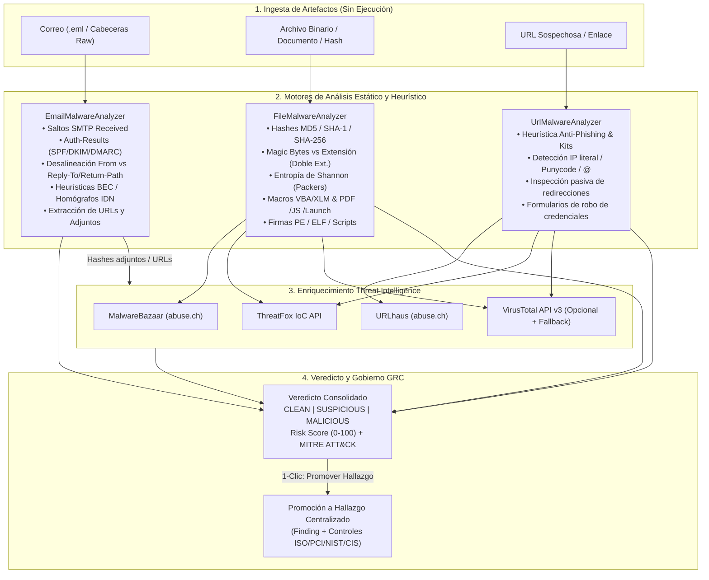

# Laboratorio de Análisis de Malware, Phishing y Amenazas (`Threat & Malware Lab`)

> **Módulo**: `backend/src/threat-lab/` | `frontend/src/pages/ThreatLabPage.tsx`  
> **Dominio Funcional**: 3. Laboratorio de Malware y Amenazas  
> **Fuentes de Inteligencia ($0 USD / Open Threat Feeds)**: abuse.ch (MalwareBazaar, URLhaus, ThreatFox) + VirusTotal Community API v3 + Analizadores Estáticos Locales

---

## 1. Propósito y Alcance del Módulo

Las pequeñas y medianas empresas (PyMEs) y los equipos SecOps enfrentan diariamente vectores de ataque que no ingresan únicamente por puertos abiertos, sino a través de **correos electrónicos de suplantación (Phishing / BEC)**, **archivos adjuntos maliciosos (facturas falsas, documentos con macros, ejecutables camuflados)** y **enlaces de robo de credenciales o descarga de ransomware**.

El **Laboratorio de Análisis de Malware y Amenazas (`Threat & Malware Lab`)** dota al SSPM de una estación de triaje forense no intrusiva y aislada en memoria que permite evaluar bajo demanda:

1. **Correos Electrónicos (`.eml` y Cabeceras Raw SMTP/MIME)**.
2. **Archivos Sospechosos y Hashes Criptográficos (`MD5`, `SHA-1`, `SHA-256`)**.
3. **URLs y Enlaces Sospechosos (Phishing, C2 y Distribución de Malware)**.

Además, todo artefacto confirmado como `MALICIOUS` o `SUSPICIOUS` puede **promoverse en un clic a un Hallazgo de Seguridad formal** dentro del **Centro Maestro de Hallazgos (`/findings`)**, vinculándose con un activo de la organización y mapeándose automáticamente a los controles normativos de **ISO/IEC 27001:2022**, **PCI-DSS v4.0**, **NIST CSF 2.0**, **CIS Controls v8** y **SOC 2**.

---

## 2. Arquitectura y Flujo de Triaje Forense



---

## 3. Especificación de los 3 Motores de Análisis

### 3.1 Motor de Análisis de Correos (`email-malware.analyzer.ts`)

Analiza archivos `.eml` completos o bloques de cabeceras RFC 5322 pegados directamente por el analista:

| Vector Evaluado | Inspección Técnica | Indicador / Regla Generada | Técnica MITRE ATT&CK |
|---|---|---|---|
| **Autenticación de Remitente** | Parseo de `Authentication-Results`, `Received-SPF` y `DKIM-Signature` (`pass`, `fail`, `softfail`, `none`). | Fallo de autenticación SPF/DKIM/DMARC en el mensaje recibido. | `T1566.001` / `T1566.002` |
| **Suplantación de Identidad (Display Name & Reply-To Mismatch)** | Comparación entre el dominio del encabezado `From`, el `Return-Path` (sobre SMTP) y el `Reply-To` (desvío de respuesta). | Discrepancia entre remitente visible y buzón de respuesta (*BEC / CEO Fraud*). | `T1656` (Impersonation) |
| **Dominios Homógrafos / Typosquatting** | Detección de codificación Punycode (`xn--`), sustitución de caracteres (`rn` por `m`, `0` por `o`, `1` por `l`) frente a dominios corporativos o bancarios. | Dominio remitente con alta similitud visual o internacionalización engañosa. | `T1583.001` (Domains) |
| **Trazabilidad de Saltos SMTP (`Received`)** | Extracción cronológica de cada MTA en la cadena `Received: from ... by ...`, identificando IPs públicas de origen y retrasos anómalos. | Cadena de relés de correo e IP originadora expuesta para correlación. | `T1586.002` (Email Accounts) |
| **Ingeniería Social / BEC Urgency** | Detección heurística en asunto y cuerpo de patrones de fraude financiero, cambio urgente de cuenta bancaria, facturas vencidas o reseteo de credenciales/MFA. | Lenguaje de coacción o urgencia ejecutiva/financiera detectado. | `T1566` (Phishing) |
| **Extracción de URLs y Adjuntos MIME** | Extracción de todos los hipervínculos (`href`), comparación de texto ancla vs destino real, y cálculo de SHA-256 de partes MIME adjuntas (`Content-Disposition: attachment`). | Lista de URLs y adjuntos encadenados automáticamente a los motores de URL y Archivos. | `T1204.001` / `T1204.002` |

---

### 3.2 Motor de Análisis de Archivos y Hashes (`file-malware.analyzer.ts`)

Evalúa archivos subidos (en memoria, sin escribirse como ejecutables en disco ni ejecutarse jamás) o consultas directas por hash (`MD5`, `SHA-1`, `SHA-256`):

1. **Huellas Criptográficas**:
   - Cálculo instantáneo de `MD5`, `SHA-1` y `SHA-256`.
2. **Validación de Firma Mágica (*Magic Bytes*) vs Extensión**:
   - Contrasta los primeros bytes del archivo (`4D 5A` para PE/EXE, `7F 45 4C 46` para ELF, `25 50 44 46` para PDF, `50 4B 03 04` para ZIP/OOXML, `D0 CF 11 E0` para OLE2) contra la extensión del nombre de archivo.
   - Detecta **doble extensión engañosa** (p. ej. `Factura_Octubre.pdf.exe`, `Comprobante.docx.scr`, `orden_compra.jpg.js`) y caracteres Unicode RLO (*Right-to-Left Override* `\u202E`).
3. **Cálculo de Entropía de Shannon ($0.0 - 8.0$ bits/byte)**:
   - Un valor de entropía $> 7.2$ en un binario PE o script alerta sobre empaquetado (*packing* con UPX/Themida) o payload cifrado/ofuscado.
4. **Inspección Estática de Documentos y Scripts**:
   - **Documentos Office (OLE2 / OOXML)**: Detección de flujos `vbaProject.bin`, `macros/`, `AutoOpen`, `Document_Open`, `Workbook_Open`, `Shell`, `WScript.Shell`, `PowerShell` y hojas macro Excel 4.0 (XLM).
   - **Documentos PDF**: Búsqueda de diccionarios y acciones riesgosas (`/JS`, `/JavaScript`, `/Launch`, `/OpenAction`, `/AA`, `/EmbeddedFiles`, `/RichMedia`, `/URI`).
   - **Scripts y Lotes (`.ps1`, `.vbs`, `.js`, `.bat`, `.cmd`, `.hta`)**: Detección de `-EncodedCommand`, `Invoke-Expression` (`IEX`), `DownloadString`, `FromBase64String`, `eval()`, `ActiveXObject`, `mshta` y `certutil -urlcache`.
5. **Consulta a Feeds de Threat Intelligence**:
   - **MalwareBazaar (`https://mb-api.abuse.ch/api/v1/`)**: Consulta `get_info` por hash SHA-256 para recuperar familia de malware (p. ej. *AgentTesla*, *RedLine*, *Remcos*, *AsyncRAT*, *LockBit*), etiquetas y fecha de primera aparición.
   - **ThreatFox (`https://threatfox-api.abuse.ch/api/v1/`)**: Búsqueda de IoCs asociados al hash.
   - **VirusTotal API v3 (`/api/v3/files/{sha256}`)**: Recuento de motores antivirus que detectan el hash (`malicious`, `suspicious`, `harmless`).

---

### 3.3 Motor de Análisis de URLs Sospechosas (`url-malware.analyzer.ts`)

Evalúa enlaces sospechosos reportados por usuarios o extraídos de correos y comercios:

1. **Análisis Léxico y Estructural de la URL**:
   - Uso de dirección IP literal en lugar de dominio (`http://198.51.100.45/login`).
   - Uso del carácter `@` en la autoridad de la URL para engañar al usuario (`https://empresa.com@sitio-malicioso.ru`).
   - Dominios con Punycode (`xn--`), exceso de subdominios o longitud anómala ($> 120$ caracteres).
   - Uso de TLDs de alto abuso en campañas de phishing (`.xyz`, `.top`, `.click`, `.zip`, `.mov`, `.icu`, `.ru`, `.tk`) combinados con palabras sensibles (`login`, `secure`, `verify`, `update`, `account`, `banca`, `factura`, `mfa`, `office365`).
   - Esquema inseguro (`http://`) en páginas que solicitan credenciales o pagos.
2. **Inspección Pasiva Controlada (Opcional y Protegida contra SSRF)**:
   - Validación estricta mediante el guardián anti-SSRF del sistema (bloqueo de IPs privadas RFC 1918, loopback y metadata cloud `169.254.169.254`).
   - Seguimiento acotado de redirecciones (`301`/`302`/`307`) y detección en el HTML de formularios de captura de contraseñas (`<input type="password">`), iframes ocultos o kits de phishing.
3. **Cruce con Inteligencia de Amenazas Externa**:
   - **URLhaus (`https://urlhaus-api.abuse.ch/v1/url/` y `/v1/host/`)**: Verifica si la URL o su host distribuyen malware activamente.
   - **ThreatFox (`https://threatfox-api.abuse.ch/api/v1/`)**: Verifica si el host/URL actúa como servidor Comando y Control (C2).
   - **VirusTotal API v3 (`/api/v3/urls/{id}`)**: Veredicto multimotor sobre la URL.

---

## 4. Modelo de Datos (`MalwareAnalysis`)

```prisma
enum MalwareArtifactType {
  EMAIL
  FILE
  URL
}

enum MalwareVerdict {
  CLEAN
  SUSPICIOUS
  MALICIOUS
}

model MalwareAnalysis {
  id                String              @id @default(uuid()) @db.Uuid
  organizationId    String              @map("organization_id") @db.Uuid
  assetId           String?             @map("asset_id") @db.Uuid
  requestedById     String?             @map("requested_by_id") @db.Uuid
  artifactType      MalwareArtifactType @map("artifact_type")
  /// Nombre del archivo, asunto del correo o URL analizada
  artifactName      String              @map("artifact_name") @db.VarChar(500)
  /// Identificador único o hash principal (SHA-256 para archivos/correos o URL canónica)
  artifactIdentifier String             @map("artifact_identifier") @db.VarChar(500)
  md5               String?             @db.VarChar(32)
  sha1              String?             @db.VarChar(40)
  sha256            String?             @db.VarChar(64)
  mimeType          String?             @map("mime_type") @db.VarChar(120)
  sizeBytes         Int?                @map("size_bytes")
  verdict           MalwareVerdict
  /// Puntuación de riesgo de la amenaza (0 = limpio, 100 = malicioso confirmado)
  riskScore         Int                 @default(0) @map("risk_score")
  severity          FindingSeverity     @default(INFO)
  malwareFamily     String?             @map("malware_family") @db.VarChar(120)
  summary           String
  /// Resultados detallados del análisis estático (cabeceras SMTP, entropía, macros, heurísticas)
  staticAnalysis    Json                @map("static_analysis")
  /// Respuestas consolidadas de MalwareBazaar, URLhaus, ThreatFox y VirusTotal
  threatIntel       Json                @map("threat_intel")
  /// Indicadores detectados: [{ code, title, severity, category, mitreTechnique, description }]
  indicators        Json
  /// IoCs extraídos (URLs, IPs, dominios, hashes de adjuntos)
  extractedIocs     Json?               @map("extracted_iocs")
  /// Si el análisis se promovió al Centro de Hallazgos, referencia al Finding creado
  promotedFindingId String?             @map("promoted_finding_id") @db.Uuid
  createdAt         DateTime            @default(now()) @map("created_at") @db.Timestamptz(6)

  organization Organization @relation(fields: [organizationId], references: [id], onDelete: Cascade)
  asset        Asset?       @relation(fields: [assetId], references: [id], onDelete: SetNull)
  requestedBy  User?        @relation(fields: [requestedById], references: [id], onDelete: SetNull)
  finding      Finding?     @relation(fields: [promotedFindingId], references: [id], onDelete: SetNull)

  @@index([organizationId, createdAt])
  @@index([organizationId, artifactType, verdict])
  @@index([sha256])
  @@map("malware_analyses")
}
```

---

## 5. Reglas de Catálogo y Mapeo Normativo Asociado

Cuando un análisis del Laboratorio se promueve al **Centro Maestro de Hallazgos**, se registra bajo la categoría `MALWARE_THREAT` utilizando una de las siguientes reglas canónicas:

| `ruleId` | Título | Severidad Base | Controles Normativos Vinculados |
|---|---|---|---|
| `THREAT-EMAIL-PHISHING-BEC` | Correo malicioso de Phishing / Suplantación Ejecutiva (BEC) detectado | `HIGH` / `CRITICAL` | • **ISO 27001:2022**: A.8.7 (Protección contra malware), A.6.3 (Concientización)<br>• **PCI-DSS v4.0**: Req. 5.4 (Mecanismos anti-phishing)<br>• **NIST CSF 2.0**: DE.CM-01, PR.AT-01<br>• **CIS Controls v8**: Control 9 y Control 10 |
| `THREAT-FILE-MALICIOUS-HASH` | Archivo o artefacto con firma confirmada de Malware en Threat Intelligence | `CRITICAL` | • **ISO 27001:2022**: A.8.7 (Protección contra malware)<br>• **PCI-DSS v4.0**: Req. 5.2, 5.3 (Detección y prevención de malware)<br>• **NIST CSF 2.0**: DE.CM-09, RS.AN-03<br>• **CIS Controls v8**: Control 10 (Defensas contra malware) |
| `THREAT-FILE-SUSPICIOUS-MACRO-PDF` | Documento o ejecutable con macros activas, scripts embebidos o doble extensión | `HIGH` | • **ISO 27001:2022**: A.8.7, A.8.9<br>• **PCI-DSS v4.0**: Req. 5.2<br>• **NIST CSF 2.0**: DE.CM-09<br>• **CIS Controls v8**: Control 10 y Control 2 |
| `THREAT-URL-MALICIOUS-PHISHING` | URL maliciosa de distribución de malware, C2 o captura de credenciales | `HIGH` / `CRITICAL` | • **ISO 27001:2022**: A.8.23 (Filtrado web), A.8.7<br>• **PCI-DSS v4.0**: Req. 5.4<br>• **NIST CSF 2.0**: DE.CM-01<br>• **CIS Controls v8**: Control 9 (Seguridad en navegadores y correo) |

---

## 6. Contratos de API REST (`/api/v1/threat-lab`)

| Método | Ruta | Rol Mínimo | Descripción |
|---|---|---|---|
| `POST` | `/api/v1/threat-lab/analyze/email` | `ANALYST` | Analiza un correo electrónico completo (contenido `.eml` o cabeceras raw + cuerpo opcional), extrae URLs/adjuntos y retorna el veredicto forense. |
| `POST` | `/api/v1/threat-lab/analyze/file` | `ANALYST` | Analiza un archivo (buffer en base64 o metadatos + contenido) o un hash (`MD5`/`SHA-1`/`SHA-256`) contra el motor estático y feeds externos. |
| `POST` | `/api/v1/threat-lab/analyze/url` | `ANALYST` | Analiza una URL sospechosa mediante heurísticas léxicas, inspección pasiva y consulta a URLhaus/ThreatFox/VirusTotal. |
| `GET` | `/api/v1/threat-lab` | `VIEWER` | Lista el historial paginado de análisis del laboratorio con filtros por `artifactType`, `verdict`, `severity` y búsqueda libre. |
| `GET` | `/api/v1/threat-lab/summary` | `VIEWER` | Devuelve KPIs del laboratorio (total analizados, maliciosos detectados, sospechosos, limpios, familias de malware top y hallazgos promovidos). |
| `GET` | `/api/v1/threat-lab/:id` | `VIEWER` | Obtiene el informe forense completo de un análisis específico. |
| `POST` | `/api/v1/threat-lab/:id/promote-finding` | `ANALYST` | Promueve el análisis a un hallazgo formal en el **Centro Maestro de Hallazgos** vinculado a un activo de la organización. |
