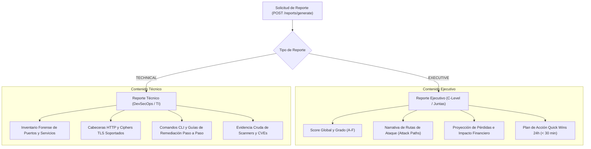

# Módulo de Reportes Ejecutivos/GRC en PDF, Alertas Tempranas y API Pública SIEM/SOAR

> **Sistema de Gestión de Postura de Seguridad (SSPM / EASM / CSPM / GRC & Threat Lab)**  
> Módulos Backend: [`reports/`](file:///home/miguel/Proyectos/Sistema-de-Gestion-de-Postura-de-Seguridad-SSPM/backend/src/reports/), [`alerts/`](file:///home/miguel/Proyectos/Sistema-de-Gestion-de-Postura-de-Seguridad-SSPM/backend/src/alerts/) y [`public-api/`](file:///home/miguel/Proyectos/Sistema-de-Gestion-de-Postura-de-Seguridad-SSPM/backend/src/public-api/)  
> Servicios: [`pdf-renderer.ts`](file:///home/miguel/Proyectos/Sistema-de-Gestion-de-Postura-de-Seguridad-SSPM/backend/src/reports/pdf-renderer.ts), [`alerts.service.ts`](file:///home/miguel/Proyectos/Sistema-de-Gestion-de-Postura-de-Seguridad-SSPM/backend/src/alerts/alerts.service.ts) y [`public-api.service.ts`](file:///home/miguel/Proyectos/Sistema-de-Gestion-de-Postura-de-Seguridad-SSPM/backend/src/public-api/public-api.service.ts)  
> Versión: **3.0.0 (Sprint 23)**

Este documento describe el motor de generación de reportes en formato PDF mediante renderizado vectorial en memoria (incluyendo Matriz GRC, telemetría del Laboratorio de Malware y evolución 360°), el sistema de notificación de alertas tempranas multicanal y la API Pública SIEM/SOAR.

---

## 1. Generador de Reportes PDF en Memoria (`pdf-renderer.ts`)

Para la generación de reportes PDF, la plataforma utiliza **PDFKit** directamente sobre streams en memoria de Node.js, descartando el uso de navegadores headless (como Puppeteer o Chromium). 

### Ventajas de este Enfoque:
- **Consumo de Memoria Reducido:** Genera PDFs completos con menos de 40 MB de RAM, frente a los 400 MB+ que demanda una instancia de Chromium.
- **Tamaño Mínimo del Contenedor Docker:** La imagen de producción no requiere librerías gráficas de Linux (X11, GLib, NSS), reduciendo la superficie de ataque y el tiempo de arranque.
- **Velocidad Extrema:** Compilación de un reporte de 10 páginas en menos de 250 milisegundos.

### Compatibilidad Tipográfica WinAnsi (Latin-1):
Para evitar fallos en tiempo de ejecución o caracteres corruptos en fuentes estándar (Helvetica, Helvetica-Bold), el motor implementa un filtro de sanitización que traduce caracteres UTF-8 complejos (tildes, eñes, comillas tipográficas, guiones largos) a sus equivalentes seguros en WinAnsi.

---

## 2. Tipos de Reportes Disponibles



### 2.1 Reporte Ejecutivo (Executive Summary — GRC + Threat Lab + 360°):
Diseñado para presidentes, directores de finanzas (CFO), CISOs y comités de auditoría:
- Lenguaje centrado en el riesgo de negocio, evitando tecnicismos innecesarios.
- Diagrama visual del Security Score con semáforo de colores y evolución de 30 días.
- **Matriz de Cumplimiento Normativo (GRC):** Tabla ejecutiva con el porcentaje de cumplimiento, controles aprobados y controles en incumplimiento para **ISO 27001, PCI-DSS v4.0, SOC 2, NIST CSF 2.0 y CIS Controls v8**.
- **Laboratorio Forense de Malware, Phishing y Amenazas (Threat Lab):** Resumen de artefactos analizados (`.eml`, archivos y URLs), veredictos maliciosos/sospechosos, amenazas promovidas a hallazgos y tabla de incidentes forenses recientes.
- **Orquestación de Diagnóstico Profundo 360° y Evolución:** Resumen de lotes 360° ejecutados, último perfil corrido y diferencial de postura (delta de puntos, hallazgos remediados y regresiones).
- Detalle de las Rutas de Ataque críticas activas (ej. Fraude Magecart, Suplantación de Marca BEC) y Matriz de Quick Wins 24h (`< 30 min`).

### 2.2 Reporte Técnico (Technical Deep Dive & GRC Controls):
Diseñado para ingenieros de sistemas, analistas SOC, DevSecOps y auditores técnicos:
- Registro exhaustivo de cada puerto abierto (`port`, `protocol`, `service`, `product`, `version`).
- Análisis de ciphers TLS y estado de la cadena de confianza X.509.
- **Taxonomía y Controles GRC por Hallazgo:** Cada vulnerabilidad abierta incluye su identificador `CWE`, técnica `MITRE ATT&CK` y controles normativos impactados (`ISO_27001`, `PCI_DSS`, etc.).
- Snippets de configuración para servidores web (Nginx, Apache), directivas DNS (SPF, DMARC, DKIM) y comandos AWS CLI / Azure CLI / Terraform.

---

## 3. Sistema de Alertas Tempranas Multicanal (`alerts.service.ts`)

El sistema detecta automáticamente desalineaciones de postura críticas al finalizar cualquier escaneo y despacha notificaciones inmediatas.

### 3.1 Disparadores de Alerta en Tiempo Real:
1. **`NEW_OPEN_PORT`:** Alerta inmediata ante cualquier puerto TCP que haya pasado de estado cerrado/filtrado a estado `open` entre dos escaneos consecutivos.
2. **`CRITICAL_FINDING`:** Alerta ante la aparición de una vulnerabilidad de severidad crítica (ej. Magecart en checkout, secreto en JavaScript o CVE explotado activamente).
3. **`CERT_EXPIRING`:** Alerta escalonada cuando el certificado SSL/TLS del activo vencerá en menos de 30 días, 15 días o 7 días.
4. **`NEW_SUBDOMAIN`:** Alerta cuando el módulo EASM descubre un subdominio vivo en Certificate Transparency no inventariado.
5. **`SCORE_ANOMALY`:** Alerta si la calificación de la organización cae más de 10 puntos en un solo escaneo.

---

## 4. Canales de Notificación y Webhooks

Las alertas se envían a través de dos canales principales administrables desde la plataforma:

### 4.1 Correo Electrónico (SMTP):
- Plantillas HTML responsivas y legibles en dispositivos móviles.
- Envío mediante `nodemailer` con cifrado TLS forzado.

### 4.2 Webhooks Salientes (Slack, Discord y JSON Genérico):
- Compatibilidad nativa con el formato de bloques interactivos de **Slack Incoming Webhooks** y **Discord Webhooks**.
- **Firma Criptográfica de Seguridad:**
  Para verificar la autenticidad del webhook, cada petición incluye el encabezado HTTP:
  ```http
  X-SSPM-Signature: sha256=<hmac_hex>
  ```
  Generado mediante HMAC-SHA256 utilizando el `signingSecret` configurado por el usuario en el canal.
- **Resiliencia y Reintentos:**
  - Timeout estricto de 5 segundos por petición HTTP saliente.
  - Cola de reintentos exponencial (hasta 3 intentos) en caso de caída temporal del endpoint receptor.
  - Registro auditable del código de respuesta en el campo `deliveries` de la alerta (`SENT`, `FAILED`).

---

## 5. API Pública SIEM/SOAR (`public-api.controller.ts`)

Para integraciones machine-to-machine con plataformas SIEM/SOAR (Splunk, Microsoft Sentinel, Wazuh, Elastic Security, Datadog), el módulo expone endpoints autenticados mediante cabecera `X-API-Key` y protegidos por scopes:

| Endpoint | Scope Requerido | Formatos | Descripción |
| :--- | :--- | :---: | :--- |
| `GET /api/v1/public/posture` | `read:posture` | `json` | Resumen ejecutivo de Security Score, conteo de activos y hallazgos abiertos |
| `GET /api/v1/public/assets` | `read:assets` | `json`, `ndjson` | Inventario de activos verificados y estado de último escaneo |
| `GET /api/v1/public/findings` | `read:findings` | `json`, `ndjson` | Hallazgos enriquecidos con taxonomía GRC, filtrables por `since`, `severity` y `status` |
| `GET /api/v1/public/alerts` | `read:alerts` | `json`, `ndjson` | Alertas tempranas generadas desde una marca temporal `since` |
| `GET /api/v1/public/attack-paths` | `read:findings` | `json`, `ndjson` | Rutas de ataque (*kill-chains*) activas correlacionadas en la organización |
| `GET /api/v1/public/compliance` | `read:findings` | `json` | Estado global de cumplimiento GRC o detalle de controles de un marco (`?framework=PCI_DSS`) |
| `GET /api/v1/public/threat-lab` | `read:findings` | `json`, `ndjson` | Análisis forenses e IoCs del Laboratorio de Malware y Phishing (`?verdict=MALICIOUS`) |
