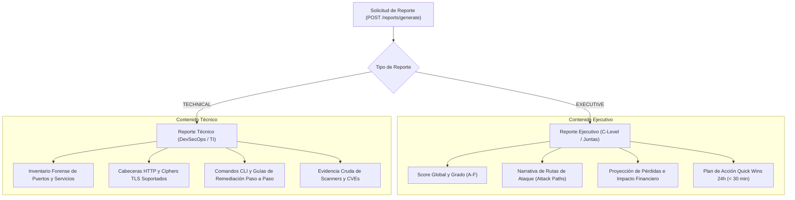

# Módulo de Reportes Ejecutivos en PDF y Alertas Tempranas

> **Sistema de Gestión de Postura de Seguridad (SSPM / EASM / CSPM)**  
> Módulos Backend: [`reports/`](file:///home/miguel/Proyectos/Sistema-de-Gestion-de-Postura-de-Seguridad-SSPM/backend/src/reports/) y [`alerts/`](file:///home/miguel/Proyectos/Sistema-de-Gestion-de-Postura-de-Seguridad-SSPM/backend/src/alerts/)  
> Servicios: [`pdf-renderer.ts`](file:///home/miguel/Proyectos/Sistema-de-Gestion-de-Postura-de-Seguridad-SSPM/backend/src/reports/pdf-renderer.ts) y [`alerts.service.ts`](file:///home/miguel/Proyectos/Sistema-de-Gestion-de-Postura-de-Seguridad-SSPM/backend/src/alerts/alerts.service.ts)  
> Versión: **2.0.0**

Este documento describe el motor de generación de reportes en formato PDF mediante renderizado vectorial en memoria y el sistema de notificación de alertas tempranas multicanal.

---

## 1. Generador de Reportes PDF en Memoria (`pdf-renderer.ts`)

Para la generación de reportes PDF, la plataforma utiliza **PDFKit** directamente sobre streams en memoria de Node.js, descartando el uso de navegadores headless (como Puppeteer o Chromium). 

### Ventajas de este Enfoque:
- **Consumo de Memoria Reducido:** Genera PDFs completos con menos de 40 MB de RAM, frente a los 400 MB+ que demanda una instancia de Chromium.
- **Tamaño Mínimo del Contenedor Docker:** La imagen de producción no requiere librerías gráficas de Linux (X11, GLib, NSS), reduciendo la superficie de ataque y el tiempo de arranque.
- **Velocidad Extrema:** Compilación de un reporte de 10 páginas en menos de 250 milisegundos.

### Compatibilidad Tipográfica WinAnsi (Latin-1):
Para evitar fallos en tiempo de ejecución o caracteres corruptos en fuentes estándar (Helvetica, Helvetica-Bold), el motor implementa un filtro de sanitización que traduce caracteres UTF-8 complejos (tildes, eñes, comillas tipográficas, guiones largos) a sus equivalentes seguros en WinAnsi.

---

## 2. Tipos de Reportes Disponibles



### 2.1 Reporte Ejecutivo (Executive Summary):
Diseñado para presidentes, directores de finanzas (CFO) y comités de auditoría:
- Lenguaje centrado en el riesgo de negocio, evitando tecnicismos innecesarios.
- Diagrama visual del Security Score con semáforo de colores.
- Detalle de las Rutas de Ataque críticas activas (ej. Fraude Magecart, Suplantación de Marca).
- Matriz de Quick Wins destacando cuántos puntos se pueden recuperar en menos de 24 horas con un esfuerzo mínimo de ingeniería.

### 2.2 Reporte Técnico (Technical Deep Dive):
Diseñado para ingenieros de sistemas, analistas SOC y administradores de red:
- Registro exhaustivo de cada puerto abierto (`port`, `protocol`, `service`, `product`, `version`).
- Análisis de ciphers TLS y estado de la cadena de confianza X.509.
- Snippets de configuración para servidores web (Nginx, Apache) y directivas DNS (SPF, DMARC, DKIM).
- Comandos listos para copiar y pegar para mitigación en AWS CLI y Azure CLI.

---

## 3. Sistema de Alertas Tempranas Multicanal (`alerts.service.ts`)

El sistema detecta automáticamente desalineaciones de postura críticas al finalizar cualquier escaneo y despacha notificaciones inmediatas.

### 3.1 Disparadores de Alerta en Tiempo Real:
1. **`NEW_OPEN_PORT`:** Alerta inmediata ante cualquier puerto TCP que haya pasado de estado cerrado/filtrado a estado `open` entre dos escaneos consecutivos.
2. **`CRITICAL_FINDING`:** Alerta ante la aparición de una vulnerabilidad de severidad crítica (ej. Magecart en checkout, secreto en JavaScript o CVE explotado activamente).
3. **`CERT_EXPIRING`:** Alerta escalonada cuando el certificado SSL/TLS del activo vencerá en menos de 30 días, 15 días o 7 días.
4. **`NEW_SUBDOMAIN`:** Alerta cuando el módulo EASM descubre un subdominio vivo en Certificate Transparency no inventariado.
5. **`SCORE_ANOMALY`:** Alerta si la calificación de la organización cae más de 10 puntos en un solo escaneo.

---

## 4. Canales de Notificación y Webhooks

Las alertas se envían a través de dos canales principales administrables desde la plataforma:

### 4.1 Correo Electrónico (SMTP):
- Plantillas HTML responsivas y legibles en dispositivos móviles.
- Envío mediante `nodemailer` con cifrado TLS forzado.

### 4.2 Webhooks Salientes (Slack, Discord y JSON Genérico):
- Compatibilidad nativa con el formato de bloques interactivos de **Slack Incoming Webhooks** y **Discord Webhooks**.
- **Firma Criptográfica de Seguridad:**
  Para verificar la autenticidad del webhook, cada petición incluye el encabezado HTTP:
  ```http
  X-SSPM-Signature: sha256=<hmac_hex>
  ```
  Generado mediante HMAC-SHA256 utilizando el `signingSecret` configurado por el usuario en el canal.
- **Resiliencia y Reintentos:**
  - Timeout estricto de 5 segundos por petición HTTP saliente.
  - Cola de reintentos exponencial (hasta 3 intentos) en caso de caída temporal del endpoint receptor.
  - Registro auditable del código de respuesta en el campo `deliveries` de la alerta (`SENT`, `FAILED`).
