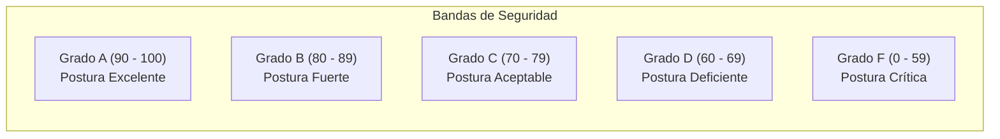

# Módulo de Motor de Riesgo, Security Score y SLAs

> **Sistema de Gestión de Postura de Seguridad (SSPM / EASM / CSPM)**  
> Módulo Backend: [`risk/risk.service.ts`](file:///home/miguel/Proyectos/Sistema-de-Gestion-de-Postura-de-Seguridad-SSPM/backend/src/risk/risk.service.ts) y [`risk/scoring.ts`](file:///home/miguel/Proyectos/Sistema-de-Gestion-de-Postura-de-Seguridad-SSPM/backend/src/risk/scoring.ts)  
> Versión: **2.0.0**

Este documento detalla la formulación matemática determinista del **Security Score**, las penalizaciones ponderadas por criticidad, la escala de calificación en grados y la gestión de acuerdos de nivel de servicio (SLAs) para la mitigación de vulnerabilidades.

---

## 1. Modelo Matemático del Security Score

A diferencia de soluciones comerciales que utilizan modelos probabilísticos opacos o algoritmos de caja negra, el Security Score de la plataforma es **100% determinista, transparente y reproducible**.

### 1.1 Penalizaciones y Topes por Severidad

Cada hallazgo abierto (`OPEN`, `IN_PROGRESS` o `VERIFYING`) resta puntos a la calificación base perfecta (100 puntos) según su nivel de severidad. Para evitar que una gran acumulación de hallazgos menores diluya el puntaje o que una sola categoría distorsione desproporcionadamente la nota, se establecen **topes máximos de deducción** por categoría:

| Severidad del Hallazgo | Deducción por Hallazgo ($w_i$) | Deducción Máxima Permitida ($\text{Cap}_i$) |
| :--- | :---: | :---: |
| **CRITICAL** | **25 puntos** | **60 puntos** |
| **HIGH** | **15 puntos** | **45 puntos** |
| **MEDIUM** | **6 puntos** | **30 puntos** |
| **LOW** | **2 puntos** | **15 puntos** |
| **INFO** | **0 puntos** | **0 puntos** |

### 1.2 Formulación de Cálculo:

1. **Cálculo de penalización por severidad con tope:**
   $$P_{\text{crit}} = \min(60, \; N_{\text{crit}} \times 25)$$
   $$P_{\text{high}} = \min(45, \; N_{\text{high}} \times 15)$$
   $$P_{\text{med}} = \min(30, \; N_{\text{med}} \times 6)$$
   $$P_{\text{low}} = \min(15, \; N_{\text{low}} \times 2)$$

2. **Pérdida Total de Puntuación:**
   $$\text{Pérdida Total} = \min(100, \; P_{\text{crit}} + P_{\text{high}} + P_{\text{med}} + P_{\text{low}})$$

3. **Security Score Final:**
   $$\text{Security Score} = \max(0, \; 100 - \text{Pérdida Total})$$

---

## 2. Escala de Calificación en Grados (Letter Grades)

El puntaje numérico (0 - 100) se traduce directamente a una calificación en letras estandarizada para facilitar la comunicación a nivel de junta directiva y auditorías:

- **Grado A (90 - 100 pts):** Perímetro altamente asegurado. No existen vulnerabilidades críticas ni altas. Cabeceras web, TLS y registros de correo plenamente conformes.
- **Grado B (80 - 89 pts):** Postura sólida con observaciones menores o medias que no comprometen directamente la integridad de datos sensibles.
- **Grado C (70 - 79 pts):** Postura aceptable pero con riesgos latentes (ej. falta de DMARC o directivas CSP permisivas).
- **Grado D (60 - 69 pts):** Postura deficiente. Presencia de al menos una vulnerabilidad alta o acumulación importante de hallazgos medios.
- **Grado F (0 - 59 pts):** Postura crítica. Presencia de vulnerabilidades críticas activas (puertos de base de datos abiertos, fallos Magecart en checkout o CVEs explotados activamente).

---

## 3. Matriz de SLAs de Remediación

Para garantizar que las vulnerabilidades detectadas no permanezcan abiertas indefinidamente, la plataforma asigna una fecha límite perentoria (`dueDate`) al momento de crearse el hallazgo según la matriz de criticidad:

| Severidad | Plazo Máximo de Resolución (SLA) | Impacto de Incumplimiento |
| :--- | :---: | :--- |
| **CRITICAL** | **7 días de calendario** | Notificación de escalamiento inmediata a ADMIN y caída en reporte |
| **HIGH** | **15 días de calendario** | Notificación de alerta preventiva a los 13 días |
| **MEDIUM** | **30 días de calendario** | Revisión periódica en ciclo mensual de seguridad |
| **LOW** | **60 días de calendario** | Planificación en backlog de mantenimiento regular |

### Estados del SLA:
- **`ON_TRACK`:** El hallazgo está abierto y el tiempo transcurrido es menor al 80% del plazo total.
- **`APPROACHING`:** Faltan menos de 48 horas para alcanzar la fecha límite de resolución.
- **`OVERDUE`:** La fecha `dueDate` ha sido superada sin que el hallazgo se haya marcado como `RESOLVED`, `ACCEPTED` o `FALSE_POSITIVE`.

---

## 4. Instantáneas Históricas de Riesgo (`RiskScore`)

Cada vez que ocurre un evento significativo de postura:
1. Finalización de un escaneo (`SCAN_COMPLETED`).
2. Triage o cambio de estado de un hallazgo (`FINDING_REVIEWED`).
3. Alta o desactivación de un activo (`ASSET_CHANGED`).

El sistema genera una fila en la tabla `risk_scores` que almacena:
- `score` y `grade`.
- Recuento detallado de hallazgos abiertos por severidad.
- Objeto JSON `breakdown` con los factores exactos del cálculo.
- Timestamp ISO 8601.

Esto permite al frontend generar gráficas históricas de evolución temporal que muestran visualmente cómo las inversiones de seguridad de la empresa se traducen en un incremento sostenido de la calificación.
