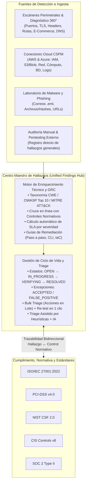

# Centro Maestro de Gestión de Hallazgos, Cumplimiento y Gobierno Normativo (`Unified Findings & GRC Hub`)

> **Módulos**: `backend/src/findings/` | `backend/src/compliance/` | `frontend/src/pages/FindingsPage.tsx` | `frontend/src/pages/CompliancePage.tsx`  
> **Dominio Funcional**: 4. Hallazgos, Riesgo y Cumplimiento (GRC)

---

## 1. Visión Arquitectónica: Centralización de Hallazgos y Normativa

A medida que el SSPM creció para abarcar **auditoría perimetral (EASM)**, **comercio electrónico profundo (Diagnóstico 360°)**, **postura multi-nube (CSPM AWS/Azure)** y el **Laboratorio de Malware y Amenazas (`Threat Lab`)**, surgió la necesidad de contar con un **Centro Maestro de Hallazgos de Seguridad y Gobierno Normativo (GRC Hub)** que actúe como la **única fuente de verdad (Single Source of Truth)** para todos los riesgos técnicos y regulatorios de la organización.



---

## 2. Ficha Integral del Hallazgo (Campos Completos)

Cada hallazgo en el Centro Maestro expone una **ficha técnica, operativa y normativa completa**, estructurada en 5 bloques de información:

### 2.1 Bloque de Identificación y Origen (`Identity & Source`)
| Campo | Tipo | Descripción |
|---|---|---|
| `id` | `UUID` | Identificador único del hallazgo en la plataforma. |
| `fingerprint` | `SHA-256` | Huella determinista `sha256(ruleId + location)` para deduplicación automática y preservación de historial. |
| `sourceType` | `Enum` | Origen del hallazgo: `PERIMETER_SCAN`, `CLOUD_CSPM`, `THREAT_MALWARE_LAB` o `MANUAL_AUDIT`. |
| `ruleId` | `String` | Código canónico de la regla (p. ej. `TLS-WEAK-CIPHER`, `CSPM-AWS-S3-PUBLIC-READ`, `THREAT-EMAIL-PHISHING-BEC`, `MANUAL-PENTEST-001`). |
| `category` | `FindingCategory` | Familia técnica (`EXPOSED_SERVICE`, `HTTP_HEADERS`, `TLS_CERTIFICATE`, `SENSITIVE_PATH`, `VULNERABLE_SOFTWARE`, `EMAIL_SECURITY`, `CLOUD_IAM`, `CLOUD_STORAGE`, `CLOUD_NETWORK`, `CLOUD_COMPUTE`, `CLOUD_DATABASE`, `CLOUD_LOGGING`, `MALWARE_THREAT`). |
| `title` / `description` | `String` | Título ejecutivo y explicación técnica detallada de la vulnerabilidad o brecha. |

### 2.2 Bloque de Clasificación de Riesgo y Estándares de Seguridad (`Security Taxonomy`)
| Campo | Tipo | Descripción |
|---|---|---|
| `severity` | `FindingSeverity` | `CRITICAL`, `HIGH`, `MEDIUM`, `LOW`, `INFO`. |
| `cvssScore` | `Decimal(3,1)` | Puntuación base CVSS v3.1 (0.0 a 10.0). |
| `cweId` | `String` | Debilidad asociada del catálogo MITRE CWE (p. ej. `CWE-319: Cleartext Transmission of Sensitive Information`, `CWE-284: Improper Access Control`). |
| `owaspCategory` | `String` | Categoría OWASP Top 10:2021 / OWASP API Security Top 10:2023 (p. ej. `A02:2021-Cryptographic Failures`, `A05:2021-Security Misconfiguration`). |
| `mitreAttackTechnique` | `String` | Táctica y técnica MITRE ATT&CK (p. ej. `T1190 - Exploit Public-Facing Application`, `T1566 - Phishing`). |
| `cveIds` / `isKev` / `epssScore` | `Array / Boolean / Number` | Identificadores CVE asociados, indicador de explotación activa en **CISA KEV** y probabilidad de explotación **FIRST EPSS**. |

### 2.3 Bloque de Normativa, Cumplimiento y Estándares (`Compliance & GRC Mapping`)
Cada hallazgo incluye de forma nativa el arreglo `complianceControls`, permitiendo filtrar y auditar hallazgos directamente por norma o control:

```json
{
  "complianceControls": [
    {
      "framework": "ISO_27001",
      "frameworkName": "ISO/IEC 27001:2022",
      "code": "A.8.24",
      "title": "Uso de la criptografía",
      "domain": "Controles Tecnológicos"
    },
    {
      "framework": "PCI_DSS",
      "frameworkName": "PCI-DSS v4.0",
      "code": "4.2.1",
      "title": "Criptografía robusta durante la transmisión en redes abiertas",
      "domain": "Protección de Datos con Criptografía"
    }
  ]
}
```

### 2.4 Bloque de Contexto del Activo y Evidencia Forense (`Asset & Evidence Context`)
| Campo | Tipo | Descripción |
|---|---|---|
| `asset` | `Object` | Activo afectado (`id`, `type`, `value`, `name`, `criticality`, `tags`). |
| `location` | `String` | Ubicación exacta (`tcp/443`, `https://tienda.com/.env`, `arn:aws:s3:::bucket-prod`, `sha256:e3b0c44...`). |
| `cloudAccount` / `cloudResource` | `Object?` | Cuenta AWS/Azure y recurso nativo afectado cuando el origen es CSPM. |
| `evidence` | `JSONB` | Evidencia verificable recolectada por el escáner o analista (banners, certificados, cabeceras, configuración JSON, veredicto de malware). |

### 2.5 Bloque de Gobierno, SLA y Remediación Accionable (`Lifecycle, SLA & Remediation`)
| Campo | Tipo | Descripción |
|---|---|---|
| `status` | `FindingStatus` | `OPEN`, `IN_PROGRESS`, `VERIFYING`, `RESOLVED`, `ACCEPTED`, `FALSE_POSITIVE`. |
| `assignedTo` | `User?` | Analista o ingeniero responsable de ejecutar la remediación. |
| `dueDate` & `sla` | `DateTime` & `FindingSla` | Fecha límite de remediación y estado del reloj SLA (`OVERDUE`, `APPROACHING`, `ON_TRACK`, `RESOLVED`, `NO_SLA`) con horas restantes. |
| `remediationGuide` | `RemediationGuide` | Esfuerzo estimado (`FAST` < 30m, `MEDIUM` < 2h, `HIGH` > 4h), impacto esperado en el *Security Score* y pasos técnicos numerados. |
| `remediationCli` / `remediationIac` | `String?` | Comandos listos para ejecutar (AWS CLI / Azure CLI / Nginx / OpenSSL) y bloques de código Terraform / Bicep. |
| `remediationNote` / `reviewNote` | `String?` | Bitácora técnica de mitigación o justificación formal de aceptación de riesgo / falso positivo. |

---

## 3. Flujos Operativos del Centro Maestro de Hallazgos

### 3.1 Registro de Hallazgos Manuales / Generales (`POST /api/v1/findings/manual`)
Permite que los administradores y analistas centralicen en el mismo tablero los hallazgos detectados fuera de los escáneres automáticos (por ejemplo: **pentesting externo**, **auditorías de código SAST/DAST**, **revisiones de arquitectura** o **auditorías internas ISO 27001 / PCI-DSS**):
- Selección del activo afectado, categoría, severidad, puntuación CVSS, CWE, categoría OWASP, técnica MITRE ATT&CK, controles normativos aplicables, ubicación, evidencia estructurada, recomendación, responsable y fecha límite SLA.
- Impacta automáticamente el *Security Score* del activo y de la organización, así como el porcentaje de cumplimiento normativo en `/compliance`.

### 3.2 Triage Masivo en Lote (`PATCH /api/v1/findings/bulk`)
Permite seleccionar múltiples hallazgos simultáneamente en la tabla para:
- Cambiar su estado (`IN_PROGRESS`, `VERIFYING`, `ACCEPTED`, `FALSE_POSITIVE`, `OPEN`).
- Asignar o reasignar un responsable (`assignedToId`).
- Fijar una fecha objetivo de remediación (`dueDate`).
- Añadir una nota de remediación o revisión unificada, registrando la trazabilidad en el `AuditLog` y recalculando el *Security Score* en una sola operación.

### 3.3 Re-verificación Puntual en 1 Clic (`POST /api/v1/findings/:id/retest`)
Lanza una sonda dirigida exclusivamente al vector y ubicación del hallazgo (puerto TCP, apretón de manos TLS, cabeceras HTTP, ruta sensible o registro DNS) para confirmar en segundos si la corrección aplicada por el equipo técnico resolvió la vulnerabilidad.
