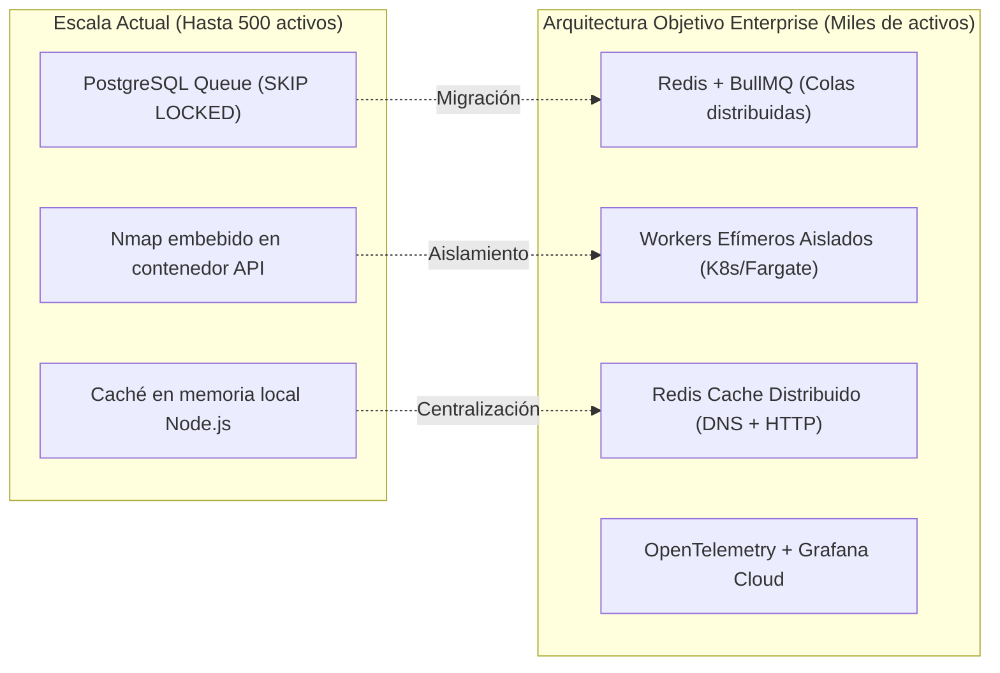
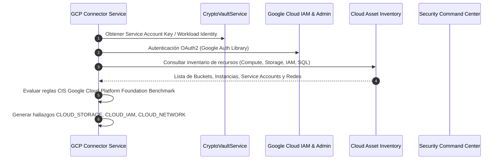
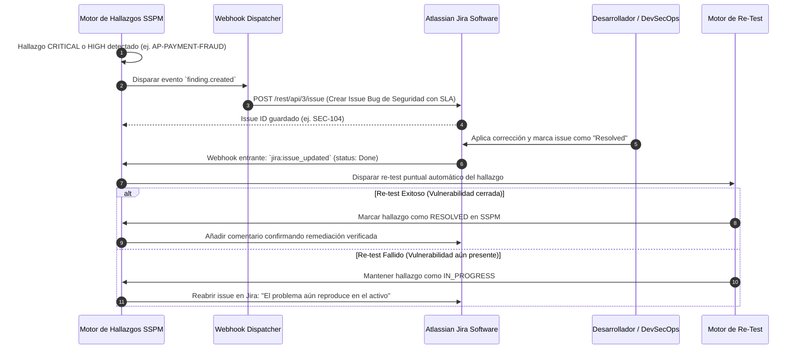
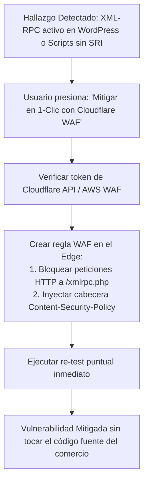
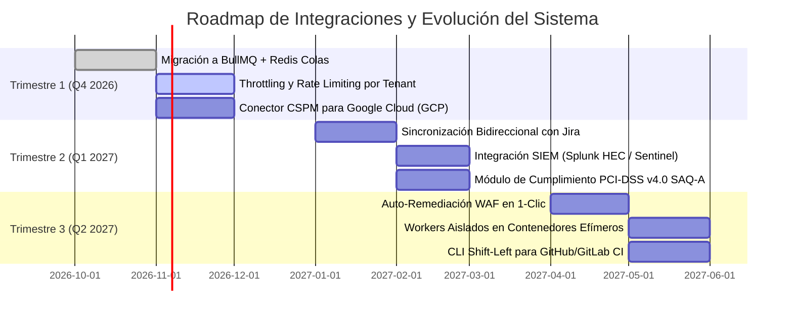

# Pendientes, Deuda Técnica, Backlog y Futuras Integraciones Estratégicas

> **Plataforma de Gestión de Postura de Seguridad (SSPM / EASM / CSPM)**  
> Versión del Documento: **2.0.0**  
> Fecha: **Octubre 2026**  
> Estado: **Aprobado para Planificación de Sprints 14+**

---

## 1. Resumen Ejecutivo del Estado del Producto

Con la culminación de la **Épica Macro #110** (Pilar 1: Escaneo Profundo y E-Commerce, Pilar 2: Orquestador 360° y Diff de Postura, y Pilar 3: Correlación de Rutas de Ataque y Quick Wins), la plataforma ha alcanzado madurez funcional completa en detección perimetral, auditoría web de comercios electrónicos, inventario CSPM multicloud (AWS & Azure) y generación de reportes ejecutivos con impacto de negocio.

Para la siguiente etapa de evolución comercial y tecnológica (**SaaS Enterprise & Escala Global**), este documento define la **deuda técnica a sanear**, los **pendientes operacionales** y la arquitectura de las **6 integraciones estratégicas** que posicionarán el sistema a la vanguardia frente a soluciones como Wiz, CyCognito o Qualys.

---

## 2. Matriz de Deuda Técnica y Mejoras Arquitectónicas



| Componente | Situación Actual | Riesgo / Limitación | Solución Técnica Planificada | Prioridad |
| :--- | :--- | :--- | :--- | :---: |
| **Cola de Escaneos** | Implementada sobre PostgreSQL mediante `FOR UPDATE SKIP LOCKED`. | Aumento de contención en base de datos si se encolan más de 500 escaneos concurrentes. | Migrar la orquestación de colas a **Redis con BullMQ**, manteniendo PostgreSQL únicamente para persistencia del estado final. | **Alta** |
| **Aislamiento de Workers** | Nmap y los analizadores corren en el mismo contenedor o proceso que la API. | Consumo compartido de CPU y memoria entre peticiones REST de usuarios y escaneos pesados. | Desacoplar el servicio `ScanWorkerService` en **Workers efímeros independientes** (ej. AWS ECS Fargate Tasks o Kubernetes Jobs) que escalen horizontalmente según la demanda de la cola. | **Alta** |
| **Caché de Consultas DNS / HTTP** | Cada analizador realiza peticiones directas hacia los servidores DNS autoritativos y endpoints web. | Posible lentitud por consultas redundantes al mismo dominio en escaneos simultáneos. | Implementar un pool de resolución DNS con caché compartida en Redis (TTL 5 min) para registros MX, TXT (SPF/DMARC/BIMI) y NS. | **Media** |
| **Observabilidad y Métricas** | Logs estructurados mediante NestJS Logger con exportación estándar a stdout. | Dificultad para rastrear latencias de red en cada etapa de escaneo y consumo de recursos por tenant. | Instrumentar el backend con **OpenTelemetry SDK**, exportando trazas distribuidas y métricas Prometheus hacia Grafana / Datadog. | **Media** |
| **Rate Limiting por Tenant** | Rate limiting global basado en IP (`@nestjs/throttler`). | Un tenant con múltiples usuarios o escaneos automáticos masivos puede consumir la cuota de otros tenants. | Implementar Throttling jerárquico: Cuota por Organización (`orgId`) + Cuota por Token/Usuario, configurable según el plan de suscripción contratado. | **Media** |

---

## 3. Futuras Integraciones Estratégicas

### 3.1 Integración 1: Conector CSPM para Google Cloud Platform (GCP)

**Objetivo:** Extender la postura cloud multicloud actual (AWS y Azure) hacia GCP, cubriendo la tríada completa de los proveedores de nube pública más utilizados por comercios y startups.



**Reglas de Postura GCP a Incorporar:**
1. `GCP-IAM-SERVICE-ACCOUNT-ADMIN`: Cuentas de servicio con privilegios de Owner o Editor asignados a nivel de proyecto.
2. `GCP-STORAGE-BUCKET-PUBLIC`: Buckets de Cloud Storage con política de acceso público `allUsers` o `allAuthenticatedUsers`.
3. `GCP-COMPUTE-SSH-OPEN`: Instancias de Compute Engine con reglas de firewall permitiendo puerto 22 o 3389 desde `0.0.0.0/0`.
4. `GCP-SQL-PUBLIC-IP`: Instancias de Cloud SQL (PostgreSQL/MySQL) con IP pública habilitada y sin red autorizada estricta.
5. `GCP-LOGGING-SINKS-DISABLED`: Ausencia de exportación continua de Cloud Audit Logs hacia BigQuery o Cloud Storage para retención forense.

---

### 3.2 Integración 2: Sincronización Bidireccional con Herramientas ITSM (Jira & ServiceNow)

**Objetivo:** Permitir que los equipos de desarrollo y operaciones mitiguen vulnerabilidades dentro de su flujo diario de tickets, cerrando automáticamente el hallazgo en SSPM cuando el ticket de Jira se resuelva.



---

### 3.3 Integración 3: Emisión de Alertas hacia SIEM / SOC (Splunk HEC, Sentinel y Security Hub)

**Objetivo:** Conectar SSPM con las herramientas centrales de monitoreo de incidentes de los centros de operaciones de seguridad (SOC).

- **Splunk HTTP Event Collector (HEC)**: Envío de eventos en tiempo real en formato JSON estructurado con metadatos de tenant, severidad, CVSS y categoría.
- **Microsoft Sentinel / Azure Log Analytics**: Publicación de alertas mediante Data Collector API para correlación con Microsoft Defender.
- **AWS Security Hub**: Importación de hallazgos mediante formato estándar ASFF (AWS Security Finding Format).
- **Formato Syslog CEF (Common Event Format)**:
  ```text
  CEF:0|SecAudit|SSPM|2.0|WEB-SRI-MISSING|Script externo sin integridad SRI|8|src=198.51.100.10 cs1=store.example.com cs2=PCI-DSS-v4
  ```

---

### 3.4 Integración 4: Auto-Remediación Activa y Playbooks de Mitigación 1-Clic

**Objetivo:** Permitir a los comercios no técnicos resolver vulnerabilidades críticas con solo presionar un botón, aplicando protecciones perimetrales en tiempo récord.



**Playbooks de Mitigación Planificados:**
1. **Playbook Anti-Magecart (Cloudflare / CloudFront)**: Inyección automática de cabeceras CSP (`script-src 'self' ...`) en el CDN para impedir ejecución de scripts externos no autorizados.
2. **Playbook Bloqueo de Fuerza Bruta XML-RPC**: Regla WAF perimetral que devuelve HTTP 403 a peticiones dirigidas a `xmlrpc.php`.
3. **Playbook Firewall de Base de Datos Cloud (AWS SG / Azure NSG)**: Eliminación automática de la regla `0.0.0.0/0` en puertos 3306, 5432 o 1433, restringiéndola a la IP del Bastion Host o subred privada.

---

### 3.5 Integración 5: Módulo de Atestación de Cumplimiento E-Commerce (PCI-DSS v4.0 SAQ-A / SAQ-D)

**Objetivo:** Automatizar la generación de reportes oficiales de cumplimiento que los bancos adquirentes y pasarelas de pago (Visa, Mastercard, Stripe, Redeban, PayU) exigen a las tiendas online.

- **Mapeo Automático de Evidencias**:
  - Requisito 6.4.3: Evidencia de escaneo de Subresource Integrity (SRI) y listado de scripts de terceros auditados.
  - Requisito 11.6.1: Detección de mecanismos anti-manipulación de encabezados y páginas de pago.
  - Requisito 11.3.1.2: Evidencia de escaneos de vulnerabilidades externas realizados periódicamente.
- **Entregable**: Generador de **Cuestionario de Autoevaluación (Self-Assessment Questionnaire - SAQ-A)** en PDF con firma digital y sello temporal (*timestamping* criptográfico).

---

### 3.6 Integración 6: Shift-Left Security — Plugin para Pipelines CI/CD (GitHub Actions / GitLab CI)

**Objetivo:** Prevenir que las vulnerabilidades lleguen a producción auditando el código y los artefactos de compilación durante el despliegue del comercio.

- **Herramienta**: CLI ligero empaquetado en binario Go o script Node (`sspm-cli`).
- **Puntos de Control**:
  - Analizar el directorio de salida `dist/` o `build/` antes del despliegue.
  - Bloquear el pipeline con código de salida `exit 1` si:
    1. Se detectan mapas de código fuente `.js.map` destinados al entorno de producción.
    2. Se detectan llaves privadas o secretos de pasarelas de pago en los bundles minificados.
    3. Faltan hashes de integridad en las etiquetas `<script>` del frontend.

---

## 4. Hoja de Ruta Estratégica Trimestral (Roadmap 2026 - 2027)



### Hitos Clave por Trimestre

#### **Trimestre 1 (Q4 2026) — Robustecimiento de Infraestructura y Cobertura Cloud:**
- [ ] Implementar colas distribuidas con **Redis y BullMQ** para escalar a 10,000 escaneos diarios sin degradación de base de datos.
- [ ] Desarrollar conector nativo de **GCP CSPM** (Cloud Storage, IAM, Compute, Cloud SQL).
- [ ] Sistema de cuotas y Throttling por plan de suscripción del comercio.

#### **Trimestre 2 (Q1 2027) — Ecosistema Enterprise e Integraciones ITSM:**
- [ ] Conector bidireccional con **Atlassian Jira Software** y **ServiceNow ITOM**.
- [ ] Transmisión de alertas en tiempo real hacia **Splunk HEC** y **Microsoft Sentinel**.
- [ ] Generador oficial de reportes **PCI-DSS v4.0 SAQ-A** para pasarelas de pago y entidades bancarias.

#### **Trimestre 3 (Q2 2027) — Automatización Activa y Shift-Left:**
- [ ] Lanzamiento de **Mitigación en 1-Clic** vía Cloudflare WAF y AWS Security Groups.
- [ ] Desacoplamiento de workers de escaneo en contenedores efímeros bajo demanda.
- [ ] Lanzamiento de `sspm-cli` para auditoría de seguridad en pipelines de CI/CD.
