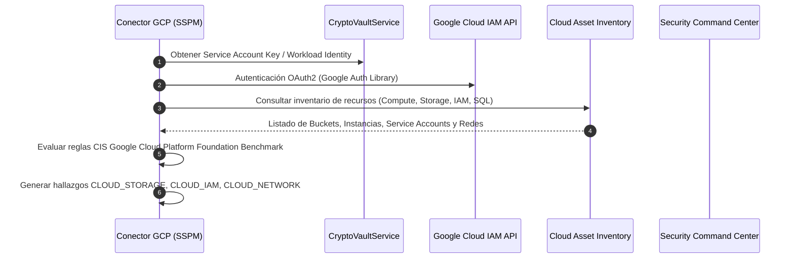
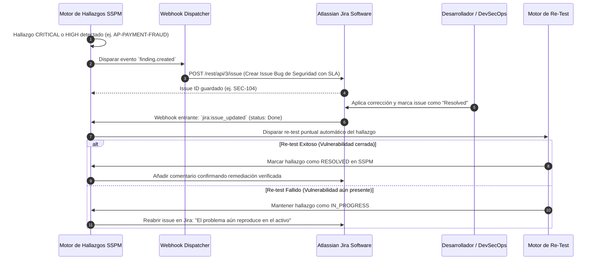
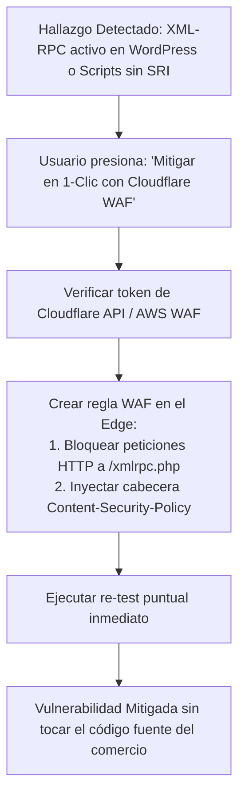

# Futuras Integraciones Estratégicas y Visión de Expansión

> **Sistema de Gestión de Postura de Seguridad (SSPM / EASM / CSPM)**  
> Versión: **2.0.0**  
> Alcance: **Sprints 14+ / Roadmap Enterprise**

Este documento detalla la arquitectura de las 6 integraciones estratégicas planificadas para evolucionar la plataforma hacia una solución de nivel empresarial global (*Enterprise Ready*).

---

## 1. Conector CSPM para Google Cloud Platform (GCP)

**Objetivo:** Completar la cobertura multicloud sumando Google Cloud Platform a las capacidades actuales de AWS y Azure, consolidando la postura integral en los tres grandes proveedores de nube pública.



### Reglas de Postura GCP a Incorporar:
1. `GCP-IAM-SERVICE-ACCOUNT-ADMIN`: Cuentas de servicio con privilegios de Owner o Editor asignados a nivel de proyecto.
2. `GCP-STORAGE-BUCKET-PUBLIC`: Buckets de Cloud Storage con política de acceso público `allUsers` o `allAuthenticatedUsers`.
3. `GCP-COMPUTE-SSH-OPEN`: Instancias de Compute Engine con reglas de firewall permitiendo puerto 22 o 3389 desde `0.0.0.0/0`.
4. `GCP-SQL-PUBLIC-IP`: Instancias de Cloud SQL (PostgreSQL/MySQL) con IP pública habilitada y sin red autorizada estricta.
5. `GCP-LOGGING-SINKS-DISABLED`: Ausencia de exportación continua de Cloud Audit Logs hacia BigQuery o Cloud Storage para retención forense.

---

## 2. Sincronización Bidireccional con Herramientas ITSM (Jira & ServiceNow)

**Objetivo:** Permitir que los equipos de ingeniería y DevSecOps mitiguen vulnerabilidades dentro de su flujo de trabajo diario de tickets, cerrando automáticamente el hallazgo en SSPM cuando el ticket de Jira se resuelva.



---

## 3. Emisión de Alertas hacia SIEM / SOC (Splunk HEC, Microsoft Sentinel y AWS Security Hub)

**Objetivo:** Transmitir hallazgos y desalineaciones de postura en tiempo real hacia los centros de operaciones de seguridad corporativos.

- **Splunk HTTP Event Collector (HEC):** Transmisión de eventos JSON enriquecidos con severidad, CVSS y categoría.
- **Microsoft Sentinel / Azure Log Analytics:** Ingestión vía Azure Data Collector API para correlación con incidentes de Microsoft Defender.
- **AWS Security Hub:** Importación estándar bajo el formato ASFF (*AWS Security Finding Format*).
- **Compatibilidad Syslog CEF (Common Event Format):**
  ```text
  CEF:0|SecAudit|SSPM|2.0|WEB-SRI-MISSING|Script externo sin integridad SRI|8|src=198.51.100.10 cs1=store.example.com cs2=PCI-DSS-v4
  ```

---

## 4. Auto-Remediación Activa y Playbooks WAF 1-Clic

**Objetivo:** Permitir a comercios no técnicos mitigar riesgos críticos con un solo clic inyectando reglas defensivas perimetrales a través de sus proveedores de CDN / WAF.



### Playbooks Planificados:
1. **Playbook Anti-Magecart (Cloudflare / CloudFront):** Inyección perimetral de cabeceras CSP restrictivas (`script-src 'self' ...`).
2. **Playbook Bloqueo de Fuerza Bruta XML-RPC:** Regla perimetral WAF que devuelve HTTP 403 a peticiones dirigidas a `xmlrpc.php`.
3. **Playbook Firewall de Base de Datos Cloud (AWS SG / Azure NSG):** Eliminación automática de reglas `0.0.0.0/0` en puertos de bases de datos, restringiéndolas a subredes privadas.

---

## 5. Módulo de Atestación de Cumplimiento E-Commerce (PCI-DSS v4.0 SAQ-A / SAQ-D)

**Objetivo:** Automatizar la generación de reportes de cumplimiento que los bancos adquirentes y pasarelas de pago (Visa, Mastercard, Stripe, PayU) exigen a las tiendas online.

- **Mapeo Automático de Evidencias:**
  - Requisito 6.4.3: Evidencia de verificación de Subresource Integrity (SRI) en scripts de terceros.
  - Requisito 11.6.1: Monitoreo de mecanismos contra manipulación de encabezados y páginas de pago.
  - Requisito 11.3.1.2: Registro de escaneos de vulnerabilidades periódicos.
- **Entregable:** Generación del cuestionario **Self-Assessment Questionnaire (SAQ-A)** en PDF con firma digital y sello temporal criptográfico (*timestamping*).

---

## 6. Shift-Left Security: Plugin para Pipelines CI/CD

**Objetivo:** Prevenir que vulnerabilidades lleguen a producción auditando el código y artefactos minificados durante el despliegue del comercio.

- **Herramienta:** CLI liviano (`sspm-cli`) empaquetado en Node/Go ejecutable en GitHub Actions y GitLab CI.
- **Puntos de Control del Pipeline:**
  1. Bloquear despliegue (`exit 1`) si se detectan archivos de mapas `.js.map` en el directorio de distribución `dist/`.
  2. Bloquear despliegue si se detectan llaves privadas o credenciales de pasarelas en bundles JS.
  3. Bloquear despliegue si faltan hashes de integridad en las etiquetas `<script>` externas.
