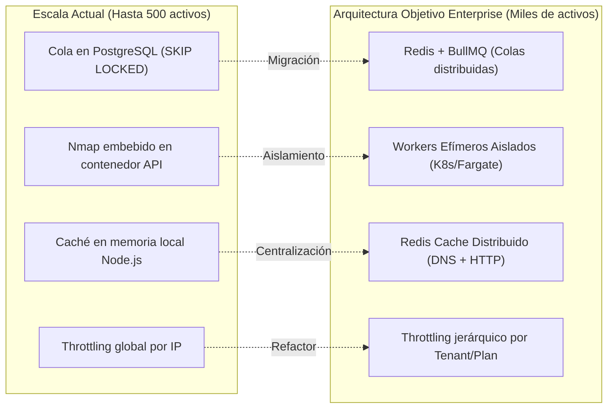
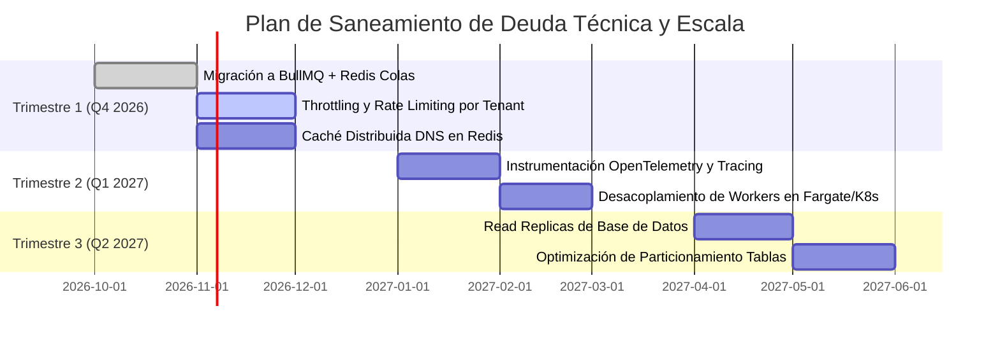

# Gestión de Deuda Técnica y Estrategia de Escalabilidad

> **Sistema de Gestión de Postura de Seguridad (SSPM / EASM / CSPM)**  
> Versión: **2.0.0**  
> Alcance: **Arquitectura Objetivo y Mitigación de Deuda Técnica**

Este documento analiza las limitaciones operacionales del diseño actual, define la arquitectura objetivo para soportar miles de clientes concurrentes y traza el plan de mitigación de deuda técnica.

---

## 1. Comparativa: Arquitectura Actual vs. Arquitectura Objetivo

---

## 2. Matriz de Deuda Técnica Priorizada

| Componente | Situación Actual | Riesgo / Limitación | Solución Técnica Planificada | Prioridad |
| :--- | :--- | :--- | :--- | :---: |
| **Cola de Escaneos** | Implementada en PostgreSQL mediante `FOR UPDATE SKIP LOCKED`. | Contención en base de datos si se superan 500 escaneos concurrentes. | Migrar la orquestación a **Redis con BullMQ**, reservando PostgreSQL solo para persistencia final. | **Alta** |
| **Aislamiento de Workers** | Nmap y los analizadores corren en el mismo contenedor que la API REST. | Consumo compartido de CPU y memoria entre peticiones de usuarios y escaneos pesados. | Desacoplar `ScanWorkerService` en **Workers efímeros independientes** (AWS ECS Fargate / Kubernetes Jobs). | **Alta** |
| **Caché de Consultas DNS / HTTP** | Cada analizador realiza peticiones directas a servidores DNS autoritativos. | Latencias por consultas redundantes al mismo dominio en escaneos simultáneos. | Pool de resolución DNS con caché compartida en Redis (TTL 5 min) para SPF, DMARC y BIMI. | **Media** |
| **Observabilidad y Trazas** | Logs estructurados mediante NestJS Logger hacia `stdout`. | Dificultad para rastrear latencias en cada sub-etapa de escaneo por tenant. | Instrumentar el backend con **OpenTelemetry SDK** enviando trazas a Grafana / Datadog. | **Media** |
| **Rate Limiting por Tenant** | Rate limiting global basado en IP (`@nestjs/throttler`). | Un tenant con múltiples usuarios puede consumir la cuota de otros clientes. | Implementar Throttling jerárquico: Cuota por Organización (`orgId`) según el plan contratado. | **Media** |

---

## 3. Plan Detallado de Mitigación

### 3.1 Migración de Colas a BullMQ + Redis
- **Problema:** En picos de escaneo simultáneo provocados por el monitoreo nocturno, la tabla `scans` experimenta alta tasa de bloqueos a nivel de fila y acumulación de transacciones abiertas en PostgreSQL.
- **Solución:**
  1. Instalar `@nestjs/bullmq` y un clúster Redis administrado (Azure Cache for Redis).
  2. Definir colas separadas por prioridad: `high-priority-scans` (solicitados manualmente por el usuario desde la UI) y `scheduled-scans` (lanzados por el cron nocturno).
  3. Utilizar BullMQ para gestionar pausas, reintentos con backoff exponencial y límites de concurrencia distribuidos.

### 3.2 Aislamiento de Ejecución en Workers Efímeros
- **Problema:** Cuando Nmap ejecuta un escaneo de puertos sobre un host que filtra paquetes, el proceso puede consumir un hilo durante varios minutos. Si la API recibe múltiples escaneos simultáneos, la latencia de las peticiones web de otros usuarios aumenta.
- **Solución:**
  1. Construir una imagen Docker mínima especializada exclusivamente en escaneo (`sspm-worker-node`).
  2. Desplegar los workers en Azure Container Apps Jobs o AWS Fargate Tasks, los cuales arrancan bajo demanda al haber tareas en la cola y se destruyen al finalizar, reduciendo costos de infraestructura en reposo a cero.

### 3.3 Instrumentación OpenTelemetry
- **Problema:** La depuración de fallos en llamadas de red hacia clientes remotos o APIs de nube depende de inspeccionar logs textuales.
- **Solución:**
  1. Integrar el SDK de OpenTelemetry en el bootstrap de NestJS (`main.ts`).
  2. Generar spans automáticos para:
     - Duración de ejecución de subprocesos Nmap.
     - Latencia de llamadas HTTP salientes a pasarelas de pago y endpoints web.
     - Tiempos de respuesta de queries complejas de Prisma ORM.

---

## 4. Cronograma de Implementación (Roadmap 2026 - 2027)

