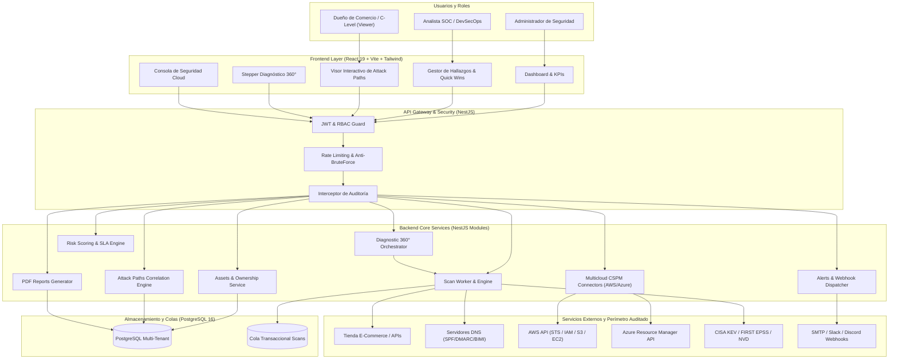
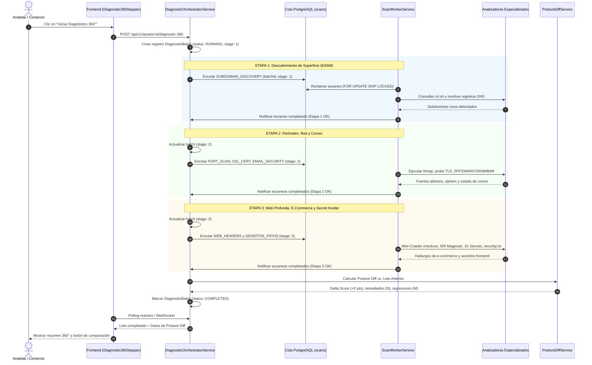
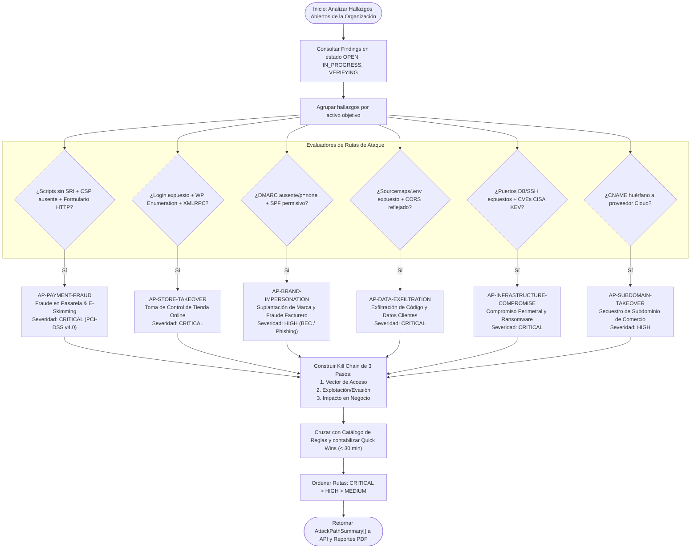
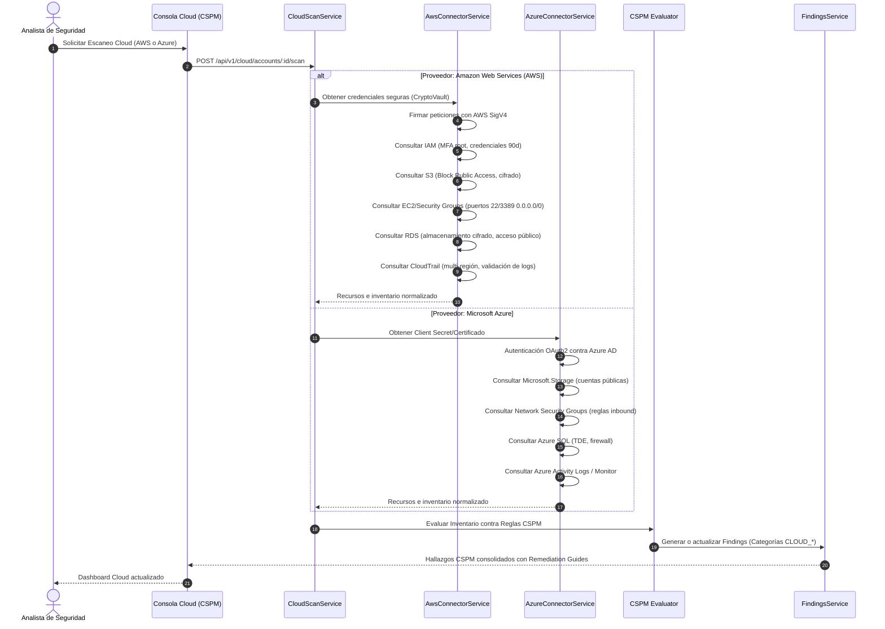
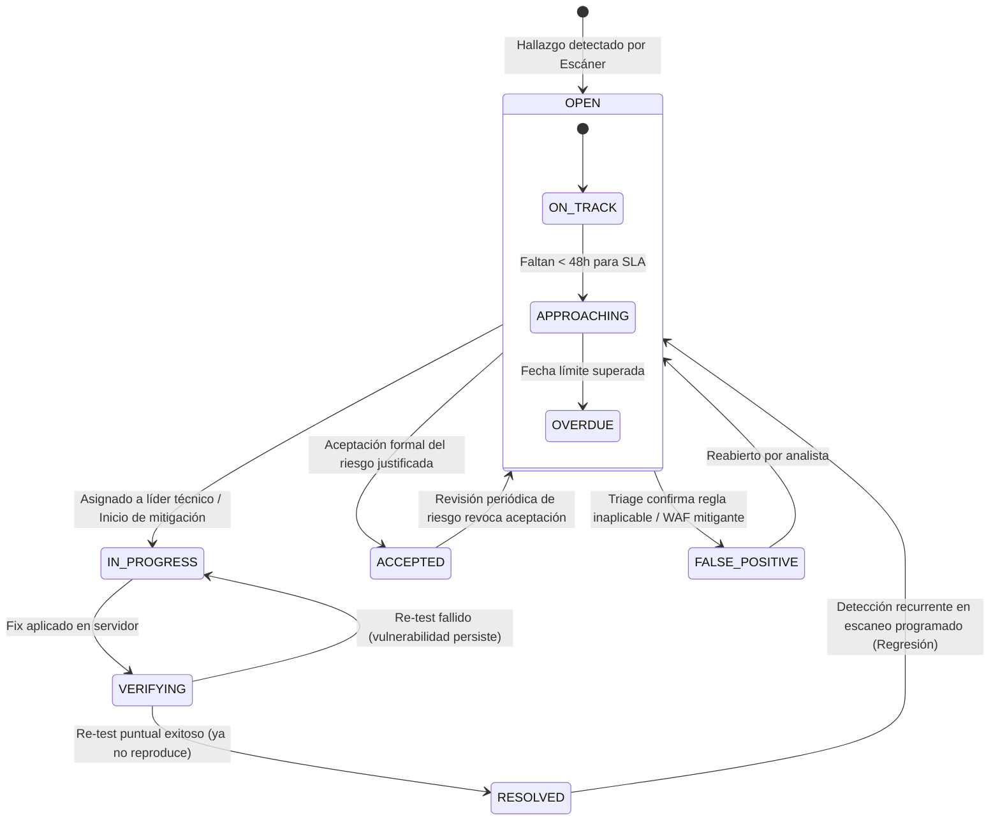
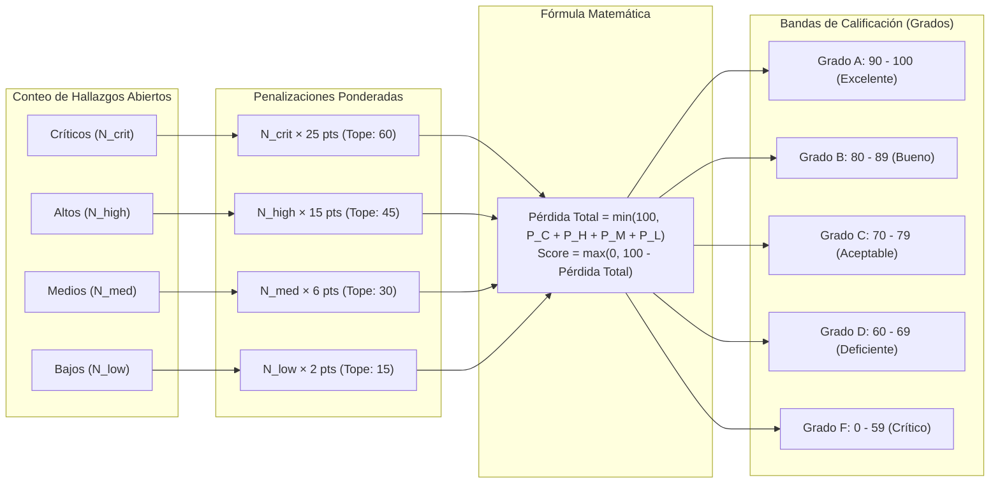
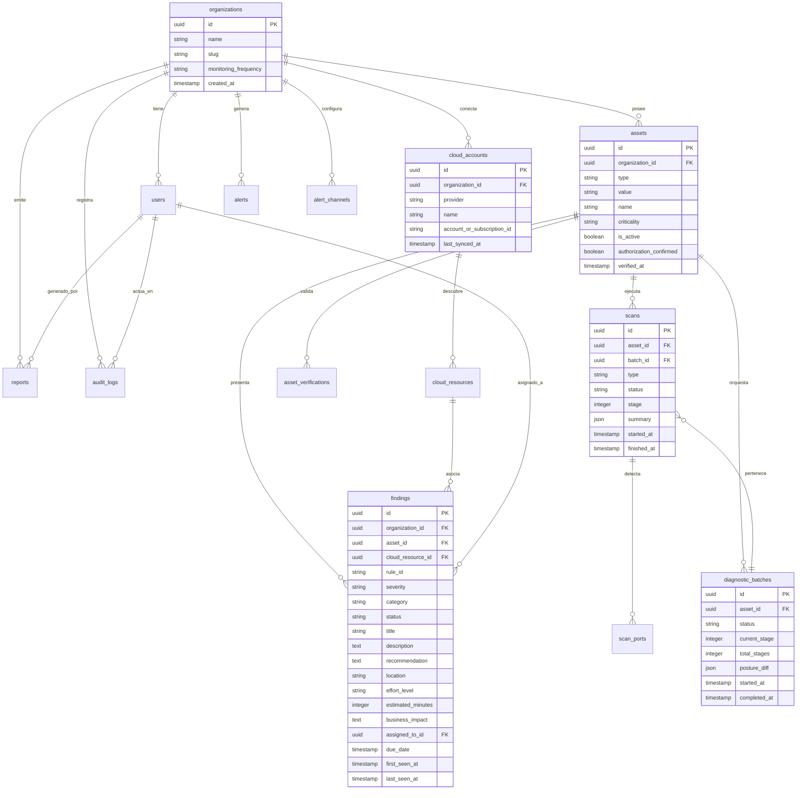

# Documentación Técnica Integral del Sistema SSPM / EASM / CSPM

> **Sistema de Gestión de Postura de Seguridad (Security Posture Management Platform)**  
> Versión del Sistema: **2.0.0 (Sprint 13)**  
> Fecha de Documentación: **Octubre 2026**  
> Alcance: **Perímetro Externo (EASM), Seguridad E-Commerce / Web Profunda, Postura Cloud Multicloud (CSPM AWS & Azure) y Correlación de Rutas de Ataque (Attack Paths)**

---

## 1. Visión General del Sistema y Objetivos

La **Plataforma de Gestión de Postura de Seguridad (SSPM / EASM / CSPM)** es una solución integral diseñada para proteger a comercios electrónicos, PyMEs y corporativos frente a vectores de ataque modernos. El sistema supera las limitaciones de los escáneres superficiales tradicionales (que solo analizan la raíz HTTP `/` o puertos genéricos) mediante tres capacidades diferenciadoras:

1. **Auditoría E-Commerce y Web Profunda**: Inspección especializada de pasarelas de pago, detección de scripts de terceros sin integridad criptográfica (**Anti-Skimming / Magecart PCI-DSS v4.0**), análisis de bundles JavaScript con búsqueda activa de llaves/secretos (**Secret Hunter**), detección de **Source Maps (`.js.map`)** y auditoría de vulnerabilidades CMS (**WordPress, WooCommerce, PrestaShop, Magento, Shopify**).
2. **Postura de Seguridad Cloud Multicloud (CSPM)**: Conectores nativos sin agente (*agentless*) para **Amazon Web Services (AWS)** y **Microsoft Azure**, auditando configuraciones de IAM, almacenamiento público (S3 / Blob Storage), redes (Security Groups / NSGs), bases de datos y logging contra mejores prácticas CIS Benchmarks.
3. **Orquestación 360° y Correlación de Rutas de Ataque (Attack Paths)**: Diagnóstico integral en 3 etapas encadenadas en 1 clic, motor de **Diff Temporal de Postura** entre escaneos, y un motor de correlación que agrupa hallazgos aislados en **Rutas de Ataque compuestas con narrativa de impacto financiero** y una **Matriz de Priorización Quick Wins 24h (< 30 min) vs. Mejoras Estructurales**.

---

## 2. Matriz de Requerimientos del Sistema

### 2.1 Requerimientos Funcionales (RF)

| ID | Requerimiento Funcional | Módulo Responsable | Descripción y Criterios de Aceptación |
| :--- | :--- | :--- | :--- |
| **RF-01** | **Gestión de Inventario de Activos** | `AssetsModule` | Registro, activación/desactivación, etiquetado y clasificación de criticidad (`CRITICAL`, `HIGH`, `MEDIUM`, `LOW`) de Dominios, Subdominios e IPs. |
| **RF-02** | **Verificación de Propiedad de Activos** | `AssetsVerification` | Validación de titularidad de dominios antes de escanear mediante registro DNS TXT (`sspm-verification=...`), archivo HTTP en `/.well-known/sspm-verification.txt` o herencia. |
| **RF-03** | **Descubrimiento de Superficie Expuesta (EASM)** | `DiscoveryModule` | Recolección pasiva en registros de Certificate Transparency (crt.sh) para identificar subdominios vivos y alertar ante nuevas apariciones no inventariadas. |
| **RF-04** | **Auditoría de Red, Puertos y Servicios** | `ScansModule` (Nmap/Parser) | Detección no intrusiva de puertos abiertos TCP, identificación de servicios (`serviceName`, `product`, `version`) y correlación con vulnerabilidades conocidas (**CPE / CISA KEV / EPSS**). |
| **RF-05** | **Auditoría de Cabeceras HTTP y TLS** | `ScansModule` (WebHeaders/TLS) | Evaluación de HSTS, CSP, X-Frame-Options, X-Content-Type-Options, Referrer-Policy, Permissions-Policy, versiones TLS obsoletas (v1.0/v1.1) y fechas de expiración de certificados X.509. |
| **RF-06** | **Seguridad del Correo Electrónico y Marca** | `ScansModule` (EmailSecurity) | Validación de registros SPF (permisividad, número de lookups), DMARC (políticas `none`/`quarantine`/`reject`), DKIM, MTA-STS, TLS-RPT, listas negras DNSBL (Spamhaus/SpamCop) y protección de marca **BIMI** (`default._bimi.<domain>`). |
| **RF-07** | **Escaneo Profundo Web, E-Commerce y Secret Hunter** | `ScansModule` (WebScanners) | Mini-Crawler seguro delimitado (`robots.txt`, `sitemap.xml`, `/checkout`, `/admin`), validación de Subresource Integrity (SRI) en scripts externos, detección de Source Maps `.js.map`, extracción y ofuscación de llaves/secretos de pago en frontend, sondeo activo de CORS Origin Reflection, métodos HTTP peligrosos y auditoría de CMS (XML-RPC, user enumeration). |
| **RF-08** | **Madurez de Divulgación Responsable (RFC 9116)** | `ScansModule` (SecurityTxt) | Inspección de `/.well-known/security.txt` validando directivas obligatorias `Contact:` y fecha de vigencia `Expires:`. |
| **RF-09** | **Auditoría de Postura Cloud Multicloud (CSPM)** | `CloudModule` (AWS & Azure) | Conexión e inventariado sin agente de cuentas AWS (SigV4) y suscripciones Azure (REST API), evaluando reglas CSPM en IAM, Storage (S3/Blobs públicos), Networking, Bases de Datos y CloudTrail/Activity Logs. |
| **RF-10** | **Orquestador de Diagnóstico 360° Encadenado** | `DiagnosticOrchestrator` | Ejecución multi-etapa en 1 clic: **Etapa 1** (Descubrimiento EASM) → **Etapa 2** (Red, TLS y Correo) → **Etapa 3** (Web Profunda, E-Commerce y Rutas), con barra de progreso reactiva y cancelación en cascada. |
| **RF-11** | **Motor de Diff Temporal de Postura** | `DiagnosticOrchestrator` | Comparación automatizada entre diagnósticos sucesivos: delta de Security Score, hallazgos remediados vs. nuevas regresiones y balance de variación en puertos y tecnologías. |
| **RF-12** | **Correlación de Rutas de Ataque (Attack Paths)** | `FindingsModule` (AttackPaths) | Algoritmo que encadena vulnerabilidades aisladas en 6 escenarios de riesgo de negocio (Fraude en Pagos Magecart, Toma de Control de Tienda, Suplantación de Marca BEC, Exfiltración de Datos, Compromiso de Infraestructura, Subdomain Takeover) con narrativa de impacto comercial y pasos kill-chain. |
| **RF-13** | **Matriz Quick Wins 24h vs. Mejoras Estructurales** | `FindingsModule` (RulesCatalog) | Clasificación de esfuerzo de remediación (`QUICK_WIN` < 30 min, `MODERATE` < 2 h, `STRUCTURAL` > 4 h), tiempos estimados y filtrado por un clic en la interfaz. |
| **RF-14** | **Gestión de Hallazgos, SLAs y Triage Inteligente** | `FindingsModule` | Trazabilidad del ciclo de vida (`OPEN`, `IN_PROGRESS`, `VERIFYING`, `RESOLVED`, `ACCEPTED`, `FALSE_POSITIVE`), asignación de responsables, cálculo de vencimiento según SLAs por severidad, re-test puntual y asistencia de triage heurístico/IA. |
| **RF-15** | **Motor de Riesgo y Security Score Determinista** | `RiskModule` | Cálculo matemático transparente (0-100, grados A-F) sin cajas negras, con penalizaciones ponderadas por severidad (`CRITICAL`: 25, `HIGH`: 15, `MEDIUM`: 6, `LOW`: 2) y topes máximos para evitar puntuaciones infladas. |
| **RF-16** | **Reportes Ejecutivos y Técnicos en PDF** | `ReportsModule` (PDFRenderer) | Generación de reportes bajo demanda o programados: Reporte Ejecutivo con diagnóstico en lenguaje de negocio, Rutas de Ataque, Impacto Financiero y Matriz Quick Wins 24h; Reporte Técnico con detalles de puertos, ciphers y evidencias forenses. |
| **RF-17** | **Alertas Tempranas y Webhooks** | `AlertsModule` | Disparo en tiempo real de notificaciones ante puertos recién abiertos, certificados por expirar (< 7 días), hallazgos críticos o caídas de score, despachadas vía Email (SMTP) o Webhook (Slack, Discord, JSON genérico) con control de concurrencia y reintentos. |
| **RF-18** | **Monitoreo Continuo Automatizado** | `MonitoringModule` | Programador configurable (Diario / Semanal / Desactivado) que encola y ejecuta escaneos periódicos sin intervención humana. |

---

### 2.2 Requerimientos No Funcionales (RNF)

| ID | Requerimiento No Funcional | Especificación Técnica |
| :--- | :--- | :--- |
| **RNF-01** | **Seguridad Multi-Tenancy Estricta** | Aislamiento lógico riguroso por `organizationId` validado en cada query a base de datos. Ninguna petición puede acceder a datos de otra organización. |
| **RNF-02** | **Autenticación Fuerte y MFA** | Tokens JWT con expiración corta (15 min), Refresh Tokens seguros, hashing de contraseñas con Argon2id/Bcrypt y soporte nativo de autenticación de dos factores (TOTP RFC 6238). |
| **RNF-03** | **Control de Acceso Basado en Roles (RBAC)** | Roles predefinidos (`ADMIN`, `ANALYST`, `VIEWER`) aplicados mediante decoradores `@Roles()` en NestJS y guards de ruta en React. |
| **RNF-04** | **Escaneo No Intrusivo y Seguro** | Todos los sondeos web, DNS y de red operan de forma no destructiva (sin inyección SQL, sin payloads destructivos de exploits, con límites de timeout de 10s y respeto de `robots.txt`). |
| **RNF-05** | **Determinismo y Transparencia del Scoring** | El algoritmo de Security Score es 100% determinista y auditable; dos organizaciones con la misma composición de hallazgos obtienen exactamente la misma calificación. |
| **RNF-06** | **Trazabilidad y Auditoría de Operaciones** | Registro inmutable en tabla `audit_logs` de todas las acciones administrativas (creación/edición de usuarios, aceptación de riesgos, cambios de estado en hallazgos y generación de reportes). |
| **RNF-07** | **Rendimiento y Control de Concurrencia** | Cola de escaneo transaccional en PostgreSQL (`FOR UPDATE SKIP LOCKED`) con ajuste adaptativo de concurrencia para evitar saturación de CPU o ancho de banda. |
| **RNF-08** | **Privacidad y Ofuscación de Secretos** | Cualquier token, llave de API o secreto detectado por el analizador es automáticamente ofuscado (`redactToken`: ej. `sk_live_...4a2b`) antes de almacenarse en base de datos. |
| **RNF-09** | **Compatibilidad y Estándares Abiertos** | Formatos estándar RFC 4180 (CSV con BOM UTF-8), RFC 9116 (`security.txt`), BIMI, PDF-1.4 (WinAnsi Latin-1 seguro) y Swagger/OpenAPI v3. |
| **RNF-10** | **Retención de Datos y Purga Automática** | Mecanismo programado de purga para escaneos antiguos, logs de auditoría históricos y tokens de sesión expirados (`RetentionService`). |

---

## 3. Arquitectura del Sistema (C4 Nivel 1 y Nivel 2)

El sistema se compone de una arquitectura modular basada en microservicios lógicos encapsulados en un monorrepo limpio, desplegable mediante contenedores Docker en Azure (Container Apps para API, Static Web Apps para Frontend y PostgreSQL administrado).

---

## 4. Diagramas de Flujos y Procesos Clave

### 4.1 Flujo del Orquestador de Diagnóstico 360° en 3 Etapas

Este flujo ejecuta el diagnóstico integral multi-etapa en un solo clic, asegurando progresión ordenada y consolidación de postura:

---

### 4.2 Flujo del Motor de Correlación de Rutas de Ataque (Attack Paths & Kill Chain)

Transforma hallazgos atómicos en escenarios de impacto para el negocio:

---

### 4.3 Flujo de Escaneo de Postura Cloud Multicloud (CSPM AWS & Azure)

---

### 4.4 Ciclo de Vida del Hallazgo y Gestión de SLAs

---

### 4.5 Algoritmo Determinista del Security Score

---

## 5. Modelo de Datos y Esquema de Base de Datos (ERD)

---

## 6. Detalle Modular del Sistema

### 6.1 Módulo de Escaneo y Web Profunda (`backend/src/scans/`)
- **`ecommerce-crawler.ts`**: Crawler con límite estricto de páginas y dominios que extrae selectores de formularios, campos de contraseñas/tarjetas y analiza scripts externos.
- **`magecart-security.analyzer.ts`**: Validador de PCI-DSS v4.0 Req. 6.4.3 (hashes SRI obligatorios) y Req. 11.6.1 (integridad de cabeceras y ausencia de mixed-content).
- **`js-secrets-sourcemap.analyzer.ts`**: Búsqueda regex de alto rendimiento para llaves Stripe (`sk_live_`), MercadoPago (`APP_USR-`), tokens AWS, llaves JWT y accesibilidad de mapas `.js.map`.
- **`cms-ecommerce.analyzer.ts`**: Pruebas activas contra `/wp-json/wp/v2/users`, `/xmlrpc.php`, `debug.log`, paneles de login expuestos e introspección GraphQL.
- **`security-txt.analyzer.ts`**: Analizador RFC 9116 validando `Contact:` y `Expires:`.
- **`bimi.ts`**: Consultas DNS TXT a `default._bimi.<domain>` para verificar logotipos SVG de marca.

### 6.2 Módulo de Correlación de Rutas de Ataque (`backend/src/findings/attack-paths.service.ts`)
- Agrupa hallazgos en escenarios de amenaza concretos con cálculo dinámico de `quickWinsAvailable` y acciones de mitigación recomendadas.

### 6.3 Módulo CSPM Multicloud (`backend/src/cloud/`)
- **`aws-connector.service.ts`**: Llamadas REST firmadas con SigV4 usando llaves cifradas con AES-256-GCM desde `CryptoVaultService`.
- **`azure-connector.service.ts`**: Conexión vía Service Principal con Azure REST API.
- **`cspm.catalog.ts`**: Reglas de postura en IAM, Compute, Redes, Almacenamiento y Logging.

### 6.4 Módulo de Riesgo y Security Score (`backend/src/risk/scoring.ts`)
- Modelo matemático determinista con topes por categoría y penalizaciones balanceadas.

### 6.5 Generador de Reportes PDF (`backend/src/reports/pdf-renderer.ts`)
- Renderizado de PDF con PDFKit en memoria, WinAnsi seguro, paleta cromática profesional y bloques para C-Levels y equipos técnicos.

---

## 7. Políticas de Seguridad y Despliegue en Producción

1. **Gestión de Secretos**: Todas las credenciales maestras y llaves de cifrado se cargan desde variables de entorno y Azure Key Vault. En base de datos, los secretos de conectores Cloud se cifran con **AES-256-GCM** con vector de inicialización único por registro.
2. **Pipelines de Integración Continua (CI/CD)**:
   - Verificación obligatoria en cada Pull Request: análisis estático ESLint (0 errores), tipado TypeScript estricto, 81 suites de pruebas unitarias/e2e y verificación de autoría de commits.
   - Despliegue automatizado con autenticación federada OIDC (GitHub Actions a Azure Container Apps y Static Web Apps sin almacenar secretos en el repositorio).
